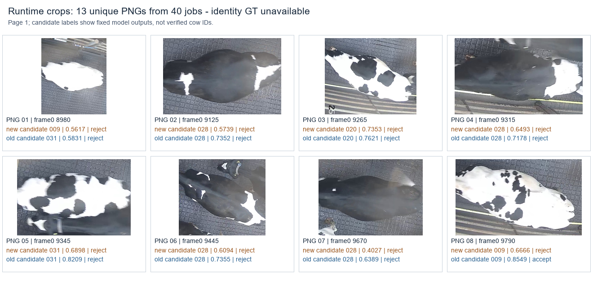
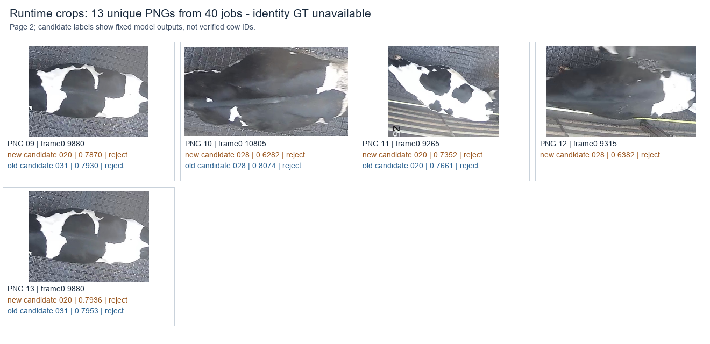

# 当前结果与交接说明

2026-11-01更新：用户随后授权继续完成离线通道计数流程。当前入口为[counting](counting/README.md)，最新证据见[计数状态](maintenance/offline_counting/STATUS.md)与[新日期冻结验证](maintenance/offline_counting/R5_REPORT.md)。原片8912–10873已在PYNQ-Z2三轮完整链路中计12 IN / 0 OUT，用户确认结果视频标注正确，原片视频验收通过且免除8780/逐事件JSON。

以下保留2026-10-31停止自动科研时的历史归档，包含当时计10次的前台/身份后台联合实验。它们不是上述新离线计数链路的当前结果；身份找回及实时性能仍留作后续范围。

## 项目实际实现

方向一是通道中的奶牛检测、跟踪和双向计数；方向二是在耳标关联异常时保存身体照片，做已登记图库的候选身份检索与拒识。

当前实现为 YOLO26n 检测＋ByteTrack／计数器；后台是 MobileNetV3-small 身体编码器、576维特征和图库检索。通用 YOLO 的 `cow` 类和临时 track ID 不能直接当作永久牛号。

已在 PYNQ-Z2 上实际运行 O8 检测、ARM 跟踪／计数、照片裁剪／预处理、NCNN 身份网络及检索。测试使用公开回放，低分帧预先就绪，RFID未读为模拟；没有据此证明真实相机／RFID全链路性能。

## 归档阶段最后一轮：由计数事件触发身份任务

以下是用户停止自动研究前，已经完成并取回的四轮结果。它比研究总览第24版更晚，尚未整理成新的完整论文版本；协议、代码、原始指标和独立复算已经保留。

| 轮次 | 身份编码器 | 处理/392 | 跳过 | >200ms | FPS | 释放至计数P95ms | 下行计数 | 身份任务/阈值接受 |
|---|---|---:|---:|---:|---:|---:|---:|---|
| r1_old | 旧 | 388 | 4 | 78 | 4.949 | 338.06 | 10 | 10/1 |
| r1_new | 新 | 369 | 23 | 94 | 4.707 | 349.64 | 10 | 10/0 |
| r2_new | 新 | 385 | 7 | 100 | 4.911 | 351.85 | 10 | 10/0 |
| r2_old | 旧 | 390 | 2 | 72 | 4.974 | 314.61 | 10 | 10/1 |

人工确认源片8912–10873帧、橙框通道中完整下行12头。四轮均计10，不能把总数差直接当作逐事件漏检或计算事件F1。永久牛号真值仍缺，因此阈值接受也不是正确找回的证明。

本轮四个身份后台均实际完成10个当前计数事件产生的任务，未强制填成10。身份入队至结果最大分别1941.42、1952.57、1803.83、1666.49ms。旧／新照片及实际处理帧不完全一致，时间顺序和缓存／换页也有影响，不将四次差值全部解释为编码器速度差。

实机图前向1592次：1532正式检测＋8准入＋8检测预热＋40身份正式＋4身份预热。源码主要改动是把前台导入留给父进程，并修正跨boot历史PID守门及预算校验。模型、计数器、选择器和阈值未替换。

独立复算核对1532份实际raw、1568个高分JPEG生产记录、40张运行时照片／输入／特征／分数及240个候选观察。完整CPU关联复算8664观察／2041跟踪行、8计数路径，临时ID和事件相同。

40个身份任务对应25个唯一“模型＋输入”组合；新增Torch参考前向13次，复用12个已验证查询和60个图库向量。100个固定检索决定核对一致，最大查询归一化差约2.17e-6。此为部署数值一致性，未增加永久身份准确率证据。

- [本轮计划](docs/research/pynq_parent_only_trigger_20261031/计划与验收.md)
- [实际协议](research/pynq_parent_only_trigger_20261031/protocol/run_v1.json)
- [板上结果复算](research/pynq_parent_only_trigger_20261031/results/independent_verification.json)
- [CPU参考与复用校验](research/pynq_parent_only_trigger_20261031/results/reference_independent_verification.json)
- [完整跟踪关联校验](research/pynq_parent_only_trigger_20261031/results/tracker_reference_verification.json)
- [13张唯一运行时裁剪图的两页汇总](research/pynq_parent_only_trigger_20261031/results/photo_panel_manifest.json)

图中标注是候选与分数，非确认牛号。13张唯一PNG不代表13头不同奶牛。

## 此前已经取得的主要结果

- 四次启动探针中，精简导入后的READY约2.36秒，原方式15.4–17.0秒；两进程顺次采样PSS合计低约37.5–37.9MiB。原40秒超时未被该探针重现。
- 完整八轮固定负载候选中，双负载两次为4.936／4.898FPS，计数10／9，仍有跳帧和迟到。离线单补回9515帧可将9恢复到模型完整输入参照10，未恢复人工12。
- 同O8的256／320各8向量平均约235.55／370.93ms；不能从192结果承诺三种尺寸均达5FPS。
- 身份保留ID组件评价中，新模型Top-1为30/30，但主工作点仅正确接受3/30；跨来源BECA测试出现未知误收26/30及标签／日期边界问题，均已保留。
- 论文草稿v3、主张证据表及后续补充已存在；逐事件／永久身份、真实输入／稳定性能及具体创新贡献仍待证据。

详细数值、适用范围和不利结果见各阶段报告。原五轮失败、访问中断、打包失败、参考修正及不采用决定均未删去。

## 仍未解决的事项

独立人工逐事件复核JSON、原12次通行永久牛号、实际相机／RFID关联、稳定完整性能与功耗、跨来源泛化和可证明的论文贡献仍未完成。这里仅列出现状，**不启动新的训练、实验或自动优化；后续由用户决定。**
