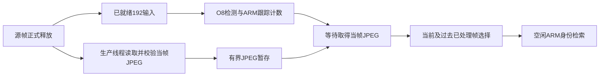

# 有界输入已真实重叠，吞吐改善但时序与计数仍未达最终目标

2026年10月30日。**保留异步高分输入为实验候选，暂不替换默认。** 四次同一PYNQ-Z2实测中，异步两次处理378／385帧、4.821／4.911FPS，串行354／348帧、4.515／4.439FPS；计数均10，人审仍12。异步确实减少等待和跳帧，但170／363个时刻迟到，最长身份完成61.17／79.17秒；没有证明稳定实时或身份更准确。

本轮完整运行检测、ARM跟踪计数、实际高分JPEG取得、过去帧选择和真实身份检索。低分192输入仍是预备好的同源回放，RFID全未读为模拟；不能当作真实摄像头双流、曝光／编码和RF接收的现场证据。

## 唯一研究改动与事前边界

固定mosaic050_seed26、原O8、计数阈值、1秒几何选择、图库和身份拒识阈值。两种模式都对每个取得的JPEG做完整SHA校验，顺序serial→async→async→serial，每次392时隙／78.4秒。与前一阶段未逐帧校验的串行口径不同，本轮串行才是直接基线。

serial在模型后同步读JPEG并校验；async线程只在该源帧正式释放后开始读取／校验，与前台计算并行。前台取得当前帧JPEG后才选择及入队，等待保留在总时延内。两个后台均沿用SIGSTOP确认后前台、前台后恢复的空闲策略。

图展示本轮异步回放实现。线程不会在释放前预读未来帧；它会读全部392个源时隙，包括前台跳过的源帧。串行只读已处理时刻，因此两者并非完全相同的读取次数消融。后台任务数恰好相同，但照片、触发时刻及进程状态并不完全相同。

启动时的完整性核验在计时外读过全部源JPEG，可能影响内核页缓存；没有把这些预检结果当作可选择的未来照片。无未来读取的结论限定于正式周期的生产者／候选使用，不能据此声称真实相机输入没有预读或缓存影响。实际采集／读取成本仍按本轮周期重新执行并记录。

事前生产者行为检查覆盖释放时间、慢消费者固定旧帧、最多7帧清理后缓存、失败传播和停止，在Windows及实际板端均通过。生产者最新6帧＋一个固定旧帧，读入瞬间理论最多8；前台原环另有6／7、队列另有副本。没有把全部260MB JPEG预装RAM来掩盖输入成本。

## 四次完整回放结果

| 实际顺序／策略 | 处理／392 | 跳过 | 超过200ms | 吞吐FPS | 计数／人工12 | P95前台完成ms |
| --- | ---: | ---: | ---: | ---: | ---: | ---: |
| r1_serial_input | 354 | 38 | 353 | 4.515 | 10 | 415.5 |
| r1_async_input | 378 | 14 | 170 | 4.821 | 10 | 362.6 |
| r2_async_input | 385 | 7 | 363 | 4.911 | 10 | 343.6 |
| r2_serial_input | 348 | 44 | 347 | 4.439 | 10 | 416.7 |

时延起点是全局源时隙释放，终点含跟踪计数、JPEG到达等待、选帧及身份入队的前台流程完成；历史字段叫release_to_count，不能把它缩成计数函数内部时间。迟到分母是已处理时刻，跳过另计。第二轮异步比串行多37处理帧，但迟到363比347多，全部不利结果保留；P95两轮均较串行低，不代表每帧约束都满足。

1465次实际O8完整raw逐字节等于既有同模型视频输出；8实际锚点准入、各轮2次共8预热另计。8597个含1783×4前史观察、8计数路径与1465个实际暂停区间已复算。没有靠补入跳过帧或调整计数规则把10写成12。

## 等待缩短，资源竞争仍存在

| 运行 | 平均模型阶段ms | 当帧JPEG读取ms | 校验ms | 前台等待输入ms | 模型与读取重叠ms |
| --- | ---: | ---: | ---: | ---: | ---: |
| r1_serial_input | 142.79 | 46.32 | 16.85 | 63.22 | 0.00 |
| r1_async_input | 166.38 | 62.89 | 19.93 | 1.60 | 39.51 |
| r2_async_input | 182.14 | 64.02 | 18.57 | 1.42 | 25.63 |
| r2_serial_input | 144.74 | 47.94 | 16.83 | 64.83 | 0.00 |

784条生产者记录及1465次前台接收逐条对应，这784次生产者读取均在该帧释放后，来源SHA正确。580个已处理时刻存在正的模型／读取时间重叠；其余可能输入已提前到达该时刻的前台，而非每帧都需要等待。选择仍只看已经处理的当前及过去框，不看未来像素或检索分数。

前台等待由约63–65ms降到1.4–1.6ms；同时模型阶段从143–145ms拉长到166–182ms，JPEG线程自身读取和校验也较长。重叠没有全部转成吞吐收益。CPU调度、内存／总线、解释器等因素没有分别隔离，不据这些墙钟数认定唯一原因。

两轮吞吐增加约6.8%和10.6%，仅是该片段两次顺序对照的观测，不给统计显著性或跨牧场泛化结论。源缓存／swap等顺序状态未重置，未清全局cache、关闭swap或改固件。

## 后台仍可能饥饿

| 运行 | 实际身份任务 | 接受候选数 | 最大排队秒 | 最大入队至完成秒 |
| --- | ---: | ---: | ---: | ---: |
| r1_serial_input | 10 | 0 | 70.68 | 76.25 |
| r1_async_input | 10 | 1 | 56.31 | 61.17 |
| r2_async_input | 10 | 1 | 73.75 | 79.17 |
| r2_serial_input | 10 | 0 | 73.59 | 79.08 |

两轮串行0接受、异步各1接受；两个接受预测来自同一f9790照片、候选009、相似度0.854908及相同像素／文件SHA。它不是两头不同奶牛，也没有永久身份真值证明接受正确。串行的f9790／9795裁剪边界与轨迹不同，分数0.829／0.817而拒识；不能把接受数变化当身份准确率提高。

空闲门控仍会在前台接近200ms时使身份工作几乎等到片段结束。第二轮异步的最长完成时间79.17秒并未优于串行79.08秒，保留这一结果，不只展示第一轮改善。下一步需要把后台服务预算与前台期限一起研究，而非继续只优化读取等待。

## 所有照片、数值与缓冲范围

[一轮串行10张](<../../../research/async_highres_20261030/results/actual_photo_panels/r1_serial_input.png>) · [一轮异步10张](<../../../research/async_highres_20261030/results/actual_photo_panels/r1_async_input.png>) · [二轮异步10张](<../../../research/async_highres_20261030/results/actual_photo_panels/r2_async_input.png>) · [二轮串行10张](<../../../research/async_highres_20261030/results/actual_photo_panels/r2_serial_input.png>)

全部40张实际照片已查看；过曝、邻牛混入、裁切变化仍保留。每张照片按源JPEG及实际框重算像素、Pillow输入和图库分数。11份与已有／本轮相同输入的ARM raw精确一致。独立Torch CPU对40查询＋30图库做70前向，输入误差0，查询归一化特征最大差2.168e−6、图库4.046e−6，80种查询／图库条件的候选与拒识决定一致。它证明数值实现，不能证明真实身份。

仅用事件帧＋临时ID＋方向作字面对照得到6对，28条条件记录未配对，均未删除。没有强制改编号配成同一动物或只保留好照片；见[配对与未配对全表](<../../../research/async_highres_20261030/results/paired_identity_observations.json>)。

实际生产者两轮最多保留6份JPEG、负载峰值4418520字节，读入瞬间5149692字节；理论固定旧帧可到7／8，行为检查也覆盖该情况。这只算生产者JPEG负载，前台环可能共享或额外持有bytes，队列／pickle／RGB／网络和图库另计，不能把它当系统总内存。父进程累计VmHWM238536kB，VmSwap随顺序到99328kB，不以该累计高水位推导各策略增量。

## 故障、采用决定与后续

本机验证脚本生成器首次因通用采集器没有硬编码旧目录而断言停止，已核对来源并仅补生成剩余验证脚本，未影响正在运行的板端载荷。服务器首次sbatch因CRLF拒绝，尚无参考作业；只创建LF版脚本，输入／模型／数值门禁均未改。修复后130643在CPU分区4核心完成0:0、4秒；失败输出与原载荷保留，未重跑板端实验。

父PID10028、4身份子进程、生产线程及采集PID11258均终态／消失，原O8 bit保持，锁与SSH／Jupyter核查正常。实机结果包20731222字节、179成员，SHAea5507ad5c36b4005a12e5b50775f87268c030db931c59a8da5349f46c7a0d64；参考包293910字节、9成员均逐文件校验。没有训练、校准或最终独立测试。

异步输入保留为研究候选，**不全局替换，不宣布稳定5FPS、12头计数或身份找回完成**。当前证据足以继续验证后台调度：在同样输入生产者和模型下比较固定空闲门控与低优先级并行／明确预算，固定顺序与负载，保留前台／后台两端指标。之后再做更长／新会话、普通俯视独立事件和永久身份评价；不能靠挑一轮、放松拒识阈值或把较快网络时间当端到端成功。

[实机完整复算](<../../../research/async_highres_20261030/results/independent_verification.json>) · [784源记录与因果性](<../../../research/async_highres_20261030/results/producer_independent_verification.json>) · [独立编码参考](<../../../research/async_highres_20261030/results/reference_independent_verification.json>) · [全部分量及两轮对照](<../../../research/async_highres_20261030/results/summary.json>) · [事前计划](<计划与验收.md>)
