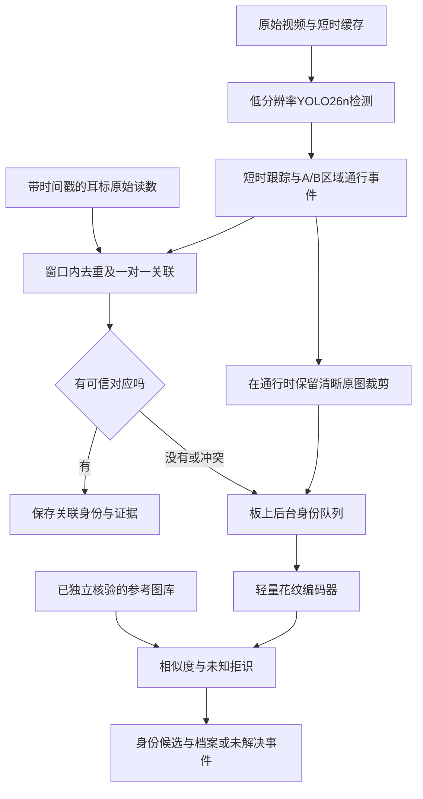

# 奶牛通道计数与耳标异常身份辅助找回：从想法到论文

更新：2026年10月29日。本文是整个研究的阅读入口；逐次实验、数据清单和代码见[研究进度](<../../../研究进度.md>)。

当前统一入口：[研究阶段总结（2026年10月30日）](<../../../研究阶段总结_20261030.md>)。已实际完成同板O8检测／ARM跟踪、高分辨率照片裁剪与身份网络：直接后台或空闲策略在部分392时隙运行达到5FPS平均吞吐，但仍有200ms迟到、运行波动；原片计数11／人工总数12，Toros1／0／5，真实永久身份准确率未证明。132张照片身份输入与144检索决定完成ARM一致性核查；PNG0保存像素不变、存储约3倍，完整三组控制保留所有不利结果。192／256／320已统一O8实测，受控训练向量张量至raw均值155.46／235.55／370.93ms；256／320没有完整视频或同板5FPS证明。320初始NumPy参考差异、显式浮点顺序合同、失败脚本及全部原始输出保留。当前下一步是独立逐事件参考、暗色／遮挡计数质量、跨来源与重复时序验证，整体科研目标继续。下文较早的“未上板”等内容是历史阶段快照。

最新完成[新192模型量化与真实PYNQ视频计数](<../../../pynq_rot192_eval_20261029/新192量化与PYNQ视频计数结果.md>)及[自审](<../../../pynq_rot192_eval_20261029/Review与当前状态.md>)：新192直角seed26在用户指定O8上真实执行2654视频前向、2734跟踪时刻及6计数路径，原片为11，人工总数12；Toros仍1／0／5。FP32／QDQ／实际整数原片分别10／11／11，后两者raw并不相同；8实际视频锚点与CPU整数参考逐字节一致。无损192 PNG至计数平均178.24ms、P95198.02ms，118帧超过200ms，不能宣称稳定5Hz。132图身份编码器NCNN服务器特征／检索一致性已通过，ARM隔离编译进行中；下一步[392时刻周期释放与同板后台](<../../../pynq_periodic_joint_20261030/计划与验收.md>)已固定，真实摄像头和RFID未接入。三栏1962帧视频与5图16面板已核查，原640的12头版本保持。

最新完成[15新模型固定通道裁剪对照](<../../../factorial_lane_crop_20261029/固定裁剪结果与部署下一步.md>)及[自审](<../../../factorial_lane_crop_20261029/Review与当前状态.md>)：39810真实前向、90计数路径，9图54面板与两段视频3924帧已核对。192直角三seed由6／5／5升为10／10／10，256为11／11／12，320为12／12／11；Toros跨来源召回仍不足，原片12头仅为人工总数，不是逐事件真值。结果读取前固定的192直角seed26已完成[新候选O8编译与实机向量资格检查](<../../../pynq_rot192_compile_20261029/计划与验收.md>)：仅128训练图校准，8实际板上输出与CPU整数参考逐字节一致，张量到原始输出平均155.46ms。正在推进量化后的完整视频计数和板上NumPy跟踪回归；采集、计数、后台身份同板联合5FPS仍未证明，原640成功版本保留。

最新完成[低分辨率漏计分解](<../../../lowres_event_audit_20261029/低分辨率漏计分解与下一步.md>)及[自审](<../../../lowres_event_audit_20261029/Review与当前状态.md>)：只读27整幅＋12既有裁剪缓存，78条件／234辅助路径独立核对。固定192直角seed26实际6，6未计开发参照在IoU0.3／0.5下即使辅助对应原始框仍缺现行区域证据；5条入口连续观察不足，1条出口不足，单改ID关联不够。18源帧／6页36面板已实际检查并按绝对PTS逐像素复核；参照为模型轨迹，不新增正式框／身份真值，辅助路径也不是单调误差上界。本轮无新网络、训练或板端动作。下一步[15新模型固定裁剪对照](<../../../factorial_lane_crop_20261029/计划与验收.md>)已冻结原ROI和39810前向计划，尚未提交；保持权重、跟踪和计数规则，保留原12头成功版本。

最新完成[15组低分辨率训练与统一评价](<../../../detector_factorial_20261029/低分辨率训练对照与采用决定.md>)及[自审](<../../../detector_factorial_20261029/Review与当前状态.md>)：各组10轮、18375次正式更新，全部末轮权重共同冻结后新增63375次真实图条件推理。直角增强的CW90躯干匹配召回均值达到192的98.00%、256的98.91%、320的98.96%，但原片5Hz计数仅6／5／5、7／8／8、7／8／7，未恢复12头；新模型暂不替换原640成功组合。23565关联、61225框逆变换、90计数路径与60事件评分独立复核一致。训练收尾LF误判导致原作业FAILED，成功权重经核验恢复，逐次梯度数组未回收、旋转日程为明确重建，全部失败证据保留。下一步先分析低分辨率检测／跟踪／稳定区间，再把固定候选接入已通过首轮向量验证的O8通路；新15模型的实际视频计数和同板后台5FPS仍待验。

最新在用户确认的O8引擎完成[奶牛单类权重实机准入](<../../../pynq_cow_compile_20261029/奶牛单类权重O8实机准入.md>)及[自审](<../../../pynq_cow_compile_20261029/Review与当前状态.md>)：冻结旧seed26权重经128训练图PTQ、单类头和三个精确索引／广播结构改写后，生成94PL＋8ARM整数卷积、25对驻留的192部署图。8训练输入上，CPU整数参考、原生C++和真实PYNQ-Z2输出相同，含2预热10次板端推理，原O8固件／SO保持。均值140.30ms仅为固定张量到raw短测，未合并为完整FPS；源视频计数和前后台联合仍待验。15个新低分辨率候选已全部完成10轮并共同冻结，训练作业收尾LF误判及记录恢复边界保留，统一评价继续进行，不按原片12头选择权重。

最新已完成[真实PYNQ-Z2三尺寸性能与输入瓶颈验证](<../../../pynq_board_validation_20261029/PYNQ实机三尺寸结果与下一步.md>)及[自审](<../../../pynq_board_validation_20261029/Review与当前状态.md>)：SD卡插紧后SSH／Jupyter恢复，地址仍192.168.2.99。板上424次实际网络推理、406份raw、324次CPU输入操作已取回并独立核对；预热后192／256／旧引擎320检测均值158.79／261.82／1056.39ms。每帧从大JPEG缩略解码时192仅2.97FPS；相同像素低分辨率BGR已就绪控制为4.90FPS、98/100处理、2跳帧和16迟到，尚未满足完整系统稳定5Hz。当前是COCO量化权重，12照片均无牛类输出，奶牛微调权重、跟踪计数及后台身份尚未联合上板；不能把服务器12头与板端4.9FPS拼成一个成功系统。全部7自有实验进程终态，固件已读回已知O8。下一步对齐用户原测程序，以192为优先候选推进低分辨率训练、奶牛权重编译与实际输入／前后台联合验收。

下文保留此前阶段的证据快照；连接未恢复、尚未上板等表述是当时状态，当前进展以顶部实机报告为准。

最新完成[固定通道裁剪与低分辨率对照](<../../../lowres_roi_20261029/固定通道裁剪与低分辨率结果.md>)：12冻结模型尺寸条件新增31848次真实前向，72计数路径独立复算一致。原片三个seed的192计数从0／1／2升至7／4／8，但256、320仍有无改善或退步，所有条件均未恢复人工12头；Toros官方256／320亦有退步，裁剪不默认采用。8源锚点、24真实网络输入、9173框、完整1962帧视频和13图73面板已核查。用户明确192／256／320及约5FPS来自实机约束，必须实机验证；SD卡插紧后SSH／Jupyter已恢复、IP仍192.168.2.99，旧PID8082无完整可采信性能结果，已归档。[PYNQ实机复测计划](<../../../pynq_board_validation_20261029/计划与验收.md>)按单帧探针、三档受控样本、真实前台时序及同板后台逐步验收，当前尚未宣称5FPS达标。

最新按用户要求转向[192／256／320与5Hz基线](<../../../lowres_baseline_20261029/低分辨率基线与5Hz计数结果.md>)，并完成[板端连接核查](<../../../pynq_lowres_20261029/PYNQ低分辨率部署与连接核查.md>)：PYNQ3.1.1／ARMv7环境已实际读到；短测PID8082启动后服务失联，终态及PL配置未能读回，未重复启动，5FPS尚未证明。服务器12条件50700前向和72计数路径完成，原片192三seed为0／1／2、256为7／7／7、320为10／8／10；Toros官方256／320由30Hz的6匹配降为5Hz的4。三视频、独立复算和当前图已核查，原640人工12头版本保持。旧9组640训练未执行，新低分辨率15训练候选仅为计划；先恢复硬件可观测状态，并离线检验固定通道裁剪与采样机制，再训练和验证同板前后台。

最新完成[检测框躯干配对与尺度诊断](<../../../detector_torso_pairs_20261029/检测框躯干配对与尺度诊断.md>)：8380源图／10752旋转躯干参考已建立完整对应，主640CW90条件4模型配对为1141／592／505／226（分母1864）；seed26训练仅2920/8888配对，未把成功子集当全部数据。固定8图追加288输入控制，排除坐标还原错误，seed26同方向／补边320为11/12、640为4/12；未据此全局改320。独立几何／关联／目标及12图82面板核查完成，保留全部边界和未匹配项。原12头成功组合保持，下一步优先尺寸与直角旋转增强的三seed训练对照，再决定躯干定位；本轮无新训练或身份真值，PYNQ-Z2联合关口继续待验。

最新完成[裁剪域验证与采用决策](<../../../crop_domain_20261029/裁剪域验证与采用决策.md>)：先用80个验证输入冻结20阈值和5个规则选择，再打开102评价／实际输入，全部5编码器、4规则、原／新阈值共40评价条件保留。C28选择去边框，但复合方案为19C/0F，旧基线21C/0F；同原阈值两裁剪均21C，因子已拆开。C26校准后26C/3F，风险仍超小验证目标；实际只保留E010匿名009候选，仍未核实。3640真实图像编码、5080决定、70700余弦、728像素变换和六图72面板核查完成；不作默认替换，原12头达标计数保持。下一步转向真实检测框与躯干参考的成对定位，身份独立通行参考及PYNQ-Z2联合验收继续待补。

最新完成[跨日期图库与实际抓拍结果](<../../../crossdate_gallery_20261029/跨日期图库与真实抓拍身份结果.md>)：固定5编码器／原阈值，旧Aug14与新Aug19图库共10条件，60有标签裁剪＋12实际照片完整配对。C26登记正确23→27/30，但图库外误接收1→5/30；新图库只剩E010在C28给匿名009候选，仍未确认为身份。30新图官方校验、132输入检查、720决定／21600余弦、全部新误认病例及四图54面板复核完成；失败数值门限与CPU直接复现均保留。原12头达标计数保持，本轮无训练、无真实RF／板测；Aug19晚于原片，只作回溯开发诊断。下一步固定隔离身份的裁剪域及图库风险校准，再到新通行和PYNQ-Z2前后台共同验收。

最新[身份来源审计](<../../../identity_source_provenance_20261029/原视频身份来源核查与评价准入.md>)发现当前E010／ID009图库存在强同次通行重叠：三张正式Aug14登记图能与原视频9610、9685、9760帧像素对齐，均落在该次轨迹。它们不能用于独立事件身份准确率，已另存准入排除，历史功能输出和原片人工12头计数保持。正式包及102作者源文件没有找到发布图到源帧的显式映射；几何搜索覆盖全部30图库，成功／失败和端点限制保留，未以模型分数生成真值。下一步优先来源隔离的登记／查询与有标签裁剪域，PYNQ-Z2联合关口继续待验。

最新[流式RF入口与实际身份回退实验](<../../../confirmed12_rf_stream_20261029/12事件流式读码与真实查询异常验证.md>)把12事件照片接入10种合成读码输入和2个真实队列压力控制，形成144条明确终态。关联器保留未计数邻轨迹，S01为5唯一RF候选／7共享；故意单码错误仍可产生错误模拟候选，因此唯一性不等于身份正确。515实际配置查询、独立读码窗口／图库分数和两图核查完成，原计数成功版本保持。它是源事件复用的软件系统实验，没有真实RF、独立身份准确率或PYNQ联合结果；下一步收敛到原视频身份来源对应、有标签裁剪域及板上验收。

最新[12事件抓拍与后台身份链路](<../../../confirmed12_capture_identity_20261029/12事件原图抓拍与身份查询结果.md>)已实际运行：保留人工12头达标计数，12张原分辨率照片对应60次真实CPU模型查询，2事件出现匿名020／009候选、其余10事件全部拒识。权重、图库、阈值未改，源像素、因果选图、任务终态、图库分数及新进程重复前向均复核。两个候选没有独立身份参考，不能作为正确找回数；本轮检测来自缓存，尚无PYNQ-Z2联合性能。原关联基线与先前不利结果保持，下一步继续身份对应、裁剪域及真实读码／单板验收。

最新[第一阶段候选的完整回归与采用决策](<../../../firststage_iou_regression_20261029/多seed与反向回归结果及采用决策.md>)支持保留当前基线：局部普通俯视恢复重现，但Toros官方6次正确匹配降为5次；原片人工12头成功总数保持。已完成9缓存／18跟踪／36计数路径、多seed、全部不利结果及发布方身份对应病例核查，未临时添加场景或seed特判。候选保存作机制控制，不作全局替换，也不认领新颖算法贡献。独立计数／代价、9并排视频和失败放大图可查；后续继续可信事件参考、事件抓拍与异常身份查询，以及PYNQ-Z2前后台联合实测。

最新[普通俯视长片关联机制实验](<../../../long_video_track_gap_20261029/新片轨迹分段定位与单因素对照.md>)在相同检测框下取得seed26预测11→12：从同一中断前状态恢复了原ID，3次真实B区观察后发出事件。只改变第一阶段的分数融合，原模型、输入、第二阶段、确认和计数规则保持。独立数值、事件和并排媒体核查完成；另一事件提前0.2秒等变化全部保留。这支持先做关联回归，尚不构成新片100%准确率、最终采用或论文贡献；原片人工12头成功版本保持，下一步核查其他seed、原片与真实反向片。

最新[普通俯视长视频四模型回放](<../../../long_video_fixed_replay_20261029/普通俯视长片四模型回放与研究决策.md>)已实际完成：相同冻结输入与计数链路下，官方／seed26／seed27／seed28向下预测0／11／12／12，全部模型和两个计数器对照保留。原生病例定位了检测缺口后的轨迹分段，以及确认前一次观察交接带来的事件增量；12个视频与独立复算已核查。新片尚无独立接受的参考，不能把12预测写成100%准确率；原源片人工确认12头的seed26达标成果继续保留。后续按错误证据推进新会话参考、关联或训练对照、身份触发及PYNQ-Z2联合实测。

以下按阶段保留此前记录；当时“尚未回放”等表述是历史状态，本轮实际结果以上述报告为准。

新长片参考现已进一步[细化完成时间并保留不确定性](<../../../event_timing_refinement_20261029/完成时间细化与复核重点.md>)：12候选在助理工作中心范围下各保留0.2或0.4秒的时间跨度，R03扩展了旧建议时段。原生刻度、读数、枚举和独立复算可查；未把条件时间范围当精确人工真值，未新增模型成绩，原12头里程碑不变。

新增[普通俯视长片的模型前参考草案](<../../../overhead_positive_reference_20261028/新长片通行参考草案与下一步.md>)已整理12个向下候选与原生A/B连续证据，供独立复核。该新片草案尚无正式事件时间，未用于新分数；它与用户已确认12头的原源片分别记录，原片达标成果保持。下一步先补精确完成帧及复核，再做冻结模型配对回放。

最新[普通俯视长视频准入](<../../../overhead_long_session_20261028/普通俯视长视频筛选与下一步.md>)已找到主通道有牛的新候选。首先固定的10分30秒原片仅在概览中见背景，保留而未补造0事件真值；对其余6文件统一原生抽查后选出13-25-38候选，属于内容筛选后的开发资料。原片损坏、包时钟和抽样限制单独记录，尚未新增正式计数成绩；下一步先取得完整事件参考，原12头人工验收保持。

最新已完成[普通正上方新视频会话验证](<../../../overhead_session_validation_20261028/普通俯视新视频回放与研究决策.md>)：4段普通俯视短片、两固定模型8条件、216次前向，保留全部输出。seed26有框时点多于官方，但新短片的完整事件仍受边界与观察连续性限制；没有新事件真值，未报告准确率。当前研究转向补完整事件参考及长视频，原源片12头人工总数验收继续有效；鱼眼分支不再投入。

**最新人工验收：指定源片8912–10873帧橙框内共12头完整向下通行，用户已确认无误。当前seed26候选预测12，片段总数绝对误差0，现作为冻结的开发可用版本。** 后续数据按用户要求收敛为普通摄像头正上方俯视，优先带视频的Cows2021／MultiCam合适相机；不再继续MooTrack鱼眼路线。见[人工确认、固定版本与后续路线](<../../../human_count_confirmation_20261028/人工确认12头与后续数据路线.md>)。

下文此前实验叙述保留当时状态；“总数待确认”的历史记录现由上述12头人工参考更新。逐事件指标和板上联合性能继续按各自证据验收。

此前[MooTrack360原片与GT核查](<../../../mootrack_alignment_20261028/MooTrack原片对齐核查与准入决策.md>)发现尺度和时间对应问题。当前因实际摄像头视角不符用户需求而[归档](<../../../mootrack_continuous_20261028/分支归档说明.md>)，不作为后续新增训练或最终测试主线。

**这两个方向可以构成一个系统：先形成可靠的通行事件，再为缺少可信耳标关联的事件寻找身份。现有公开数据已能支持算法开发和可复现实验；当前还没有证明完整系统在PYNQ-Z2上可用，也没有确立足以投稿的主要创新。** 下一步的工作应围绕这两项缺口收敛。

用户后续确认源帧8912–10873的橙框内完整通行明显不止8头，并要求板卡稍后提供、继续优化。新一轮10组固定权重对照已完成：整幅图320改640后，三个seed的向下预测由8／6／8变为11／10／11。[最新同步回放](http://127.0.0.1:8779/annotation_workbench/counting_recovery_preview.html)及[完整诊断](<../../../counting_recovery_20261028/源片漏计优化与下一步.md>)。这是开发候选，仍未证明数全；独立复核JSON与PYNQ-Z2连接／版本分别用于最终评分和板上验收，软件诊断继续推进。此前[接收准备](<../../../evaluation_intake_20261028/README.md>)保留为历史完成阶段。

随后完成[跟踪时钟与稳定区间诊断](<../../../tracker_clock_20261028/跟踪时钟与稳定区间诊断.md>)，并已实现[确认前入口观察交接](<../../../confirmation_handoff_20261028/入口观察交接与配对结果.md>)。相同跟踪框和三次稳定规则下，向下预测11／10／11→12／11／11，前两组仅各新增9345帧事件，第三组无新增。[当前同步回放](http://127.0.0.1:8779/annotation_workbench/confirmation_handoff_preview.html)。独立计数准确率、B区断续问题及板上联合验收继续待完成。

随后[23组预测评价入口](<../../../paired_event_intake_20261028/评价入口与下一步.md>)及[B区探针](<../../../paired_event_intake_20261028/B区中断与关联门槛.md>)确认检测缺口、Lost资格与二次匹配代价范围的共同限制。该阶段保持原输出；实际关联修改作为后续独立控制执行。

**荷斯坦源片上的两项后续关联控制均已完成，源片计数没有增加。** [第二阶段纯IoU](<../../../secondstage_iou_20261028/第二阶段代价对照与结果.md>)恢复分支可达性，随后[Lost低分恢复资格](<../../../lost_recovery_20261028/Lost低分恢复与完整事件结果.md>)恢复部分实际观察；三组主事件仍12／11／11，时间／方向一致、ID变化。本段33次Lost恢复中4次在ROI，均已逐例核查，仍未形成额外完整事件。[当前29条件／9配对索引](<../../../../../research/lost_recovery_20261028/results/frozen_prediction_catalog_v4.json>)保留此前全部条件，[最新回放](http://127.0.0.1:8779/annotation_workbench/lost_recovery_preview.html)只展示指定帧段。两项均未采用为已证明有效的计数改进，后续先用人工事件参考确认实际漏计，再决定补标注或训练；板上联合证据继续待完成。

后续又用原官方／五轮检测缓存补做[既有Toros的方法回归](<../../../external_method_regression_20261028/外部方法回归与结果.md>)。官方四主要路径仍6／6匹配；五轮只在Lost路径2／6→3／6，仍低于官方，并出现同一可见牛的重叠双ID。固定评分FP0没有排除轨迹冗余，该有限增量不作为最终模型或新的独立测试证据；源片和PYNQ-Z2验证状态不变。

针对该风险，现已完成[六组全片双ID只读审计](<../../../duplicate_track_audit_20261028/双ID冗余审计与研究决策.md>)：微调原／纯IoU／Lost为22／22／23个高重叠候选帧，120帧候选可追溯到原始双低分框；官方323帧则表明高重叠也能对应相邻两头真牛。75对×帧／48片段及原框链接独立核验，原预测不变。评价现同时保留事件、轨迹冗余候选与物理对应三个层次，不直接据IoU合并ID；独立人工事件和板上结果继续待输入。

## 1. 项目到底解决什么

| 层次 | 要回答的问题 | 应输出什么 |
| --- | --- | --- |
| 方向1：双向视觉通行计数 | 什么时候、朝哪个方向、经过几头？ | 进入/离开事件、时间、轨迹与图像证据 |
| 方向2：耳标关联异常的身份辅助找回 | 这次没有可信读码对应的通行，可能是哪头已登记的牛？ | 可接受的身份候选、未知或未解决状态，以及对应证据 |

方向2共享方向1的检测、短时跟踪和抓拍，但还需要参考图库、身份编码器、拒识规则与后台队列。计数正确不会自动给出牛的档案编号。

“没有可信读码”是能够观察的状态，原因可以是未戴标、掉标、损坏、漏读、延迟或关联冲突。没有读到码，不能直接判定掉标；读到一个有效码，也可能关联到了另一头牛。受控实验已经暴露“唯一有效错码”这一失败情形。

项目动机采用上述可实验的问题。原来“2026年欧盟强制普及奶牛电子耳标”的说法已在[政策与证据核查](<../../../科研路线_计数与身份找回_20261026/02_证据与实验验收.md>)中更正，不作为本研究成立的前提。

## 2. YOLO26能不能分辨具体哪一头

**官方YOLO26检测权重可以定位奶牛、输出类别和分数；它没有内置本牧场每头牛的档案身份。** 官方通用检测权重基于COCO类别，检测任务与个体身份检索是不同的学习目标。[官方模型说明](https://docs.ultralytics.com/models/yolo26/)

下面三个编号不能混用：

| 编号 | 含义 | 能否直接查询牛档案 |
| --- | --- | --- |
| 检测类别cow | 画面里是什么种类 | 不能 |
| 临时track ID | 此视频中的短时轨迹编号 | 不能，重启或遮挡后可能改变 |
| 登记cow ID | 经过核验并与参考图绑定的内部个体身份 | 可在匹配被接收后查询 |

可以把每头牛作为一个类别，训练闭集分类器；但新增牛、图库外牛和跨日期变化需要额外处理。本项目主路线是“检测器定位＋轻量身份编码器提取向量＋参考图库检索＋未知拒识”。它允许新增已核验图库样本，而不必把所有新牛都加入检测器类别。

高分辨率照片提供花纹材料，身份网络仍可使用经过裁剪与缩放的较小输入。当前原图抓拍与轻量编码器链路已经跑通；不能把它描述成整张高分辨率图直接输入一个更大的YOLO26，就自然输出牛的身份和健康档案。

## 3. 完整系统怎样运行

抓拍在奶牛通过时完成，再等待读码窗口结束。若等漏读被确认后才拍照，奶牛可能已离开最佳视野。每个事件可以保留少量候选帧，选帧预算、清晰度规则和阈值在开发/验证数据确定。

“进入”和“离开”分别记数。同一头牛出去再回来是两次通行；在区域边缘折返但未到达另一侧，不计作完成通行。存栏估计还需要初始数量及所有通道覆盖，不能只由一个摄像头的净流量推导。

登记图库需要图像与真实身份的可靠对应。公开数据阶段使用作者匿名ID；它不是经过本项目核实的官方耳标号。模型输出不确定时保持未知或未解决，不自动污染图库。档案内容来自数据库，图像模型不生成产奶量或治疗记录。

## 4. 文献已经做到哪一步，论文空间在哪里

本轮补充检索查看了以下直接相关的一手来源。它们证明技术路线有基础，也限制了可声称的创新范围。

| 工作 | 已有内容与本题的关系 | 本项目应如何使用 |
| --- | --- | --- |
| Andrew等：Visual Identification of Individual Holstein Friesian Cattle via Deep Metric Learning | 已研究以背部花纹做个体度量学习 | 作为花纹身份基础与比较方法，不能声称首次利用花纹识别奶牛。[论文](https://arxiv.org/abs/2006.09205) |
| Gao等：Cows2021 | 提供检测、旋转定位、身份与原视频资源 | 用于来源可追溯的俯视开发；旋转标签需正确解释。[论文](https://arxiv.org/abs/2105.01938)、[作者仓库](https://github.com/Wormgit/Cows2021) |
| ReadMyCow，WACV 2024 | 利用视频跟踪与WhenToRead机制，在Jetson上选择性读取印刷耳标 | 已有“边缘设备＋按需读取＋时间上下文”，应与花纹找回、RFID关联分别比较；其设备成绩不适用于Z2。[CVF论文页](https://openaccess.thecvf.com/content/WACV2024/html/Smink_Computer_Vision_on_the_Edge_Individual_Cattle_Identification_in_Real-Time_WACV_2024_paper.html) |
| MultiCamCows2024及其2025期刊工作 | 多相机、多日期花纹身份，公开监督与自监督代码 | 为跨日期/相机评价提供数据和基线，不把同场不同日期称为跨牧场。[作者项目页](https://phoenix4582.github.io/MultiCamCows2024.github.io/)、[期刊论文](https://www.sciencedirect.com/science/article/pii/S016816992500674X) |
| AutoCattlogger，Smart Agricultural Technology 2025 | 将通道跟踪、花纹表示和动态建档结合；论文的数据可用性段写明数据保密 | “通道经过一次并登记/识别”已有直接先例；可比较机制，不能承诺下载其完整数据复现。[作者全文](https://engineering.purdue.edu/VADL/publications/AutoCattlogger_SAT2025_ManuRamesh_AmyReibman.pdf) |
| Animal Re-Identification on Microcontrollers，2026年7月v2 | 在Arduino上研究64×64输入、轻量编码及本地图库检索；部署章节使用编译固化的测试图像 | 低资源本地动物Re-ID已有先例；其单图部署不同于连续视频、检测与身份共享服务。arXiv页面声明被SmartIoT 2026接收，本轮未另查会议录。[摘要与版本](https://arxiv.org/abs/2512.08198)、[方法全文](https://arxiv.org/html/2512.08198v2) |
| LPYOLO，2022 | 将TinyYOLOv3重新设计为低比特人脸检测网络，并在PYNQ-Z2实现 | 提供同板硬件先例；不能把它的网络、任务和性能套给原版YOLO26n与奶牛身份联合系统。[论文](https://arxiv.org/abs/2207.10482) |

**推荐的主要研究问题是：在一块PYNQ-Z2上，如何使异常身份任务共享有限计算和内存，同时控制前台漏计、错误身份和后台等待？** 这是结合当前约束提出的研究假设，尚需实验和更全面的新颖性比较支持。

建议保留一项主要机制，例如有预算的身份任务调度与拒识；检测微调、选帧和量化服务于这个问题。只把YOLO换成YOLO26、串联现有模块，或展示一段效果视频，首先得到工程基线。若无法证明联合运行的明确改进，应重新定位论文主张。

## 5. 网上权重能用到什么程度

| 资源 | 当前核验范围 | 下一步用途 |
| --- | --- | --- |
| 官方YOLO26n | 官方文档提供通用检测权重，本地也已实际运行 | 保留通用基线，再用公开奶牛框标注适配场景 |
| Cows2021作者模型 | 官方ZIP目录已找到检测h5与身份pkl，大学直链HEAD均200，大小与归档成员一致；README旧路径与实际`Weights`路径的差异已查明 | 已核实公共文件入口；内容未下载/加载，需核对作者方法、预处理、许可和训练划分，不作为YOLO26身份权重 |
| MultiCam作者CowIDentifier | 已核对README，明确区分监督多类分类和自监督对比学习，提供训练配置；本轮未核实可直接装载的身份权重 | 作为作者方法复现入口，按其划分重现后再与轻量模型比较 |
| 当前自训模型 | 已有OpenCows检测微调、轻量身份三seed权重和导出图 | 继续作为有局限的实验基线，不能直接认领本牧场牛的档案 |

因此不需要从随机初始化开始训练全部网络。可以使用通用预训练，再做公开数据适配和图库登记。已核实有作者原方法的[身份文件](https://data.bris.ac.uk/datasets/4vnrca7qw1642qlwxjadp87h7/Sub-levels/Weights/Identification/current025_model_state.pkl)和[检测文件](https://data.bris.ac.uk/datasets/4vnrca7qw1642qlwxjadp87h7/Sub-levels/Weights/Detection/resnet50_trained_144.h5)，但没有核验到能直接满足“本牧场身份＋YOLO26＋Z2联合运行”的现成完整权重。当前训练与部署仍按本项目路线验收。[实际权重核查](<../../../cows2021_adaptation_20261027/官方归档与作者权重核查.md>)、[CowIDentifier README](https://github.com/Phoenix4582/CowIDentifier/blob/main/README.md)

## 6. 是否必须新找数据或自己采集

**当前先用公开数据继续训练是合理的；要把论文结论扩展到真实掉标牧场应用，最终需要与该结论匹配的现场证据。** 数据选择按任务区分：

| 任务 | 现有可用材料 | 仍缺什么 |
| --- | --- | --- |
| 奶牛检测 | OpenCows已审计并训练；Cows2021全来源及8380图开发准入通过，三seed各10轮已完成并在回放前冻结 | 新模型原片/事件效果、独立最终评价及部署继续验收 |
| 方向事件 | Toros发布方轨迹导出的6次完整通行；用户指定源视频观察段 | 同一固定通道的独立双向完整事件、遮挡/并行/折返参考 |
| 个体身份 | MultiCam匿名ID的图库、查询与三seed训练 | 更多身份/日期/相机及从未用于开发的新评价组；原始源片与匿名ID的独立对应 |
| RF协同 | 已有正常、缺失、重复、迟到、多码和错码的受控输入 | 真实同步RF、读区对应和时钟/传输误差测量 |
| 板上联合运行 | 已有导出图、算子预算、数值失败回归材料 | Z2工具版本、小网络、目标网络和完整会话实测 |

公开数据支持公开数据范围内的论文；真实RF失效率、掉标人工盘点收益和新牧场泛化，不能由合成RF或单农场公开图像代替。可以先完成系统方法与板级实验，再将现场扩展作为独立阶段。

独立事件素材的新增核查已实际执行：CattleEyeView论文研究俯视通道与折返，实际数据入口指向尚未成功读取的Google表单；MooTrack360轨迹包已取得，但序列配置和同名视频容器的帧率、长度不一致。它们仍是候选，尚未形成新计数成绩或合格双向测试集。[候选审计](<../../../counting_reference_candidates_20261027/独立计数参考候选核查.md>)

划分按日期/会话先分组，再抽帧和增强。相邻帧不是独立样本；不同数据集名也不证明不同牧场。身份训练牛、校准牛、评价登记牛和未知牛分开；gallery与query按独立日期或通行组织。已经用于调参的评价组，后续归入开发记录。

## 7. 当前实验告诉了我们什么

| 观察 | 支持的判断 | 不支持的判断 |
| --- | --- | --- |
| Toros固定6事件：官方模型匹配6，五轮微调匹配2 | 当前微调存在外部计数退化，官方基线必须保留 | 已达到通用牧场双向计数精度 |
| 三seed各20轮后，开发AP提高，Toros匹配仍为1/2/1 | 图像AP不能替代事件质量，单纯增加训练轮数未解决问题 | 训练越久计数必然越好 |
| 相同更新日程的组成对照：real_repeated开发AP更高，Toros与源片事件输出未改善 | 保留不利结果，转向场景覆盖与数据定义 | 合成数据比例已被证明是退化的唯一原因 |
| 身份专训相对相同预处理冻结基线增加正确接收，但出现登记错配/未知误接收 | 身份效果应同时看接收覆盖与错误风险，不能只挑最好的seed | 闭集Top-1高就能安全替代耳标 |
| 原始视频已产出7张高分辨率照片、真实后台任务完成，五身份配置全部拒识 | 抓拍和后台链路能运行；拒识被保留 | 7次身份找回成功，或原片牛已被证明全部在图库外 |
| 普通Conv PTQ明显退化，原QDQ数值检查有1/8输入未过门槛 | 原路径失败与0训练更新保留；后续整数合同另行准入和训练 | 用新实现通过改写旧失败，或直接认领板上运行 |
| 新seed26整数累加参考关闭优化8/8通过，默认优化6/8；416个逐层条件独立一致 | 已有明确数值候选可继续验证；原QDQ仍7/8、候选改变一个输入的旧输出，需单独验证 | 原QDQ失败已消失、全部seed/梯度/QAT或硬件已通过 |
| 后续只恢复默认优化图的一处残差加法，或ALL禁用QDQ融合，8输出均精确回到OFF | 本组默认优化分歧已有单点因果证据和可复现配置路径，可继续验证可训练实现 | 该结果已经证明三seed、身份效果或PYNQ-Z2性能 |
| 三seed各2次冒烟更新后，六模型8输入与独立INT64累加全部通过 | 可训练前向、STE和导出具备本次准入依据；正式配对训练固定同CPU合并初值 | 数值通过等于身份准确率提高或板上性能通过 |
| 六轮配对QAT360更新：C2/1/3→10/9/7，浮点同预算18/16/15；QAT错配1/0/1 | 量化训练恢复部分接收能力，精度／错误风险继续权衡，全部模型保留 | 已达到浮点身份质量或已适合替代耳标 |
| 冻结分数诊断：匹配浮点C需使未知误接收增至12/7/26（各30查询） | 当前分数分离限制接收覆盖，先检验特征／量化策略，原阈值保留 | 只降低相似度阈值即可同时解决覆盖和未知风险 |
| 训练侧固定权重去截断：三个seed两版本共12比较的教师余弦均下降 | 不直接取消截断；若调整范围／精度，需要新的受控训练对照 | 去掉截断即可修复身份效果，或本轮已排除所有重新标定策略 |
| Cows2021的8380张开发图准入后，三seed各10轮开发AP约0.82，源段预测0/1/0、Toros均0/6匹配 | 新来源适配仍未解决当前外部通行效果，保留不利结果并诊断覆盖/域差异 | 只要扩充公开数据、提高开发AP就能改善计数 |
| 同1571验证图的0°/90°固定模型配对：召回下降7.67/2.47/11.91个百分点，低阈值提高匹配同时增加FP | 朝向敏感性有实际证据，可继续检查与视频时序的联系 | 已证明朝向是全部漏计原因，或阈值/旋转已修复计数 |
| 三冻结模型的视频输入90°配对：原坐标跟踪，源段向下预测0/1/0→8/6/8，Toros仍全漏6事件 | 输入方向参与当前场景的输出不足，存在可验证的开发候选；需按相机条件评价 | 预测变多即准确率提高，或对一个俯视场景有效就能用于所有场景 |
| 相同冻结模型整幅图320→640：源段预测8/6/8→11/10/11；裁剪640单seed只有1次预测 | 分辨率与关联连续性值得继续分析，ROI检测覆盖不能代替完整事件质量；全部10组结果保留 | 已数全十几头、源片F1提高、640已能在Z2实时运行，或事后确认组就是预设规则选出的最优组 |
| 五缓存精确重放后，两项保留时间控制未增加事件；状态插桩发现9305待确认、9310才进入计数，A区仅两次的案例 | 支持对确认前入口观察交接做保持检测／跟踪不变的开发对照；另一B区断续案例单独检查 | 所有漏计都由确认延迟造成，或单凭该诊断就认领实现／准确率和板上验证 |
| 随后实际实现一条紧邻待确认观察的因果交接，固定框和3次稳定要求，11/10/11→12/11/11，原事件全保留 | 当前机制在两个已诊断案例产生预期新增事件，三seed不利结果和完整对照保留 | 已数全、真实物理重计为0、真实双向已验证，或仅这一改动已足以形成论文创新 |
| B区插桩保持原输出：9360失配后转Lost；低分分支仅接收Tracked对象，当前融合代价对score<0.25总大于0.75而门槛为0.5 | 可以单独检验第二阶段代价合同；检测缺口和Lost资格必须分开处理，暂不改计数结果 | 只改代价就已恢复目标个体、所有版本ByteTrack都有同一问题，或此处诊断即可替代独立事件与板上结果 |
| 随后只删除第二阶段分数融合，六条件全历史新增786次低分匹配，ROI观察增加10/4/3行，主事件仍12/11/11且时间／方向完全相同 | 代价可达性与完整通行恢复是不同关口，需继续定位Lost和真实检测缺口；全部条件保留 | 更多低分匹配等于更多正确奶牛、该改动已提高源片准确率或已达到投稿条件 |
| 再只扩展Lost低分资格，全历史恢复259次，本段33次但ROI仅4例，主事件仍12/11/11 | 恢复零散观察仍不能替代完整跨区证据；优先以人工事件分母确认实际漏计，再选择后续改动 | 恢复次数等于奶牛数、同ID就是同一真实个体、已数全或板上可用 |
| 原两检测缓存的Toros回归：官方四路径6／6，五轮Lost路径2／6→3／6，但新增案例同时有重叠双ID | 保留有限参考事件增量与轨迹冗余风险；旧微调仍不及官方，固定方法需按场景验收 | 原片新三seed跨牧场有效、事件FP0就没有重复轨迹，或已证明主要创新／硬件性能 |
| 全片冗余诊断：微调高重叠候选帧22／22／23，原方法已有；120帧有原始双低分框来源，同时323帧有相邻双牛高重叠反例 | 事件指标和轨迹质量分别验收，几何候选需结合参考／原图判断；不以单一IoU规则合并ID | 候选对×帧等于重复奶牛数量、几何支持等于个体身份真值，或所有冗余只因Lost恢复 |

证据详见[计数评价](<../../../counting_eval_20261026/计数评估与下一步.md>)、[20轮对照](<../../../detector_training_20261027/20轮训练与原片对照.md>)、[数据组成对照](<../../../composition_control_20261027/数据组成对照与原片结果.md>)、[Cows2021实际结果](<../../../cows2021_adaptation_20261027/图像准入与后续训练.md>)、[身份训练](<../../../identity_training_20261026/训练方案与执行记录.md>)、[真实视频后台](<../../../video_chain_20261026/真实视频抓拍与后台推理.md>)、[QAT数值检查](<../../../qat_study_20261026/QAT导出检查与后续训练.md>)。

用户指定的展示范围固定为源帧**8912–10873，包含两端，共1962帧/78.48秒**。已完成的模型对照只导出该范围；源视频与标注草稿保留原坐标。原片输出继续称为预测，在独立人工参考到位前不填计数准确率。[最新Lost资格同步回放](http://127.0.0.1:8779/annotation_workbench/lost_recovery_preview.html)及[完整配对报告](<../../../lost_recovery_20261028/Lost低分恢复与完整事件结果.md>)。

## 8. 为什么PYNQ-Z2是当前关键关口

用户约束是检测和身份推理都在Z2，服务器只训练、准备和评价。Z2的512MB DDR、220 DSP和约630KB BRAM，需要共同容纳运行时、模型、视频缓冲与图库；已有服务器进程的内存使用超过板卡容量，不能直接搬运。[厂商规格](https://www.tul.com.tw/images/PYNQ-Z2_PA_v2_pp_20201209_STD.pdf)、[本项目预算](<../../../deployment_audit_20261026/模型导出与Z2部署准入.md>)

已有静态导出图还包含卷积以外的注意力、Softmax、TopK等操作。导出成功、QDQ量化成功、综合成功和板上正确是四个不同关口。身份编码器从[整数累加参考](<../../../integer_reference_20261028/整数卷积参考与导出边界.md>)进一步完成三seed可训练准入及六轮配对训练，当前仍保留DOUBLE重建及非卷积FP32，最终定点部署待验。背景身份任务的一次完整网络调用也不自动可抢占，不能仅设低线程优先级就宣称前台截止期得到保证。

板上按以下顺序验收：工具链与小网络数值 → 检测单模型 → 身份单模型 → 抓拍/图库/队列 → 两任务完整会话。PS/PL分工、DDR分块、缓存上限和最长不可抢占时间以实际测量决定。当前没有板上FPS、功耗或联合运行结果。

本轮重查FINN官方文档，Z1/Z2在切换Vivado 2024.2后退出官方支持和CI，但文档仍说明`xc7z020`及手动恢复构建入口。它是需要验证的工具链维护条件，不能解释为芯片不能运行神经网络；普通ORT QDQ图也不能直接当作已通过FINN映射。[FINN官方支持状态](https://finn.readthedocs.io/en/latest/getting_started.html#supported-fpga-hardware)

## 9. 最终怎么评价

| 层面 | 评价方式与分母 |
| --- | --- |
| 检测 | 在统一躯干/整牛定义下报告mAP和召回，作为定位诊断；旋转框AP与派生轴对齐框AP分开 |
| 通行事件 | 先按时间/空间做一对一匹配，再判断方向；分别报告Precision、Recall、F1、漏计、重计和方向错误，进入/离开误差分列 |
| 身份 | 登记查询Rank-1、正确接收、错配、拒识及未知误接收同时报告；相同风险水平比较接收覆盖 |
| 端到端异常处理 | 对真实异常通行保持`N=C+W+U+M`：正确恢复、错误身份、未解决、完全漏掉；额外虚假事件另计 |
| 联合服务 | 无后台、持续身份推理、固定K帧、预算调度在相同输入下比较；记录前台P95/P99、丢帧、后台等待、队列峰值、超时 |
| 硬件与能量 | 报告实现后资源/时序、峰值内存、实际输入端功率及整段会话J/通行，保留失败和空闲成本 |

阈值按完整事件在验证集确定，测试前冻结所有对照。统计按牛/会话等独立单位聚类；同一头牛的相邻帧和多个seed不能当成多个独立牧场。零次误识别也需要给出样本数与不确定性。

计数框范围尤其要统一：当前OpenCows训练框偏躯干，已审阅Toros参考含头/腿；低IoU可能同时反映范围差异，不能直接全部归为漏检。[口径审计](<../../../data_definition_20261027/标注口径与训练数据审计.md>)

## 10. 接下来按什么顺序做

| 顺序 | 具体动作 | 完成证据 |
| --- | --- | --- |
| A 已完成 | Cows2021全10402份XML来源恢复、缺项补取、逐项hash/字段核验与13165个cow框对照 | 原角色共用2个日期已确认，全部来源完整；原失败记录和类别筛选修正保留 |
| B 已完成开发准入 | 8380张训练/验证开发图的完整解码、逐图官方CRC、重复及实际loader检查通过 | [准入与训练记录](<../../../cows2021_adaptation_20261027/图像准入与后续训练.md>)；最终日期候选仍未开启，未认领跨场独立性 |
| C 本轮完成，效果不采用 | 三seed各10轮训练、冻结、回放、独立事件复算、媒体和浏览器检查完成，源段预测0/1/0、Toros均0/6匹配 | [实际对照页](http://127.0.0.1:8779/annotation_workbench/cows2021_preview.html)；下一步先在训练/验证侧检查朝向/视角/尺度覆盖与输出关联，不以AP决定部署 |
| C后续诊断已完成 | [单帧朝向配对](<../../../orientation_validation_20261027/固定模型朝向对照与下一步.md>)及[视频原坐标配对](<../../../orientation_video_20261027/视频输入旋转配对与结论.md>)均已完成。源段输出恢复，Toros不改善 | 保留全部seed及失败场景，先做独立事件验收；后续增强训练必须固定对照、预算与开发用途，不能由预测增多推定有效 |
| C用户反馈后的优化已完成 | [10组开发对照](<../../../counting_recovery_20261028/源片漏计优化与下一步.md>)检验输入分辨率、裁剪、5/25Hz和阈值；另行确认整幅图640的三个seed为11/10/11 | 原旧事件/轨迹精确复现、10条件独立复算、坐标和媒体核查；继续逐头核查新增预测与未形成通行的轨迹，不能按粗略总数调到目标 |
| C时钟和确认状态定位已完成 | [五精确重放、两项控制及三次插桩](<../../../tracker_clock_20261028/跟踪时钟与稳定区间诊断.md>)区分保留预算、入口确认和B区不连续 | 随后的入口交接已实现并配对验证，见下一行，B区断续仍需分层检查 |
| C入口交接已实现为开发候选 | [实现与三seed配对](<../../../confirmation_handoff_20261028/入口观察交接与配对结果.md>)固定框／跟踪／区域和稳定次数，只接回确认前紧邻一次观察；原11/10/11→12/11/11 | 14行为检查、原轨迹及关闭交接回归、9独立计数路径、Windows重放、媒体／页面核查完成；下一步接入独立评价入口、检查B区断续及新会话 |
| C后续代价与Lost控制均完成 | [纯IoU代价](<../../../secondstage_iou_20261028/第二阶段代价对照与结果.md>)与[Lost资格](<../../../lost_recovery_20261028/Lost低分恢复与完整事件结果.md>)分别单因素检验，低分输出恢复而主事件均不变 | 保留负结果，先由人工参考确认真正漏计，再决定检测场景标注／训练或其他时序方案；不按粗略总数持续放宽关联 |
| C固定方法外部回归已完成 | [Toros六参考事件回归](<../../../external_method_regression_20261028/外部方法回归与结果.md>)保留原官方6／微调2基线，并追加固定方法12路径评分，微调Lost为3匹配 | 同时保留双ID重叠风险，旧微调不采用为最终模型；这不是三Cows2021权重的跨场测试，优先独立新会话和真实事件验收 |
| C轨迹冗余全片核查已完成 | [六组输出／原始框审计](<../../../duplicate_track_audit_20261028/双ID冗余审计与研究决策.md>)定位原方法已有候选和120帧原框来源，保留323帧相邻两牛反例 | 不据已见样例添加去重门槛或删除事件；后续改动由人工参考中的真实漏计／重计和新会话风险决定，事件F1与轨迹质量分开报告 |
| D 独立事件参考 | 已追加29条件／9配对的评分入口，保留此前索引；收到人工JSON后核对来源、覆盖、关键原帧和仲裁，再冻结评分；补真实双向新会话 | [当前29条件索引](<../../../../../research/lost_recovery_20261028/results/frozen_prediction_catalog_v4.json>)复用原接收框架，完成29条件／58方向行软件贯通；独立JSON仍未收到，QA未生成真值或真实成绩 |
| E 身份与整数数值 | 可训练准入、六轮对照和诊断已完成。保留原候选，先完成独立数据／板上评价，再决定是否设定新的范围或精度对照 | [六轮结果](<../../../integer_qat_20261028/六轮配对QAT与身份验证结果.md>)、[风险诊断](<../../../identity_risk_diagnosis_20261028/身份错配拒识与下一步.md>)、[截断结果](<../../../activation_range_20261028/量化范围与截断对照.md>)；更多开发集结果不能补足独立与板上证据 |
| F 板上主实验 | 收到SSH、PYNQ镜像与Vivado/HLS版本后，按小网络到联合会话验收 | Z2运行日志、准确率、资源时序、前后台延迟和功耗 |
| G 论文收敛 | 固定一个主机制，完成相关工作差异、消融、统计与复现包 | 每个主张都有相应独立数据及实际板上证据 |

已经完成的公开数据训练继续保留。新增Cows开发图像、三seed训练及回放自审现已完成，结果不支持采用为最终计数改进。独立计数JSON继续用于最终评分，不由模型预测充当真值；阶段完整性与来源筛查也不自动批准最终测试独立性。

## 11. 论文如何组织、何时具备投稿条件

暂定题目：**资源受限FPGA边缘节点上的奶牛通行计数与耳标异常身份辅助恢复**。实际稿题根据最终验证的机制重写；若只有回放实验，就在标题和摘要中明确其范围。

建议按“问题与应用约束 → 直接相关工作及差异 → 系统和主要机制 → 数据/划分/参考 → 软件和板上结果 → 消融、失败与适用条件”组织。贡献条目只写真正得到实验支持的结果，尚未完成的现场收益写为后续研究。

投稿前至少需要：主要机制相对明确基线有可解释改进；独立事件与身份评价能承受审查；两种推理确实在Z2完成并给出联合成本；数据/代码/配置及不利结果可追溯。若主张真实耳标协同，还需要同步实采RF证据；若主张跨牧场，还需要相应牧场划分。

当前判断是**值得继续研究，有形成论文的路径**。最关键的增量不是继续累计训练轮数，而是得到可靠事件分母、明确机制贡献和板上联合证据。现在适合完成方法与实验设计稿，还不具备将整套系统写成已验证科研成果的条件。

## 12. 自审与证据入口

本总览的自审区分：已有文献、当前实际实验、研究假设和后续动作。作者仓库核对有[来源获取记录](<../../../../../research/research_synthesis_20261027/evidence/Cows2021_README.md.record.json>)；新近文献核查记录见[文献补充与主张边界](<../../../research_synthesis_20261027/文献补充与主张边界.md>)。完整自审见[Review](<../../../research_synthesis_20261027/Review与当前状态.md>)。
