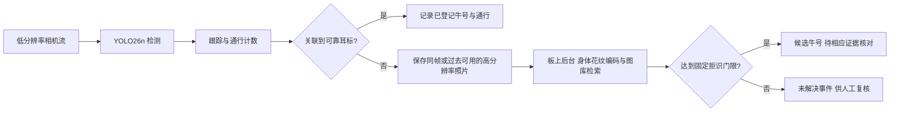

# 奶牛通道计数与耳标异常身份辅助：从想法到实机与论文

更新：2026年10月30日。本文按问题、已有证据、评价和下一步组织；逐次历史实验见[研究进度](<../../../研究进度.md>)，原报告及失败记录均保留。历史段落中的“当前／下一步／未开启”按原实验时点解释，最新状态以本页开头结论和最近阶段为准。

2026年10月30日写作进展：[方法与实验草稿](<../../../paper_readiness_20261030/论文方法与实验草稿.md>)、[12项主张与证据对应](<../../../paper_readiness_20261030/论文主张与证据对应.md>)及[五篇最接近原始论文对照](<../../../paper_readiness_20261030/文献对照_原始来源.md>)已形成并完成数字与范围自审。草稿区分10ID×3组件图库与6ID/30图通道图库、各自校准与共用系统阈值，保留3／30自动接受、迟到及10／人工12的不利结果；当前尚不具备投稿条件。用户告知网线已接路由器，最近一次只读发现电脑为192.168.3.13／24，但未找到板卡22／9090服务，COM6仍无输出；等待板卡IP与供电状态确认后优先取回SD原实验。没有新增推理、训练、调参或重跑，实际触发四轮仍待原始数据核验。

**当前进展：同90图的两编码器ARM实现核验已完成，480决定与CPU一致；新模型候选排序好，但仅自动接受3／30查询。实际计数触发对照已启动，前三轮摘要为10／10／8，第四轮终态与原始数据尚未取回。用户确认板卡断电或连接移动，当前先保留证据并等待恢复访问，不认领完整四轮通过。可靠自动找回、稳定全链路5FPS及论文主要贡献仍待验证。**

身份结果中，C为正确接受牛号、W为接受错误牛号、U为拒绝并留待复核；FA为未知牛被错误接受。Top-1表示检索第一候选正确，仍需通过拒识门限才能自动接受。

| 当前证据状态 | 结果与实际范围 | 仍需解决 |
| --- | --- | --- |
| 新实际触发阶段（待核验） | 只取回前三轮摘要10／10／8；第四轮至少350帧 | 恢复SD结果，核对raw／轨迹／照片和第四轮终态 |
| 192检测与计数 | 同O8回放；检测mosaic0.5计10／人工12、mosaic1.0计11 | 跨来源质量、入口缺帧、独立事件参考 |
| 两网络同板 | ARM身体网络、真实裁剪／预处理／图库检索已经执行 | 当前12事件的可靠身份与实际RF关联 |
| 新域身份训练与开发 | 六次配对训练；主候选40ID Top-1 99／120 | 20ID校准阈值下C10／W1／U109、未知FA5／120；非完整事件 |
| 保留ID组件与ARM一致性 | 10注册＋10未知、90图；180ARM特征与480决定同CPU | 新Top-1 30／30但C3／W0／U27、FA0／30；仍低覆盖 |
| 新身份权重实机 | 97图准入后再做四次同板；新模型4.974／4.974FPS、均计10 | 固定10照片负载，仍有迟到／跳过；永久牛号未知 |
| 有界高分输入 | 异步4.821／4.911，对照串行4.515／4.439FPS | 170／363迟到，后台最长61.17／79.17秒 |
| 后台服务取舍 | 持续后台2.56／2.19秒，暂停52.51／51.40秒 | 持续吞吐4.617／4.273FPS，一轮计数9 |
| 256与320同O8 | 各8向量平均235.55／370.93ms | 尚不能据此承诺含输入／跟踪／后台的5FPS |
| 外来源俯视检测 | COLO官方50图／450有效框，9个固定条件 | 新192召回19.11%；无新增通行／永久身份GT |
| 此前CPU分配对照 | 主线程两核＋共享后台4.987／5.000FPS，身份最长1.882／1.967秒 | 58／68迟到、计数10；与本轮新旧编码器对照分开 |

2026年10月30日最新：[实际计数触发对照的部分观察与恢复](<../../../identity_trigger_pair_20261030/实际触发对照_部分观察与恢复.md>)已启动旧—新—新—旧四轮，最后成功串口观察取得前三轮摘要：计数10／10／8、身份任务10／10／8，吞吐4.630／4.770／4.643FPS。第四轮只确认至少350帧进度，累计定时检测调用至少1451；原始raw、照片／特征、第四轮终态尚未取回，不能作为完整四次验收。用户随后确认断电或移动连接；当前COM6无输出、原IP端口超时，停止继续探测与重跑。已冻结本机观察证据和恢复代码，待恢复SD启动／USB后只读检查原目录、boot ID和结果；不加载模型或O8凑终态条件。此前已完成的同90图ARM一致性证据仍保留，整体目标继续。

此前已完成的同90图ARM核验：[同90图两编码器ARM实机核验](<../../../identity_final20_arm_20261030/同90图ARM实机一致性与计时范围.md>)已完成180正式＋4预热，90原JPEG／tensor hash、180实际原始特征及480固定决定全部核对。Top-1、Top-5和接受决定与CPU一致，主结果仍旧C22／30及C10／W2／U18／FA3，新C30／30及C3／W0／U27／FA0。纯身份网络均值旧149.29ms、新150.35ms，单次旧→新顺序、无检测并发，不认领速度优势或完整5FPS。完整原包已取回并独立复算；两套模型、库、默认encoder及O8未替换。本次是已评分90图的实现复核，不增加独立身份测试；下一步接回真实计数触发抓拍，独立事件与永久身份仍待补。

此前同90图CPU评价：[保留20身份评价与自动接受限制](<../../../identity_final20_20261030/保留20身份结果与自动接受限制.md>)按像素请求前冻结的协议完成10已登记／10未知、90图评价。旧／新编码器Top-1为22／30、30／30；主工作点C／W／U分别10／2／18、3／0／27，未知FA3／30、0／30。新模型只接受3张、来自2个作者ID，不能称可靠自动恢复或总体零风险。90输入、180特征、1200身份分数／480决定及按ID统计均复算，完整原包4,413,444字节已取回。20个保留身份现在已使用，03-05至03-11像素仍隔离；同场景身份组件评价不等于全项目未见像素或原12通行身份真值。本轮180次CPU前向、0训练／0板端；下一步在PYNQ-Z2复核同90图的两模型及全部决定，再接回实际抓拍。

此前新旧编码器同板对照：[新旧身份模型四次同板对照](<../../../identity_joint_pair_20261030/新旧身份模型固定负载同板对照.md>)已完成旧—新—新—旧四次固定10照片负载：旧模型均392／392、5.000FPS，新模型均390／392、4.974FPS，四次均计10／人工12，迟到分别80／69／67／76。后台每次都完成相同10个任务，新模型使用自己重新编码的同一30张图库；旧／新模型主阈值接受各1／0（／10，重复一致），没有永久身份正确率。完整原包、1564份实际raw、40份照片／特征、20配对及四条完整关联重放已复核。新模型不据此默认替换。下一步先执行已固定的20ID组件评价，再接回真实通行触发；当前保留身份像素仍关闭，独立逐事件与现场输入仍待补。

此前训练与新模型实现准入：[新域三seed配对训练](<../../../identity_domain_adapt_20261030/身份域适配配对训练与开发结果.md>)完成六次同初值、各300更新对照；新Cows训练16ID／457图与既有120ID和未来20候选隔离。主seed26在两个20ID开发组Top-1为54／60、51／60，完整40ID压力为99／120（旧C65／120），但新域阈值下C10／W1／U109，未知FA5／120，自动接受覆盖率仍不足。[拒识分数与校准选择](<../../../identity_rejection_scores_20261030/拒识分数对照与校准选择.md>)比较7模型×3分数，21阈值只用校准选，主方法仍为绝对余弦，未因开发结果换方法。[630图NCNN一致性](<../../../identity_domain_ncnn_20261030/新身份编码器NCNN转换与一致性验证.md>)的1260条开发决定一致，240条校准决定中1个浮点端点变化如实保留。[新权重97图ARM实机](<../../../identity_domain_arm_20261030/新身份候选ARM实机与研究决定.md>)完成97正式＋2预热，120检索决定一致，纯网络均值144.12ms、P95 161.87ms；该次没有并发检测。原始包完整取回并独立复算，默认encoder与O8未变。保留未来20ID及03-05至03-11像素，独立逐事件JSON、原12事件永久身份、稳定全链路与现场输入仍待补。

同日此前身份基线结果（保留原口径）：[Cows2021身份来源核查](<../../../cows2021_identity_intake_20261030/身份来源核查与跨日期评价准入.md>)确认官方身份Test有8670图、181非空ID，README13784与论文8670测试口径已厘清；[540图跨日期身份评价](<../../../cows2021_identity_eval_20261030/跨日期身份检索与拒识结果.md>)按预先SHA选120ID／540图，两个冻结编码器共1080次CPU前向。适配前旧C在120已登记查询Top-1为65（54.17%），新域阈值C30／W21／U69，未知误接受20／120（16.67%）；ImageNet基线Top-1为69。[20／40牛号图库控制](<../../../cows2021_identity_gallery_control_20261030/图库规模控制与拒识限制.md>)保持查询和阈值，确认加20干扰ID使C的未知误接受12或16→20；即便20ID仍未维持校准5%，不采用新阈值或自动可靠身份主张。全部540输入、1080特征、24000分数／960决定和图库控制2880决定均复算；12固定源样例、11事后解释面板已查看。原结果包与失败记录保留，03-05至03-11像素继续隔离。该旧阶段0训练、0板端推理；已有同板八次实机保留，原12事件永久牛号与独立逐事件JSON仍缺。

前一输入阶段的[完整四次实机报告与40张照片](<../../../async_highres_20261030/有界输入四次实机结果与下一步.md>)已自审：1465实际检测输出、784异步源记录和70次Torch参考均核对。读取与计算实际重叠，前台等待缩短；检测阶段变慢、后台仍饥饿，吞吐改善并未自动变成完整实时或身份收益。低分输入是已就绪回放，计时外完整性检查读过源JPEG；正式周期只用已释放数据，现场双流／曝光编码未证明。

## 1. 两个方向可以这样定义

**方向一：奶牛通道视觉检测、跟踪与双向通行计数。** 系统判断一头牛是否完成A→B或B→A，保持折返、并行、遮挡和跟踪中断的事件记录。耳标提供身份和对照，视觉可以补充头数核对；视觉总数与耳标读取数不一致时，先记录异常，不能直接认定一定掉标。

**方向二：耳标关联异常后的身体花纹辅助检索。** 在规定时间窗内没有可靠RFID关联时，保存当次通行的高分辨率照片，后台与已登记图库比较，输出候选身份或“未解决”。“未佩戴”“掉标”“漏读”“重复读取”“多码冲突”应分别记录；只凭没有读到RFID不能区分这些原因。

方向二是方向一上的附加任务。科学问题可以收紧为：**在资源受限的FPGA SoC上，按需身份检索怎样在控制误接收风险的同时，保持通道检测与计数的吞吐及可接受等待？** 这是待验证的研究问题，不是已经证明的新颖性。

### YOLO26能否认出具体哪一头牛？

通用YOLO26检测权重输出目标框、类别和置信度；其COCO模型含80类。`cow`类别说明“这是牛”，临时track ID说明“当前轨迹”，都不会自动对应牧场的永久牛号。把检测图裁得更高清，也不会自动产生个体身份功能。[Ultralytics官方YOLO26说明](https://docs.ultralytics.com/models/yolo26)

本项目实际采用：YOLO26n定位＋ByteTrack计数；后台用已训练的MobileNetV3-small身体编码器产生576维特征，再对已登记图库检索并拒识。也可以研究每头牛作为封闭类别的分类方案，但新增牛、未登记牛和重新注册需要另行处理。当前实机后台是身体编码器，并未把“高分辨率YOLO26检测”冒充个体识别。

要进一步显示“这头牛的具体信息”，还需要牧场登记表，把永久牛号、耳标号、登记照片与已有生产记录绑定。当前公开图库的身份号不能自动映射成你牧场的真实牛号，也没有你的生产记录；图库登记和信息表是部署的一部分。

图是目标系统设计。当前相机输入来自公开视频回放，RFID异常是模拟；两种网络和照片处理确实在同一块板上运行，现场传感器尚未接入。

### 政策背景需要纠正

论文不应沿用“2026年欧盟所有奶牛全面强制电子耳标”这一未经核对的统一表述。欧盟委员会2023年报告讨论成员国的自愿／国家强制选项，不能由其中的2026年法规评估节点推出全面实施日期。Defra在2026年7月更新的英格兰计划仍表述：预计2027年对新生犊牛引入LF电子身份，旧标签与电子标签会有并存期。研究动机直接写“电子身份系统中的读取和关联异常”更准确，具体辖区与实施要求另外逐项引用。[欧盟委员会报告](https://eur-lex.europa.eu/legal-content/EN/TXT/?uri=celex%3A52023DC0498) · [Defra LITP最新说明](https://www.gov.uk/government/publications/livestock-information-transformation-programme-litp/livestock-information-transformation-programme-litp)

## 2. 论文和现成权重说明了什么

| 证据 | 支持的判断 | 不能直接推出的结论 |
| --- | --- | --- |
| Andrew等的Holstein-Friesian深度度量学习研究 | 背部黑白花纹可用于个体生物特征识别，已有公开数据／代码／权重先例 | 对任意牧场、任意牛种或本项目掉标事件都有效 |
| Cows2021论文 | 发布普通俯视图像的定位／身份标签和视频，适合建立检测及身份基线 | 数据集的图像标签自动成为全部视频的完整通行事件真值 |
| LPYOLO | 低精度检测网络在PYNQ-Z2上部署有研究先例 | 它的人脸检测吞吐等于本项目YOLO26＋身份网络的吞吐 |
| 本项目实际O8与ARM记录 | 特定冻结模型、输入与代码已经同板执行 | 牧场现场精度、功耗、长期稳定性和论文新颖性已证明 |

对应原论文：[花纹个体识别](https://arxiv.org/abs/2006.09205)、[Cows2021](https://arxiv.org/abs/2105.01938)、[LPYOLO](https://arxiv.org/abs/2207.10482)。这是支持可行性的定向来源，不是完整的2026年相关工作系统综述。

YOLO26本体已有2026年6月2日提交的[官方论文](https://arxiv.org/abs/2606.03748)，应纳入方法引用。论文讨论通用视觉任务、网络结构和公开基准；其中的GPU／服务器性能不能代替本项目PYNQ-Z2实测，也没有直接提供本牧场永久牛号。[官方模型说明](https://docs.ultralytics.com/models/yolo26)

官方`yolo26n.pt`可以取得；作者的奶牛检测／身份项目也有已有模型资源。它们适合初始化或比较，**不存在一个通用权重能直接知道你牧场里每头牛的登记牛号**。至少要建立本牧场的带身份图库，并验证拍摄视角、日期变化和未登记牛拒识。本项目已经用公开数据训练并冻结了检测和身体编码器，不需要再把“是否能找到权重”当作实施前提。[本地公开权重核查](<../../../cows2021_adaptation_20261027/官方归档与作者权重核查.md>)

## 3. 已经完成哪些实际工作

### 3.1 公开数据训练与低分辨率对照

已检查本地OpenCows2020、Cows2021公开标注和MultiCam视频来源，保留标签范围、日期划分与同次通行泄漏审计。后来按用户的普通俯视和板端约束，完成15个新固定训练条件，并保留3个历史320普通增强控制，覆盖192／256／320、普通／直角增强及seed26／27／28的比较；15个新模型末轮权重共同冻结，再做完整视频评价。

固定通道裁剪后，三个直角增强seed的FP32原片计数分别为：192的10／10／10、256的11／11／12、320的12／12／11。**没有因为某个seed恰好数到12就选择它。** 主候选在读取该组裁剪结果前已固定为192直角seed26。[训练对照](<../../../detector_factorial_20261029/低分辨率训练对照与采用决定.md>) · [全部固定裁剪结果](<../../../factorial_lane_crop_20261029/固定裁剪结果与部署下一步.md>)

后续新增6次mosaic1.0／0.5配对训练（含3次新重复控制），各10轮。三个新1.0对照各708个参数／缓冲状态张量完全复现旧模型；0.5的开发图未匹配预测减少，但seed28静态匹配少20。原片为10／10／11，反向5Hz为3／3／0，均不足以宣称最终成功。主seed26保持预先选择，随后已完成PTQ及实机，不按seed28的原片11改选。[完整配对结果与候选](<../../../mosaic_pair_20261030/配对训练结果与量化候选.md>)

### 3.2 用户指定的O8三尺寸实机

现在三尺寸均已在用户指定的`yolo26_optimization_8`固件上运行奶牛单类权重。下面只比较各自8张训练校准向量的“张量输入→完整raw”，各另有2次预热。

| 输入 | 固定模型 | 实机平均ms | 本阶段范围 |
| --- | --- | --- | --- |
| 192 | S192_rot90_seed26 | 155.46 | 8向量；另外已做完整视频及同板后台 |
| 256 | S256_rot90_seed26 | 235.55 | 8受控向量，不含摄像头／计数／后台 |
| 320 | S320_rot90_seed26 | 370.93 | 8受控向量，不含摄像头／计数／后台 |

各尺寸使用分别训练并冻结的权重，不是同一权重只改尺寸的严格消融。此前320使用O6测得约1056ms的历史结果仍保留，不与本表混用。[同O8实机与数值Review](<../../../pynq_o8_sizes_20261030/同O8三尺寸实机与320数值口径.md>)

320初始旧NumPy完整raw参考有1/8未通过。实际探针定位到注意力浮点累加顺序导致一个INT8半整数边界翻转；明确MatMul和Softmax的FP32顺序后，三尺寸24个固定向量与既有原生输出全部逐字节一致，320板端也与该参考一致。权重、校准、原生程序、固件和误差门限没有改变；旧参考失败没有覆盖。

新mosaic0.5主seed26另完成同O8的8训练向量＋2预热，完整raw逐字节一致，平均140.32ms；该次短测不混入旧三尺寸数据。之后完整2654帧的网络均值144.24ms、PNG到计数及raw保存均值179.79ms，两种计时范围也分别报告。

### 3.3 完整192视频：模型可执行与计数质量分开

旧mosaic1.0板端曾完成2654个视频图条件推理、2734个跟踪时刻和6计数路径；下表是该历史模型。新mosaic0.5主seed26也独立完成同样2654帧：FP32／QDQ／实际O8原片都为10，Toros5Hz都为3／0／3、30Hz控制都为4／0／2。新静态FP32／QDQ匹配1838／1839，所有2654帧QDQ raw仍不等于实际O8，8个新原生锚点逐字节相同。[新模型完整实机与视频](<../../../pynq_mosaic192_eval_20261030/新候选量化与真实视频结果.md>)

| 数据／评价 | 结果 | 解释 |
| --- | --- | --- |
| 原片8912–10873，人审总数12 | FP32 ONNX计数10；QDQ ONNX计数11；实际O8计数11 | 人审只有总量，不能计算可靠逐事件F1，也不能排除重计与漏计抵消 |
| Toros，发布方轨迹导出6个完整反向事件 | 旧实际O8交接计数TP1／FP0／FN5 | 跨来源召回仍弱；5／30Hz源采样对照都为1／0／5，30Hz不是板端实际FPS |
| 1571张开发验证图，1864个躯干AABB参考 | FP32匹配1819；QDQ匹配1814 | 固定IoU0.5关联，不是COCO mAP，也不是视频身份精度 |

QDQ与实际O8的raw并不相同，不能用导出图替代板端结果。8个视频输入的实际O8输出已与CPU整数参考逐字节核对。[完整实机视频报告](<../../../pynq_rot192_eval_20261029/新192量化与PYNQ视频计数结果.md>)

[新mosaic0.5三栏实机视频，仅8912–10873](<../../../../../ARCHIVE_CONTENTS.md#omitted>) · [旧mosaic1.0三栏视频](<../../../../../ARCHIVE_CONTENTS.md#omitted>)

### 3.4 身份网络也已在板上运行

适配前的固定身体编码器在Cortex-A9上完成132张图的真实推理；板端照片预处理的132份张量与服务器参考逐字节相同，特征最大差异约4.49×10⁻⁶，144次检索的排名和拒识决定相同。网络张量→特征平均147.16ms；这仅是实现一致性和受控耗时，不能当作真实掉标找回准确率。[ARM身份部署与Review](<../../../pynq_identity_ncnn_20261029/身份编码器ARM实机部署与一致性.md>)

当前以Aug19图库检索Aug14原片事件属于回顾实验；图库晚于事件，尚未验证“事件发生前已完成注册”的上线顺序。Aug14同次通行历史图库只作为泄漏控制。正式身份实验还要保证注册图与查询不是同次通行，并分别评价已登记牛和未登记牛。

实际解决并保留了VFPv4不兼容、Pillow9／11缩放补边取整差异，以及转换器生成Python属性名问题。板卡全局Pillow／NumPy未替换，也未在板上安装Torch。

适配前旧C的带作者ID评价已经完成，不能再将“当前事件没有永久身份”写成“完全没有身份评价数据”。Cows2021的120个ID按预先规则分校准／评价及已登记／未知，540张身体裁剪中图库至少早于查询7天；输入日期不晚于03-04，03-05至03-11继续隔离。适配前旧C的Top-1为65／120，基线B为69／120；新域阈值下C正确接受30、错误身份接受21、拒绝69，未知误接受20／120，不能认作可靠找回。

原协议的校准图库20ID、评价40ID存在规模变化。保持查询与阈值的事后控制显示C未知误接受12或16→20；规模解释一部分，20ID下仍未维持校准经验5%。不在评价集调阈值，也不按4个Top-1差异替换模型。[540图跨日期身份评价](<../../../cows2021_identity_eval_20261030/跨日期身份检索与拒识结果.md>)和[20／40牛号图库控制](<../../../cows2021_identity_gallery_control_20261030/图库规模控制与拒识限制.md>)保存全部4主条件、16规模控制与独立复算。

这里是作者提供的身体裁剪，未包含检测／抓拍漏失；7,931原测试裁剪能对应检测原图体系，跨年物理牛号映射也未知。它支持冻结编码器的公开图像评价，不是原12头牛的档案答案或独立端到端测试。

### 3.5 同板周期回放：吞吐、迟到与后台等待

此前已完成固定身份负载的CPU分配对照：八次都做相同10个JPEG裁剪／PNG0／实际NCNN／检索任务，与该次计数解耦。主线程CPU0的四次计数9／10／9／8、吞吐4.50–4.55FPS，全1423处理时刻迟到，未采用。追加四次令主线程可用两核，结果如下。两阶段按时间先后执行，不能将全部差异归因于亲和性；只核查主线程／发布线程和后台线程mask，不宣称严格核心隔离。

| 轮次 | 后台CPU | 处理／392 | 跳过 | >200ms | FPS | 计数／人工12 | 最长身份完成s |
| --- | --- | ---: | ---: | ---: | ---: | ---: | ---: |
| 1 | 共享0／1 | 391 | 1 | 58 | 4.987 | 10 | 1.882 |
| 1 | 固定1 | 383 | 9 | 67 | 4.885 | 10 | 1.657 |
| 2 | 固定1 | 374 | 18 | 64 | 4.770 | 8 | 1.770 |
| 2 | 共享0／1 | 392 | 0 | 68 | 5.000 | 10 | 1.967 |

固定CPU1略缩短身份等待，却未同时改善吞吐和计数，因此不采用。当前后台完成含JPEG、PNG和输入／特征NPZ证据写出，不能用约168–206ms纯身份网络用时代替完整任务；没有每帧高分JPEG环，也不代表真实触发或现场双流。2963份raw、80照片／特征和40同照片配对均复核，完整原包已取回；详见[固定10照片任务的八次实机](<../../../cpu_partition_combined_20261030/固定照片负载八次实机与CPU分配取舍.md>)。

此前的每帧有界输入调度阶段保留如下，负载与上述固定照片控制不同。

此前调度对照固定相同有界输入、模型和选择规则，仅切换是否按帧暂停后台。两组均有CPU边界仪器，该阶段暂停组才是直接基线。四次结果为：

| 轮次 | 后台策略 | 处理／392 | 跳过 | >200ms | FPS | 计数／人工12 | 最长身份完成秒 |
| --- | --- | ---: | ---: | ---: | ---: | ---: | ---: |
| 1 | 按帧暂停 | 378 | 14 | 191 | 4.821 | 10 | 52.51 |
| 1 | nice10持续 | 362 | 30 | 177 | 4.617 | 9 | 2.56 |
| 2 | nice10持续 | 335 | 57 | 304 | 4.273 | 10 | 2.19 |
| 2 | 按帧暂停 | 391 | 1 | 187 | 4.987 | 10 | 51.40 |

持续后台降低排队，却在两轮都降低吞吐、提高P95，第一轮还少计1次。CPU边界记录支持它在前台期间实际得到CPU；10／9实际触发任务、不同照片与状态不能当完全相同负载。全部39图像素／输入、69次Torch参考及78候选／拒识决定已核验，没有永久身份正确率主张。网口断开后已通过串口取回完整原始包并本机复算，旧恢复报告按其历史状态保留；见[完整原包恢复补充](<../../../backend_service_20261030/完整归档恢复与复核补充_v2.md>)。[完整调度报告及恢复说明](<../../../backend_service_20261030/后台服务四次实机结果与取舍.md>)

前一轮专门检验高分辨率读取能否和检测重叠，四次均有实际身份后台，数据如下。表中迟到以已处理时刻为分母，跳过另计；完成时间含当前JPEG等待、选帧及入队。每次仍为392时隙／78.4秒，两个重复不代表独立会话。

| 轮次 | 高分输入 | 处理／392 | 跳过 | >200ms | FPS | 计数／人工12 | 最长身份完成秒 |
| --- | --- | ---: | ---: | ---: | ---: | ---: | ---: |
| 1 | 串行 | 354 | 38 | 353 | 4.515 | 10 | 76.25 |
| 1 | 有界异步 | 378 | 14 | 170 | 4.821 | 10 | 61.17 |
| 2 | 有界异步 | 385 | 7 | 363 | 4.911 | 10 | 79.17 |
| 2 | 串行 | 348 | 44 | 347 | 4.439 | 10 | 79.08 |

两组均逐帧读取并校验JPEG，异步源会读前台跳过的时隙；不是同读取次数消融。1465实际raw、8597观察、8计数路径、784源记录及40身份任务通过复算，580个时刻真实重叠。输入等待缩到1.4–1.6ms，模型阶段却由143–145ms拉长至166–182ms；不能把等待减少全部算作系统收益。异步只保留为研究候选。两次接受均为相同f9790照片，无永久身份真值。[完整范围和原始数据](<../../../async_highres_20261030/有界输入四次实机结果与下一步.md>)

下表保留此前高分照片按需读取的同模型阶段，输入成本和工作负载与本轮不同。

此前，新mosaic0.5权重已完成两轮顺序反转的6次同板实测，所有已处理时刻均运行实际O8，后台合计40次真实身份前向。输入、图库、照片和拒识口径保持；公开回放与RFID全未读模拟不等于现场传感器。

| 轮次 | 策略 | 处理／392 | 跳帧 | 释放→计数>200ms | FPS | 计数／人工12 |
| --- | --- | ---: | ---: | ---: | ---: | ---: |
| 1 | 独占 | 391 | 1 | 21 | 4.987 | 10 |
| 1 | 直接后台 | 388 | 4 | 66 | 4.949 | 10 |
| 1 | 空闲后台 | 388 | 4 | 37 | 4.949 | 10 |
| 2 | 空闲后台 | 391 | 1 | 20 | 4.987 | 10 |
| 2 | 直接后台 | 392 | 0 | 55 | 5.000 | 10 |
| 2 | 独占 | 392 | 0 | 22 | 5.000 | 10 |

每次计数与任务数同时报告，两次重复不能支持统计显著性或跨牧场泛化。当前及全部实际照片、后台排队与终态见[新候选两轮复测](<../../../pynq_mosaic192_joint_20261030/新候选同板周期与两轮复测.md>)。新旧模型的计数、实际触发负载不同，不能把旧单次与新两次直接解释为纯调度改善。

这两次设备重复中，直接后台最大排队0.60–0.67秒，空闲后台4.24–4.63秒。40个身份任务中共有4次接受，都是源帧9790的重复回放；没有永久身份真值，不能写成找回4头不同奶牛。

下表保留旧mosaic1.0的历史单次控制，范围与新权重分开。

前台实际O8＋跟踪计数；当次计数触发高分辨率通道图读取、实时框裁剪、照片保存、预处理、实际NCNN网络和图库检索。耳标输入固定为“全部未读”的模拟压力条件。每条件78.4秒、392个5Hz释放时隙。

| 单次运行条件 | 处理帧／392 | 跳帧 | 200ms迟到 | 最大后台排队 |
| --- | --- | --- | --- | --- |
| 原PNG6，直接后台 | 389 | 3 | 128 | 1.29秒 |
| 原PNG6，空闲后台 | 392 | 0 | 28 | 27.60秒 |
| 无损PNG0，直接后台 | 392 | 0 | 67 | 0.65秒 |
| 无损PNG0，空闲后台 | 388 | 4 | 25 | 5.02秒 |

每个后台条件均完成11次真实身份作业，各计数仍为11。PNG0与PNG6在11张保存微基准中像素完全相同，平均保存由732ms降为100ms，但文件总量约3倍。实际流水线中17个新旧同帧／同框作业的照片、张量和网络特征也逐字节一致；其余因采样或轨迹变化不强行配对。

空闲策略让真实网络在前台完成后的间隙推进，暂停区间与CPU用时已核查；代价是后台等待增加。各条件只有单次运行，独占控制本身也有波动，暂不作统计显著性推断。**约5FPS平均吞吐可以达到；零跳帧、零迟到、长期稳定和真实相机全链路延迟不是同一个结论。**

[直接并发结果](<../../../pynq_periodic_joint_20261030/同板前后台周期实测与下一步.md>) · [空闲策略与等待代价](<../../../pynq_idle_control_20261030/空闲后台调度结果与等待代价.md>) · [PNG无损编码及三组完整对照](<../../../pynq_capture_encoding_20261030/抓拍无损编码与完整同板结果.md>)

[全部11张实际触发照片](<../../../../../ARCHIVE_CONTENTS.md#omitted>)。固定阈值每组接受1个预测、拒绝10个；照片没有可靠永久身份真值，不能写成1/11准确率，更不能自动说接受的牛号正确。

### 3.6 外来源俯视检测：9个固定条件

COLO来源准入后，在首次打开测试像素前冻结三个既有模型与192／256／320输入、标签处理和评分。原451框保留，零宽ID127隔离，其余450框作裁边与原坐标敏感性对照；全部50图保留。该外来源评价阶段为450次Torch CPU前向，无训练或板端运行。

192输入下旧模型AP11.99%、TP92／FP21／FN358，新模型AP11.97%、86／5／364。新模型误检较少，召回20.44%→19.11%；尚无全面改善。320输入的新模型AP50较高，严格AP仍低于官方，因此不只报有利指标。这是同一套192训练权重改变测试输入，不是另外训练的256／320模型，也不是量化O8结果。

COLO图像含明显广角、饲喂边界牛与作者推断遮挡框；相机与标注对象差异需受控验证。它不提供完整事件或永久身份。72组评分本机复算差0、66面板已查看；[COLO三模型三尺寸评价](<../../../colo_eval_20261030/COLO三模型三尺寸外来源检测与下一步.md>)保留全部条件与失败记录。

### 3.7 外来源低召回已经分解，标签范围继续保留

在固定conf0.20／IoU0.50的静态图上，9条件的最大一对一匹配数均等于原TP；仅换静态分配不能补回缺口。新192的364个未匹配框中，104个仅有0.001–0.20 cow候选、196个只有更低分候选、64个没有足够几何。这不证明低分候选正确，也不把GT选框上界当召回改善。内部186框仅28匹配，边界264框58匹配，小框外仍有缺口。

4050逐框记录、173条件级FP、5400个最大匹配证书和13原图案例已经核查，见[外来源错误分解与检测对象约定](<../../../colo_error_diagnosis_20261030/低召回分解与检测对象约定.md>)。已固定[躯干与整牛标签约定](<../../../colo_error_diagnosis_20261030/检测对象与标注使用约定.md>)：当前训练与计数中心沿用躯干，COLO保留作者整牛／遮挡推断范围作压力评价；没有可靠映射前不混成标注一致训练集，不自动重标或删难例，默认模型和阈值不变。

### 3.8 新域训练改善排序，新权重已经通过实机准入

六次正式训练从同一已上板encoder开始，M分支为MultiCam580图／20ID，C分支为Cows457图／16新ID，各seed26／27／28固定300更新。六个末轮权重共同冻结后才计算校准特征与各自阈值，再统一评价开发／原来源保留集；不按epoch或开发seed择优。正式1800更新、57600训练图像前向，另有丢弃预检2更新／64图及3780评价图像前向。作者原名Identification/Test中的16个未用ID被明确改作本项目训练，不能声称复现原作者测试协议。

| 同一20ID开发图库 | fold0 Top-1／60 | fold1 Top-1／60 |
|---|---:|---:|
| 原C不继续训练 | 42 | 29 |
| M_continue_seed26 | 37 | 33 |
| C_domain_seed26（预先指定主候选） | 54 | 51 |

全部seed及40ID压力、MultiCam保留结果均在[新域三seed配对训练](<../../../identity_domain_adapt_20261030/身份域适配配对训练与开发结果.md>)。训练来源、图数和ID数同时改变，对照不归因于单一摄影因素。完整40ID压力下主候选Top-1为99／120、Top-5为119／120；新域阈值0.8707458695890389时C10／W1／U109、未知FA5／120。匹配20ID两组分别C9／W0／U51、C1／W0／U59，未知FA5／120、0／120；未知查询被重复使用，不相加当新样本。排序改善没有自动变成高覆盖的可靠身份找回。

[拒识分数与校准选择](<../../../identity_rejection_scores_20261030/拒识分数对照与校准选择.md>)用既有特征比较绝对余弦、不同牛号间隔和距离比。主seed26在校准组正确接受10／7／9，因此预先规则仍选绝对余弦；虽有开发组间隔／距离比表现较好，也未事后换成主方法。21阈值共同冻结在开发计算前，84条件／13860决定独立复算，未知全0组不认领总体零风险。此前540图及120ID已属开发材料；在该拒识对照阶段未来20ID仍关闭，后续固定一次评价见3.10，03-05至03-11日期继续保留。

[630图NCNN一致性](<../../../identity_domain_ncnn_20261030/新身份编码器NCNN转换与一致性验证.md>)保存全部630对特征，1260开发决定一致；校准240决定中1个端点接受变化保留，不移动阈值。630次Torch和630次NCNN正式前向、1次可观测Python追踪单列，转换器内部额外探针未计量，不能给出整个转换精确总前向。

[新权重97图ARM实机](<../../../identity_domain_arm_20261030/新身份候选ARM实机与研究决定.md>)在真实Cortex-A9执行97图＋2预热，97输入hash和120保留决定一致。纯网络平均144.12ms、P95 161.87ms，7张Cows仅作实现锚点；没有并发O8检测或完整Cows板端准确率测试。新权重在独立目录保留，默认encoder和O8未替换。输入传输中断与采集Path类型错误均保留，已核验前缀续传并修复采集，模型实验只运行一次。

### 3.9 新旧身份候选已经完成同一负载的同板对照

[新旧身份模型四次同板对照](<../../../identity_joint_pair_20261030/新旧身份模型固定负载同板对照.md>)只改变身份编码器与对应重编码图库，固定检测器、照片、框、入队偏移及CPU策略，旧—新—新—旧四次各完成10个身份任务。30张新图库及10张实际照片先在CPU做Torch40／NCNN40参考，再在板上40图＋1预热准入；正式4次共40身份查询＋4预热，所有输入与各自原始特征逐项核对。

| 次序／身份模型 | 处理／392 | 跳过 | >200ms | FPS | 计数／人工12 | 最长身份完成s |
|---|---:|---:|---:|---:|---:|---:|
| r1_old | 392 | 0 | 80 | 5.000 | 10 | 3.780 |
| r1_new | 390 | 2 | 69 | 4.974 | 10 | 1.879 |
| r2_new | 390 | 2 | 67 | 4.974 | 10 | 1.710 |
| r2_old | 392 | 0 | 76 | 5.000 | 10 | 1.789 |

新模型的迟到略少，但每次多2跳过，没有改善原片总计数；网络／完成时延、同照片候选和全部次序一并保留。每种只有两次相同源重复，不作显著性推断。接受数是没有永久身份GT的候选输出，不认领真实找回。新模型不据此替换默认。该阶段拟定的保留ID评价及板端一致性随后均已完成（见3.10、3.11），当前推进真实通行触发链路。

完整归档、1564实际raw、8696观察时刻、40原照片／输入／特征、20配对和完整四次ByteTrack关联／事件重放均通过；程序复算不代替独立人工真值。O8、默认encoder、父子进程、锁与板内服务终态已核查。总新增板端前向1665，CPU参考80，训练0；该同板阶段未来20ID尚未开启，后续固定组件评价见3.10。

### 3.10 保留身份的一次固定评价：排序和自动接受仍有差距

[保留20身份评价与自动接受限制](<../../../identity_final20_20261030/保留20身份结果与自动接受限制.md>)使用新域训练前已保留的20个Cows身份，10注册／10未知；每牛3查询，注册每牛3参考且至少早7天。主候选与旧C共180次CPU图像前向，无新训练、板端推理或阈值搜索。

| 编码器 | Top-1／30已登记 | 正确C | 误赋号W | 拒绝U | 未知FA／30 |
|---|---:|---:|---:|---:|---:|
| 适配前旧C | 22 | 10 | 2 | 18 | 3 |
| 新域C_seed26 | 30 | 3 | 0 | 27 | 0 |

新模型3张正确接受来自2个作者ID，旧模型3张未知误接受来自同一未知ID。新模型的27张拒识虽然候选第一名正确，仍不能在固定阈值下自动赋号。每组只有10个身份，完美排名／零误收的经验bootstrap区间退化，不代表总体100%正确或零风险；所有八个工作点与按牛配对区间均保留。

该20身份的裁剪文件在模型、方法、阈值和代码冻结后首次取得，Cows命名空间内与16训练／120开发ID互斥；场景相同、部分检测原图已用于项目、跨年物理身份未映射，不能称整项目未见像素或跨牧场测试。90图／180特征、1200ID分数、480决定、8组按ID区间及20配对均复算，完整128成员原包取回；8源样例、23解释案例与统计图已查看。

这20身份现在已见；若再用其结果改方法，不能继续称新方法的最终未见测试。随后同90图ARM实现与数值核验已经完成（见3.11），不把重复执行算第二个独立测试。原12通行永久牛号、独立逐事件JSON和同通道真实双向仍未获得。

### 3.11 同90图ARM完整实现核验已经完成

[同90图两编码器ARM实机核验](<../../../identity_final20_arm_20261030/同90图ARM实机一致性与计时范围.md>)冻结同一90JPEG、两模型及全部八工作点，在Cortex-A9运行旧C90图＋2预热、新C90图＋2预热。图库与查询共同使用各自ARM特征，所有90输入hash、180raw／归一化特征、1200身份分数与480决定独立复算，Top-1／Top-5／接受与CPU一致。完整10ID排序变化另存，没有重调阈值。

| 编码器 | 正式图数 | 网络均值ms | P95 ms | CPU归一化特征最大差 |
|---|---:|---:|---:|---:|
| old_C | 90 | 149.29 | 152.36 | 1.61677599e-06 |
| new_C_domain_seed26 | 90 | 150.35 | 151.66 | 1.83284283e-06 |

计时从已就绪224tensor到576维特征返回，JPEG解码／预处理另列；先完成90图预处理再旧→新顺序运行，无O8检测并发，没有交错重复，不能由均值差认领模型加速或全链路5FPS。CPU评价中的低接受覆盖仍保留，硬件一致性没有增加可可靠自动找回的牛号。

原始包1,199,612字节、24成员／23清单文件完整取回，全部输入锚点、raw、原始数值和终态保留。父任务与采集结束，默认encoder、两模型／库及O8、锁和板内服务均复查。新模型仍为研究候选，不全局替换。相同90图的CPU与ARM不是两次独立测试，03-05至03-11像素继续关闭。

### 3.12 实际计数触发对照：部分摘要保留，原始结果待恢复

[实际计数触发对照的部分观察与恢复](<../../../identity_trigger_pair_20261030/实际触发对照_部分观察与恢复.md>)沿用192检测器、原O8和同一几何因果选图，高分JPEG每时隙实际读取；按当次通行触发身份，未强制每次做10个任务。旧—新—新—旧四次已由同一父任务启动，当前只取得下列主机观察。没有独立逐事件或永久身份参考。

| 已观察轮次／身份 | 处理／392 | 跳过 | >200ms | FPS | 计数／人工12 | 身份任务摘要 |
|---|---:|---:|---:|---:|---:|---:|
| r1_old | 363 | 29 | 273 | 4.630 | 10 | 10 |
| r1_new | 374 | 18 | 124 | 4.770 | 10 | 10 |
| r2_new | 364 | 28 | 285 | 4.643 | 8 | 8 |

第四轮最后只观察到至少350帧，累计定时检测调用至少1451。新模型第二轮计8的不利摘要保留；原始raw、照片／特征及第四轮终态均未取回，不能用前三轮外推、代码预期或此前固定负载结果补齐，也不能把1451写成本阶段最终前向总数。预备CPU参考与关联重放尚未实际执行，不认领独立复算通过。

用户确认断电／连接移动，具体时刻与SD写入完成未知。本机已保存冻结协议、代码、成功／超时观察和恢复准备。恢复后先读原目录与boot ID；若发生重启，区分原实验O8记录和当前基础overlay，不加载模型或PL来凑“未改变”条件。原始文件尚在与否需要实际读卡证明，不能因失联宣称丢失或完成。

电脑网口最后为DHCP192.168.3.13，与先前直连192.168.2.1不同；不修改当前IP／路由，优先恢复SD启动和PROG-UART USB后走COM6取回。此前已完整核验阶段仍按其证据成立，本阶段保持待验。

## 4. 数据还需要怎样补

保留20身份的固定评价已经完成，见[保留20身份评价与自动接受限制](<../../../identity_final20_20261030/保留20身份结果与自动接受限制.md>)。[评价前校准快照](<../../../identity_final20_20261030/校准冻结结果与像素状态.md>)继续保留，主阈值没有因测试结果换到另一个校准分组。身份组件已补保留ID结果；当前缺口是完整事件身份、跨来源和最终方法需要的进一步独立证据。

不一定要重新寻找另一个名字的数据集，但需要**独立于当前开发过程的新会话、事件参考和身份关系**。

[Cows2021身份来源核查](<../../../cows2021_identity_intake_20261030/身份来源核查与跨日期评价准入.md>)与[540图跨日期身份评价](<../../../cows2021_identity_eval_20261030/跨日期身份检索与拒识结果.md>)已经补充带作者ID的跨日期已登记／未知检验；适配前旧C暴露高错误接受，后续新域训练改善排序却仍低覆盖。余下缺口是独立于方法选择的新会话／牛号、真实事件照片对应以及全链路漏失，并非网上没有身份数据。

新增[公开来源准入快照](<../../../external_sources_20261030/公开俯视数据来源与准入结论.md>)说明COLO适于外来源检测，AutoCattlogger样本直链当前404、CattleEyeView未取得数据。COLO50测试图本次已用于固定评价；若后续据此改变方法，不能继续称其为未见最终测试。既有最终留出日期仍保持隔离。

| 任务 | 可继续用的现有材料 | 论文仍缺的关键证据 |
| --- | --- | --- |
| 普通俯视检测训练 | Cows2021定位标注、经审计的真实OpenCows图 | 低对比／遮挡难例的独立标注与跨场景表现；统一躯干与整牛框的评价口径 |
| 通行计数 | 原片12人审总量、Toros6发布方派生事件、其他普通俯视视频草案 | 独立逐事件帧、完整覆盖与争议仲裁；真实同一通道双向会话 |
| 已登记身份与拒识 | 原MultiCam、Cows120ID开发／16ID训练，另20ID／90图一次固定评价 | 改善自动覆盖与错误风险取舍；新方法的独立证据、事件身份对应及全链路C／W／U／M |
| 同板性能 | 现有实际O8与ARM回放、三种调度／保存对照及两轮顺序反转复测 | 更多重复／长时负载、真实输入、功耗、内存和队列上界 |
| 耳标异常辅助 | 已实现可复算的RF输入扰动与全部未读压力条件 | 真实读取、时钟同步和漏读／掉标／冲突分型；不能把模拟写成现场试验 |

当前原片已经多次用于开发，不再是最终独立测试集。原MultiCam60张带标签身份查询也已多次用于开发；此次Cows保留20ID的60查询刚按固定协议评分，若据其结果改方法也须转为已见材料。未使用的留出日期继续保持隔离，下一项方法与评价协议冻结后再使用。

独立逐事件JSON此前已请人复核，目前未收到可接受文件。人工确认12头这一事实已保留；接收新JSON时仍会检查源SHA、8912–10873覆盖、事件帧、复核者声明和仲裁，不由模型预测代替人工参考。

## 5. 当前最需要改的是哪里

目前有两个并行瓶颈：检测／跟踪会漏掉完整通行所需的入口观察，身份检索在低错误接受工作点下覆盖率仍低。前者需要可靠逐事件参考和独立会话；后者在匹配图库规模的评价后仍需改善分数校准与自动覆盖，并用新的独立材料验证改动，不能靠单片总数或直接放宽阈值认领成功。

固定192三实现的只读诊断指向旧640开发参照94：它在入口阶段几乎没有高分对应检测，实际O8仅2/15参照时刻匹配；入口连续有效观察0。即使只修复ID，也补不回不存在的入口观察。

对旧mosaic1.0候选检查全部300候选发现，入口有几何接近却分类分数很低的框。小幅降低阈值不足以恢复既定三次稳定要求，且可能引入额外框。这个定位基于开发模型参照，仍不能当作独立漏检真值，也不能自动定位新模型漏掉的是同一头牛。[剩余案例与原生像素Review](<../../../rot192_event_diagnosis_20261030/固定192剩余未计案例与训练方向.md>)

已完成的gamma0.7和CLAHE输入对照未改善完整计数。CLAHE在该局部参照的IoU0.3对应增多，但入口最长只有两次，仍不足三次稳定要求；不能只展示局部框增多。全部36计数路径、12675个源输入hash和34图像面板已核查。Toros在这里是侧视反向压力对照，本轮配对训练已按用户要求使用普通俯视材料。[输入对照自审](<../../../photometric_input_20261030/Review与当前状态.md>)

训练覆盖审计现已完成：8888个原生躯干区域中，低亮度代理5899、低背景对比3707，不支持“训练缺少暗色牛”的简单归因。实际加载器6809幅增强图有20292个AABB、5466个短边<24px；原生旋转矩形与增强AABB口径不同，不能直接同比。一对高度相似框已回查原始XML，仅登记疑点，未自动删除。mosaic0.5配对提供局部反向改善，但原片仍未恢复12，量化与真实O8验证现已确认这种质量取舍，下一步转向完整通行差异和普通俯视新会话，不继续按单片搜索区域或seed。[覆盖审计及边界](<../../../training_coverage_20261030/训练覆盖审计与下一组对照.md>)

新旧实际O8差异已进一步定位：开发参照103的实际原始框有3次连续入口观察，确认及合法交接只留下2次。9550分数0.28858足够进入高分集合，但融合代价即使IoU=1也至少0.7114，超过未确认阶段0.7门限；实测融合0.7722、纯IoU0.2105。只在9550干预就能恢复对应通行，但全局改纯IoU有回归，故不采用。94的入口检测缺口与103的确认损失分别保留；640模型参照仍不是人工真值。[确认瓶颈与单因素回归](<../../../unconfirmed_iou_20261030/未确认关联控制与不采用决定.md>)

后台照片的因果选择现已实际比较：原完整轨迹10事件中7次改选更早照片，边界代理改善，但清晰度有3升4降；实机两组各7次改选仍未新增接受候选。每帧JPEG读取平均46–48ms，远大于约0.23ms几何选择，因果组253／281迟到及75–81秒身份等待不支持采用。全部59面板与未配对记录保留，不能凭几何分数证明身份更正确。[抓拍选择与完整时序代价](<../../../causal_photo_20261030/因果抓拍实机结果与不采用决定.md>)

输入取得成本已进一步拆开：16均匀来源、两次反转重复的256读取条件中，冷文件42–45ms、热文件2–4ms；128实际O8前向及8准入／2预热全部raw对应旧实机。页驻留和设备计数支持存储等待解释，readinto后额外不可变复制约3.82ms，不能用较快read调用代替完整队列语义。该诊断阶段没有新的周期／身份并发，原5FPS门禁仍红；后续有界生产者的四次实机现已完成：能真实重叠并缩短等待，但资源竞争及后台等待仍需解决。[输入成本与作用范围](<../../../input_cost_20261030/高分输入取得成本与下一步.md>)

此前一轮还观察到9次计数：二轮当帧丢失入口段使临时轨迹5只有1次A观察；二轮独占漏9515使21最长只有2次。旧轨迹只删9515的计数探针也从10变9，只删10440仍10；这是事后只读诊断，不是跟踪完整重跑或部署特判。平均接近5FPS仍可能丢掉决定计数的入口证据。

## 6. 怎样继续科研并形成论文

### 先把可检验主张写清

建议工作题目：**资源受限FPGA SoC上的奶牛通道视觉计数与耳标异常按需身份辅助检索**。该题目不预设全面取代耳标，也不依赖未经证实的法规日期。

能否形成论文，要看下面几条主张能否被独立证据支持：

1. 在规定的普通俯视通道条件下，计数方法相对明确基线减少逐事件漏计／重计，结果在新会话和真实双向数据中保持。
2. 在固定已知／未知比例与拒识门限下，缺失RF关联的完整通行事件获得更好的正确恢复与错误风险权衡。
3. 在相同模型与负载下，按需调度和照片流水线相对直接后台，在前台吞吐／迟到、后台等待及资源成本之间提供可复现改善。

“用了YOLO26”“能跑FPGA”“加了耳标”“平均约5FPS”各自都不足以自动构成论文贡献。O8引擎是复用的既有实现，不能把它的全部硬件设计认领为本轮新贡献。当前最有实证基础的是系统取舍与复现链路，算法泛化和身份正确率仍需补强。

### 评价按完整事件与实际设备计算

计数：进入／离开分开报告MAE及逐事件Precision、Recall、F1，记录折返、遮挡、并行和错误轨迹；有轨迹GT再报IDF1／HOTA。事件先按时间和空间一对一对应，再判断方向，不因方向相同才允许匹配。

身份：已登记Top-1／检索指标与未登记误接收分开。完整RF异常通行分为正确找回C、错误身份W、未解决U、完全漏掉M，保持`N=C+W+U+M`；额外虚假事件另记。报告错误接收风险与覆盖率，不能只报告“接受样本中的准确率”，也不能只展示成功照片。

硬件：明确输入从曝光、接收、已就绪图像或张量哪一段开始计时；报告吞吐、P95／P99、超过200ms的数量、跳帧、后台排队／完成时延、内存、文件体积和实测功耗／每事件能量。当前没有功率计数据，不能估填板卡瓦数。

划分与统计：训练、验证、最终测试按牛／日期／会话等分组；候选参数在验证阶段冻结。重采样或置信区间使用会话／牛等有效单位，不能把相邻帧当作独立重复。系统条件使用相同回放和明确顺序，增加多次运行以量化波动。

### 下一步按这个顺序执行

1. 接收独立事件JSON，补齐事件分母；保持未审核草案与正式参考分开。
2. 保留20ID的固定CPU评价及同90图ARM完整核验都已完成，输入、特征、排名与全部决定一致。保持两编码器及阈值，不用完美排名掩盖3／30自动接受覆盖；任何后续方法改动需新独立材料。已评分20ID不再称新方法未见测试，03-05至03-11日期继续保留。
3. 实际计数触发的四次对照已启动，当前只保存前三轮摘要与第四轮进度，阶段未验收。恢复SD启动／USB后只读检查原任务和boot ID，取回所有已有原始结果；完整保存才做四轮评分，部分保存就报告实际范围，不补跑或替换。实际照片参考、关联重放和后台等待都须取包后验证。
4. 历次回放已暴露8／9／10计数波动，以及部分策略的后台饥饿；同负载控制已完成。继续补真实触发与长时负载，记录前台迟到和身份等待，不以少触发任务或事后挑一轮作为优胜。
5. 有合适相机／耳标硬件后检验真实双流、时间同步与读取异常；若论文只做公开回放，题目和结论就明确限定为公开回放原型。
6. [问题、方法与已完成结果草稿](<../../../paper_readiness_20261030/论文方法与实验草稿.md>)及文献对照已形成并完成自审。按12项主张补齐对应实验后，再确定最终结果、结论及目标刊会；当前不认领投稿准备完成或分区录用。

## 7. 本轮状态与自审

写作整理完成一份方法及实验草稿，绑定7份结果来源与6份方法／统计来源；逐表核对8行结果，检查28个本地链接，并完整通读新增正文及原始文献对照。自审修正图库规模、阈值和时钟范围的混淆，未把候选排名、零误收观察或接近5FPS升级成可靠自动恢复和全链路实时保证。此为助手自审，不是独立事件审核、完整设备结果核验或同行评审。[草稿自审记录](<../../../paper_readiness_20261030/Review与当前状态.md>)。

本轮完成实际触发链路冻结、设备预检与原父任务启动，前三轮摘要及第四轮至少350帧进度已保存。访问中断后用户确认断电／连接移动；串口与原IP无响应，未重启原实验或改网络。离线自审只核对观察文件hash、392时隙摘要算术与恢复边界，不等于原始raw／照片／特征复核。已准备区分新旧boot、不加载模型／O8的只读取回与采集脚本，尚未上板执行。本阶段原始文件、第四轮终态和独立数值／关联复算均待恢复；此前同90图ARM完整核验仍保留。

总体研究目标继续：尚缺原片独立逐事件参考与可靠永久身份、同通道真实双向和跨来源稳定计数，以及论文主张所需的现场或明确限定的完整回放证据。

本机原标注页文件仍在[这里](<../../../../../research/phase3_diagnosis_20261026/annotation_workbench/index.html>)。此前恢复8779本地服务的命令被自动审批策略拦截（未给出更具体原因），没有改动标注文件；该问题不影响上述模型、板端与报告结果。
