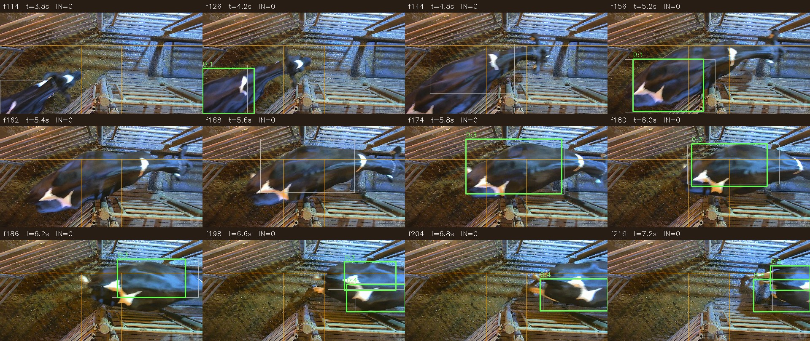

# 冻结候选的新日期视频验证

2026-11-01。原8月14日视频已获用户验收。本文保留确认次数3的冻结基线；用户随后确认8月15日实际12次，首头快速通行漏计，后续11次正确。该片已转开发材料；确认次数2的PC/ARM缓存修复恢复12次，见[修复报告](FAST_PASSAGE_FIX.md)。新的Purdue日期留出已完整实机执行，但计0/人工1，准确性未通过，见文末。模型、数据集和视频不上传GitHub。

## 数据选择与执行合同

先固定[候选](FROZEN_CANDIDATE.json)和[日期选择协议](R5_PROTOCOL.json)，再查看无预测的源画面、固定[窗口及通道](R5_ADMISSION.json)，最后在PYNQ-Z2执行。三个新日期都来自MultiCamCows2024的camera1；8月14日开发片段和先前接触过的8月17日材料均排除。

| 新日期 | 原片请求时间窗 | 本次角色 | 实际片段帧数 |
|---|---|---|---:|
| 8月15日 | 540–670秒 | 通行、跟随、停顿和超越，前后保留空通道 | 3244 |
| 8月16日 | 650–684.28秒 | 连续通行；原片在最后一头尚未走完时结束 | 851 |
| 8月18日 | 100–130秒 | 空通道误报控制，旁栏动物在ROI之外 | 741 |

原始来源为[Bristol数据发布目录](https://data.bris.ac.uk/datasets/2inu67jru7a6821kkgehxg3cv2/MultiCamCows2024Root/videos/camera1/)。来源、原片hash及顺序解码记录见[源文件校验](results/r5_source_calibration.json)，实际片段hash、完整解码帧数和流复制命令见[片段清单](results/r5_clip_manifests.json)。请求时间窗不等于精确原片帧偏移：流复制可能受关键帧对齐影响，评价对象是清单绑定的实际片段，从该片段第0帧到其实际解码终点。

片段保持2560×1440画面尺寸，只进行流复制。板上直接读取原尺寸文件，完成解码、ROI裁剪、旋转、letterbox、O8推理、跟踪和事件输出。没有把电脑预处理的低分辨率图块当作板上端到端验证。320及源PTS的5Hz采样是本次冻结候选配置，均不是产品验收门槛。

模型图、resident plan和运行资产逐项对照冻结hash；7个关键运行源码在启动前核对一致。新日期上不调置信度、门线、稳定观察次数或跟踪参数。各片段按顺序独立启动，轨迹状态不跨会话继承。板上模型使用已有共享加速器锁。

## 结果

| 片段 | 板端模型观察 | IN / OUT | 执行状态 | 参考状态 |
|---|---:|---|---|---|
| 8月15日 | 649 | 11 / 0 | COMPLETED_UNSCORED，退出0 | 用户确认12次，首头漏计1，后续11次正确 |
| 8月16日 | 171 | 6 / 0 | COMPLETED_UNSCORED，退出0 | 与助手暂点6 / 0一致；未经人工确认 |
| 8月18日 | 149 | 0 / 0 | COMPLETED_UNSCORED，退出0 | 与助手暂点空通道一致；未经人工确认 |

8月16日完整解码851帧，板端全流程约312.08秒。最后仍在上方通道的实例以`video_end / uncertain_or_truncated / counts_as_complete_passage=false`记录，未因EOF强制加1。8月18日完整解码741帧，全流程约277.13秒；在本次约30秒空通道控制中没有产生通行事件。不确定日志是诊断记录，条数不自动等于物理牛的数量。

8月15日完整解码3244帧、649次模型前向，板端全流程约1137.18秒，输出11 IN / 0 OUT及3条不确定诊断。用户已确认实际12次，故旧基线明确漏计首头1次；旧基线验收未通过。三段合计解码4836帧、969次前向，全部正常退出，整段用时合计约28.77分钟。见[终态及事件核对](results/r5_verification_summary.json)、[真实批次终态](results/r5_batch_status.json)。

三段实际全流程吞吐约0.54–0.57个处理观察/秒，单次模型推理均值约371–374ms；二者边界不同。进程峰值RSS约270.0–274.7MiB，不代表整板总内存。当前验证的是允许慢于播放的离线处理，未达到或宣称5FPS实时链路。

[助手源画面观察](results/r5_assistant_source_observations.json)是在查看预测前进行的暂定核对；8月15日随后获得[用户视频复核](results/r5_aug15_user_review.json)，确认总数12和首漏1。助手记录本身不作为独立人工GT。原8月14日的用户验收也不自动覆盖这三段。因此当前可以报告执行完成、事件结果及暂定数量一致性，尚不能据此报告独立人工事件Precision、Recall、F1或置信区间。总数一致也不能排除一次漏计和一次重复计数相互抵消。

### 快速轨迹的确认边界

8月15日的实际板端[轨迹0:7](results/r5_aug15_fast_passage_trace.json)在19.6–20.4秒有5个A区真实观察，20.6/20.8秒在中间区，21.0/21.2秒只有2个B区真实观察，之后消失。当前冻结规则需要目的区3次稳定观察，因此它没有增加IN，随后以`track_removed_or_expired`记录。轨迹已到达下方区域仍可能因确认观察不足而不计数，这给出了一条具体的低采样失败线索。

该记录解释旧基线轨迹。用户现已确认约20秒首头漏计；track 0:7由助手据轨迹关联，未提供独立精确完成时刻，不伪造计时评分。旧参数与旧11次结果保留；后续单因素修复将确认次数3改为2，恢复首头并保留其余11个事件。进一步比较确认规则或采样时，应将此片转为开发材料，再留出未接触的新会话验收；无需仅因数量差就直接启动新训练。

## 覆盖范围与剩余验收

这是同一固定相机、不同日期的初步留出验证。三段中两段有通行，一段为负例；不是三个牧场，也不是跨相机测试。没有真实反向完整通行，OUT召回率不可估计；软件双向/折返夹具只验证逻辑。18次助手暂点完整通行未达到规划中约100次的起步建议，不能把小样本表现外推为任意视频可靠性。

原片用户验收已闭环，不再要求8780页面或原片逐事件JSON。新日期结果视频可直接供用户审阅；8月15日的12次及首漏确认已收到，不再重复索要该总数或JSON。修复阶段已将这些参与比较的材料归为开发/回归集；新候选的独立验证必须换未参与本轮选择的输入。

本地结果位于`offline_counting_20261031/r5/aug15_passages_review.mp4`、`aug16_passages_review.mp4`、`aug18_idle_review.mp4`。每段由对应实际板端日志渲染，全部显示帧均重新解码核对，视频hash及帧数见[渲染校验](results/r5_render_verification.json)。渲染不运行新的检测前向。

快速通行疑点另截为约4.6秒的`offline_counting_20261031/r5/aug15_fast_passage_review_18s_22p6s.mp4`，对应实际片段帧450–564，115帧均已解码核对。[短片清单](results/r5_fast_passage_excerpt.json)绑定父视频与短片hash；只从已有结果渲染中截取，新增模型前向为0。短片用于定位第一条快速通行疑点；该总数指8月15日全片，现已获用户确认。

## 执行与审阅记录

- 服务器仅做下载、来源检查和Slurm CPU解码/流复制，未进行新模型训练或服务器推理。作业及退出状态见[准备日志](results/r5_slurm_preparation.log)。最初两个流复制作业因ffmpeg不在PATH而退出1；纠正为已验证的缓存ffmpeg后完成，失败记录保留。源文件末尾H264解码警告保留，实际解码帧数已核对。
- [批次启动记录](results/r5_board_launch.json)只证明启动；每段完成必须由子进程退出码、终态summary、文件hash和实际帧数共同证明。结果状态保留`COMPLETED_UNSCORED`，不冒充精度验收。
- 两轴审阅发现批处理封装的相对路径和父进程中断收尾问题，已修正并通过[4项纯mock回归](results/r5_supervisor_regression.log)。当前实际批次全用绝对路径且未中断，不受影响；板上使用脚本保存在[r5_batch_supervisor_used.py](results/r5_batch_supervisor_used.py)，修正版封装未被冒充为本批次所用版本。冻结检测/跟踪/计数路径未修改，也未为此重跑模型。

## Purdue替代源、校准与最终冻结验证

因原计划下载不可用，按用户“换一个试试”取得[作者官方Purdue数据](https://github.com/VADL-Purdue/AutoCattlogger/blob/main/data/readme.md)两份日样本中的第一个完整视频成员。它们是单牛时间裁剪，允许边缘出现部分其他动物；未拼接成连续牛群。相机为高位俯斜视角，不能称作已经验证了严格正上方垂直俯视。原始1920×1080 AVI分别441帧、342帧，预览缩小不参与推理。两段均在预测前获用户确认1次左→右完整通行，原话、范围与hash见[人工参考](results/purdue_user_source_review.json)。

初始确认2次的冻结v2在两段完整板端均为0；该失败完整保留。只在6月8日诊断/校准；6月9日完整结果及逐帧检测直到最终v3运行结束后才读取归档，曾在早期看到其4.8秒阶段性0计数的暴露已披露。

| 对照/角色 | 数据 | 结果 IN / OUT | 证据类型 |
|---|---|---:|---|
| 原320 INT8、v2 | 6月8日/9日 | 各0 / 0 | 完整板端AVI全链 |
| 旋转180关键帧、低候选0.1、已有COCO256 | 仅6月8日 | 未恢复真实通行 | 方向探针6前向；后两者各74前向，均拒绝 |
| 原生BGR与通用RGB接口 | 6月8日彩色帧 | raw逐位相同 | 2次板端前向，不存在本次已检出的接口颜色差 |
| 对应FP32、原配置 | 6月8日 | 1 / 0 | PC同源checkpoint完整参考74前向，另3次关键帧；不是板端INT8成绩 |
| 高分门限0.2＋关闭score融合，无前置过滤 | 6月8日 | 假成功1 / 0 | 缓存；起点来自0.4秒空画面背景，明确拒绝 |
| 通道前置过滤＋相机关联v3 | 6月8日校准 | 1 / 0 | PC/ARM实际INT8检测缓存；真实入口8.2秒、完成11.4秒，新增模型前向0 |
| **同一v3冻结后保留日期** | **6月9日** | **0 / 0，人工1 / 0** | **342帧原尺寸完整实机、57次前向、约71.37秒；数量验收失败** |

最终v3的37份源码、配置、源AVI、模型图/plan/固件均在运行前校验，运行后源码及34份原始输出再次hash比对。[冻结记录](CAMERA24_V3_FREEZE.json)未修改；两轴审阅无代码阻断项。完整终态、57行实际观察和诊断见[留出证据目录](results/purdue_evidence/channel_v3_day2_board/)，全部40份小结果见[清单](results/purdue_evidence_manifest.json)。

最终片仅16/57个观察有阈值以上候选。左侧0:1与中/右侧0:3、0:4分裂，没有同一ID形成完整A→B；0事件和4条诊断如实保留。关键帧图显示同一可见牛体检测部位/尺寸变化，[轨迹证据](results/channel_v3_reserved_failure_trace.json)不冒充人工像素GT；尚不能把根因全部归于量化或采样。未通过之后不调参数、不改计数结果、不补做模型前向。

本地`purdue_day1_cache_replay_review.mp4`为校准缓存回放，`purdue_day2_frozen_board_review.mp4`为失败的完整板端结果回放。两段441/342帧均重新解码核对，[渲染及hash](results/channel_v3_render_verification.json)保留，渲染新增0前向。

本轮结论：软件链路和原片验收成立；快速通行确认边界可修复；相机校准片1次不能证明新日期稳定计数。最终留出准确性未通过，因此整套泛化目标未完成，不宣称任意视频可靠、真实反向精度或正式事件P/R/F1。下一阶段需由用户确定检测稳定性诊断及是否开展训练/量化校准，不在这份留出上继续选择参数。
