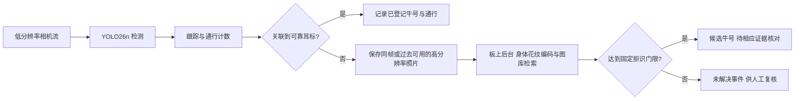

# 奶牛通道计数与耳标异常身份辅助：从想法到实机与论文

更新：2026年10月30日。本文汇总已经自审的当前结果；历史报告保留当时状态，以本文件和对应原始记录为当前入口。

**当前结论：这条路线能在PYNQ-Z2上实现同板检测、计数、实际照片处理和身份检索，192输入下已经测到约5FPS平均吞吐。但现有模型还不能作为最终牧场系统：原片当前板端计数11头／人工总数12，跨来源反向片段仅匹配1/6，永久身份恢复也缺独立真值。论文有继续研究的路径，尚不能把原型可执行写成完整现场效果已验证。**

最新质量对照：[固定192亮度／对比度结果与训练决策](<C:/Users/Donson/Documents/ChatGPT/奶牛/photometric_input_20261030/输入亮度对照结果与训练决策.md>)已完成25350次FP32／QDQ推理、36计数路径和3图34面板复核。gamma0.7静态匹配增加11／9，原片计数却由10／11降至8／10；CLAHE均为8，两个变换不采用。剩余暗色案例入口最长仍不足3次稳定观察；下一步审计普通俯视训练样本覆盖并做配对训练。本轮没有新增板端动作，历史O8原输入11／人工12及约5FPS同板记录保持。

## 1. 两个方向可以这样定义

**方向一：奶牛通道视觉检测、跟踪与双向通行计数。** 系统判断一头牛是否完成A→B或B→A，保持折返、并行、遮挡和跟踪中断的事件记录。耳标提供身份和对照，视觉可以补充头数核对；视觉总数与耳标读取数不一致时，先记录异常，不能直接认定一定掉标。

**方向二：耳标关联异常后的身体花纹辅助检索。** 在规定时间窗内没有可靠RFID关联时，保存当次通行的高分辨率照片，后台与已登记图库比较，输出候选身份或“未解决”。“未佩戴”“掉标”“漏读”“重复读取”“多码冲突”应分别记录；只凭没有读到RFID不能区分这些原因。

方向二是方向一上的附加任务。科学问题可以收紧为：**在资源受限的FPGA SoC上，按需身份检索怎样在控制误接收风险的同时，保持通道检测与计数的吞吐及可接受等待？** 这是待验证的研究问题，不是已经证明的新颖性。

### YOLO26能否认出具体哪一头牛？

通用YOLO26检测权重输出目标框、类别和置信度；其COCO模型含80类。`cow`类别说明“这是牛”，临时track ID说明“当前轨迹”，都不会自动对应牧场的永久牛号。把检测图裁得更高清，也不会自动产生个体身份功能。[Ultralytics官方YOLO26说明](https://docs.ultralytics.com/models/yolo26)

本项目实际采用：YOLO26n定位＋ByteTrack计数；后台用已训练的MobileNetV3-small身体编码器产生576维特征，再对已登记图库检索并拒识。也可以研究每头牛作为封闭类别的分类方案，但新增牛、未登记牛和重新注册需要另行处理。当前实机后台是身体编码器，并未把“高分辨率YOLO26检测”冒充个体识别。

要进一步显示“这头牛的具体信息”，还需要牧场登记表，把永久牛号、耳标号、登记照片与已有生产记录绑定。当前公开图库的身份号不能自动映射成你牧场的真实牛号，也没有你的生产记录；图库登记和信息表是部署的一部分。

图是目标系统设计。当前相机输入来自公开视频回放，RFID异常是模拟；两种网络和照片处理确实在同一块板上运行，现场传感器尚未接入。

### 政策背景需要纠正

论文不应沿用“2026年欧盟所有奶牛全面强制电子耳标”这一未经核对的统一表述。欧盟委员会2023年报告讨论成员国的自愿／国家强制选项，不能由其中的2026年法规评估节点推出全面实施日期。Defra在2026年7月更新的英格兰计划仍表述：预计2027年对新生犊牛引入LF电子身份，旧标签与电子标签会有并存期。研究动机直接写“电子身份系统中的读取和关联异常”更准确，具体辖区与实施要求另外逐项引用。[欧盟委员会报告](https://eur-lex.europa.eu/legal-content/EN/TXT/?uri=celex%3A52023DC0498) · [Defra LITP最新说明](https://www.gov.uk/government/publications/livestock-information-transformation-programme-litp/livestock-information-transformation-programme-litp)

## 2. 论文和现成权重说明了什么

| 证据 | 支持的判断 | 不能直接推出的结论 |
| --- | --- | --- |
| Andrew等的Holstein-Friesian深度度量学习研究 | 背部黑白花纹可用于个体生物特征识别，已有公开数据／代码／权重先例 | 对任意牧场、任意牛种或本项目掉标事件都有效 |
| Cows2021论文 | 发布普通俯视图像的定位／身份标签和视频，适合建立检测及身份基线 | 数据集的图像标签自动成为全部视频的完整通行事件真值 |
| LPYOLO | 低精度检测网络在PYNQ-Z2上部署有研究先例 | 它的人脸检测吞吐等于本项目YOLO26＋身份网络的吞吐 |
| 本项目实际O8与ARM记录 | 特定冻结模型、输入与代码已经同板执行 | 牧场现场精度、功耗、长期稳定性和论文新颖性已证明 |

对应原论文：[花纹个体识别](https://arxiv.org/abs/2006.09205)、[Cows2021](https://arxiv.org/abs/2105.01938)、[LPYOLO](https://arxiv.org/abs/2207.10482)。这是支持可行性的定向来源，不是完整的2026年相关工作系统综述。

官方`yolo26n.pt`可以取得；作者的奶牛检测／身份项目也有已有模型资源。它们适合初始化或比较，**不存在一个通用权重能直接知道你牧场里每头牛的登记牛号**。至少要建立本牧场的带身份图库，并验证拍摄视角、日期变化和未登记牛拒识。本项目已经用公开数据训练并冻结了检测和身体编码器，不需要再把“是否能找到权重”当作实施前提。[本地公开权重核查](<C:/Users/Donson/Documents/ChatGPT/奶牛/cows2021_adaptation_20261027/官方归档与作者权重核查.md>)

## 3. 已经完成哪些实际工作

### 3.1 公开数据训练与低分辨率对照

已检查本地OpenCows2020、Cows2021公开标注和MultiCam视频来源，保留标签范围、日期划分与同次通行泄漏审计。后来按用户的普通俯视和板端约束，完成15个新固定训练条件，并保留3个历史320普通增强控制，覆盖192／256／320、普通／直角增强及seed26／27／28的比较；15个新模型末轮权重共同冻结，再做完整视频评价。

固定通道裁剪后，三个直角增强seed的FP32原片计数分别为：192的10／10／10、256的11／11／12、320的12／12／11。**没有因为某个seed恰好数到12就选择它。** 主候选在读取该组裁剪结果前已固定为192直角seed26。[训练对照](<C:/Users/Donson/Documents/ChatGPT/奶牛/detector_factorial_20261029/低分辨率训练对照与采用决定.md>) · [全部固定裁剪结果](<C:/Users/Donson/Documents/ChatGPT/奶牛/factorial_lane_crop_20261029/固定裁剪结果与部署下一步.md>)

### 3.2 用户指定的O8三尺寸实机

现在三尺寸均已在用户指定的`yolo26_optimization_8`固件上运行奶牛单类权重。下面只比较各自8张训练校准向量的“张量输入→完整raw”，各另有2次预热。

| 输入 | 固定模型 | 实机平均ms | 本阶段范围 |
| --- | --- | --- | --- |
| 192 | S192_rot90_seed26 | 155.46 | 8向量；另外已做完整视频及同板后台 |
| 256 | S256_rot90_seed26 | 235.55 | 8受控向量，不含摄像头／计数／后台 |
| 320 | S320_rot90_seed26 | 370.93 | 8受控向量，不含摄像头／计数／后台 |

各尺寸使用分别训练并冻结的权重，不是同一权重只改尺寸的严格消融。此前320使用O6测得约1056ms的历史结果仍保留，不与本表混用。[同O8实机与数值Review](<C:/Users/Donson/Documents/ChatGPT/奶牛/pynq_o8_sizes_20261030/同O8三尺寸实机与320数值口径.md>)

320初始旧NumPy完整raw参考有1/8未通过。实际探针定位到注意力浮点累加顺序导致一个INT8半整数边界翻转；明确MatMul和Softmax的FP32顺序后，三尺寸24个固定向量与既有原生输出全部逐字节一致，320板端也与该参考一致。权重、校准、原生程序、固件和误差门限没有改变；旧参考失败没有覆盖。

### 3.3 完整192视频：模型可执行与计数质量分开

板端实际完成2654个视频图条件推理、2734个跟踪时刻和6计数路径，另有预热；所有raw及轨迹已取回。

| 数据／评价 | 结果 | 解释 |
| --- | --- | --- |
| 原片8912–10873，人审总数12 | FP32 ONNX计数10；QDQ ONNX计数11；实际O8计数11 | 人审只有总量，不能计算可靠逐事件F1，也不能排除重计与漏计抵消 |
| Toros，发布方轨迹导出6个完整反向事件 | 当前实际O8交接计数TP1／FP0／FN5 | 跨来源召回仍弱；5／30Hz源采样对照都为1／0／5，30Hz不是板端实际FPS |
| 1571张开发验证图，1864个躯干AABB参考 | FP32匹配1819；QDQ匹配1814 | 固定IoU0.5关联，不是COCO mAP，也不是视频身份精度 |

QDQ与实际O8的raw并不相同，不能用导出图替代板端结果。8个视频输入的实际O8输出已与CPU整数参考逐字节核对。[完整实机视频报告](<C:/Users/Donson/Documents/ChatGPT/奶牛/pynq_rot192_eval_20261029/新192量化与PYNQ视频计数结果.md>)

[三栏视频：FP32／QDQ／真实PYNQ，仅8912–10873](<C:/Users/Donson/Documents/ChatGPT/奶牛/pynq_rot192_eval_20261029/media_delivery/results/media/FP32_QDQ_actual_PYNQ_8912_10873.mp4>)

### 3.4 身份网络也已在板上运行

固定身体编码器在Cortex-A9上完成132张图的真实推理；板端照片预处理的132份张量与服务器参考逐字节相同，特征最大差异约4.49×10⁻⁶，144次检索的排名和拒识决定相同。网络张量→特征平均147.16ms；这仅是实现一致性和受控耗时，不能当作真实掉标找回准确率。[ARM身份部署与Review](<C:/Users/Donson/Documents/ChatGPT/奶牛/pynq_identity_ncnn_20261029/身份编码器ARM实机部署与一致性.md>)

当前以Aug19图库检索Aug14原片事件属于回顾实验；图库晚于事件，尚未验证“事件发生前已完成注册”的上线顺序。Aug14同次通行历史图库只作为泄漏控制。正式身份实验还要保证注册图与查询不是同次通行，并分别评价已登记牛和未登记牛。

实际解决并保留了VFPv4不兼容、Pillow9／11缩放补边取整差异，以及转换器生成Python属性名问题。板卡全局Pillow／NumPy未替换，也未在板上安装Torch。

### 3.5 同板约5FPS已经测到，但每帧200ms仍未全部满足

前台实际O8＋跟踪计数；当次计数触发高分辨率通道图读取、实时框裁剪、照片保存、预处理、实际NCNN网络和图库检索。耳标输入固定为“全部未读”的模拟压力条件。每条件78.4秒、392个5Hz释放时隙。

| 单次运行条件 | 处理帧／392 | 跳帧 | 200ms迟到 | 最大后台排队 |
| --- | --- | --- | --- | --- |
| 原PNG6，直接后台 | 389 | 3 | 128 | 1.29秒 |
| 原PNG6，空闲后台 | 392 | 0 | 28 | 27.60秒 |
| 无损PNG0，直接后台 | 392 | 0 | 67 | 0.65秒 |
| 无损PNG0，空闲后台 | 388 | 4 | 25 | 5.02秒 |

每个后台条件均完成11次真实身份作业，各计数仍为11。PNG0与PNG6在11张保存微基准中像素完全相同，平均保存由732ms降为100ms，但文件总量约3倍。实际流水线中17个新旧同帧／同框作业的照片、张量和网络特征也逐字节一致；其余因采样或轨迹变化不强行配对。

空闲策略让真实网络在前台完成后的间隙推进，暂停区间与CPU用时已核查；代价是后台等待增加。各条件只有单次运行，独占控制本身也有波动，暂不作统计显著性推断。**约5FPS平均吞吐可以达到；零跳帧、零迟到、长期稳定和真实相机全链路延迟不是同一个结论。**

[直接并发结果](<C:/Users/Donson/Documents/ChatGPT/奶牛/pynq_periodic_joint_20261030/同板前后台周期实测与下一步.md>) · [空闲策略与等待代价](<C:/Users/Donson/Documents/ChatGPT/奶牛/pynq_idle_control_20261030/空闲后台调度结果与等待代价.md>) · [PNG无损编码及三组完整对照](<C:/Users/Donson/Documents/ChatGPT/奶牛/pynq_capture_encoding_20261030/抓拍无损编码与完整同板结果.md>)

[全部11张实际触发照片](<C:/Users/Donson/Documents/ChatGPT/奶牛/pynq_periodic_joint_20261030/media_delivery/results/media/all11_actual_photos.png>)。固定阈值每组接受1个预测、拒绝10个；照片没有可靠永久身份真值，不能写成1/11准确率，更不能自动说接受的牛号正确。

## 4. 数据还需要怎样补

不一定要重新寻找另一个名字的数据集，但需要**独立于当前开发过程的新会话、事件参考和身份关系**。

| 任务 | 可继续用的现有材料 | 论文仍缺的关键证据 |
| --- | --- | --- |
| 普通俯视检测训练 | Cows2021定位标注、经审计的真实OpenCows图 | 暗色／遮挡正例与跨场景表现；统一躯干与整牛框的评价口径 |
| 通行计数 | 原片12人审总量、Toros6发布方派生事件、其他普通俯视视频草案 | 独立逐事件帧、完整覆盖与争议仲裁；真实同一通道双向会话 |
| 已登记身份与拒识 | 带身份公开图、不同日期图库和既定编码器 | 按牛／会话／日期隔离的未见查询，未登记牛及真实永久身份标签 |
| 同板性能 | 现有实际O8与ARM回放、三种调度／保存对照 | 多次／长时负载、真实输入、功耗、内存和队列上界 |
| 耳标异常辅助 | 已实现可复算的RF输入扰动与全部未读压力条件 | 真实读取、时钟同步和漏读／掉标／冲突分型；不能把模拟写成现场试验 |

当前原片已经多次用于开发，不再是最终独立测试集。60张带标签身份查询也已多次用于开发比较。未使用的留出数据应继续保持隔离，方法和评价协议冻结后再作最终测试；不能为了补一张好看的结果提前反复查看。

独立逐事件JSON此前已请人复核，目前未收到可接受文件。人工确认12头这一事实已保留；接收新JSON时仍会检查源SHA、8912–10873覆盖、事件帧、复核者声明和仲裁，不由模型预测代替人工参考。

## 5. 当前最需要改的是哪里

固定192三实现的只读诊断指向旧640开发参照94：它在入口阶段几乎没有高分对应检测，实际O8仅2/15参照时刻匹配；入口连续有效观察0。即使只修复ID，也补不回不存在的入口观察。

检查全部300候选发现，入口有几何接近却分类分数很低的框。小幅降低阈值不足以恢复既定三次稳定要求，且可能引入额外框。下一步优先普通俯视暗色／遮挡正例和事先冻结的训练控制，而不是为凑12头改区域规则。这个定位基于开发模型参照，仍不能当作独立漏检真值。[剩余案例与原生像素Review](<C:/Users/Donson/Documents/ChatGPT/奶牛/rot192_event_diagnosis_20261030/固定192剩余未计案例与训练方向.md>)

已完成的gamma0.7和CLAHE输入对照未改善完整计数。CLAHE在该局部参照的IoU0.3对应增多，但入口最长只有两次，仍不足三次稳定要求；不能只展示局部框增多。全部36计数路径、12675个源输入hash和34图像面板已核查。Toros在这里是侧视反向压力对照，后续训练仍按用户要求使用普通俯视材料。[输入对照自审](<C:/Users/Donson/Documents/ChatGPT/奶牛/photometric_input_20261030/Review与当前状态.md>)

后台照片还暴露出另一问题：计数完成时才取当帧框，部分身体已经到画面边缘或与邻牛重叠。后续可以研究**只利用当前及过去帧**的质量选择与压缩高分辨率缓冲，比较单帧、固定K帧与因果质量选择；不能用未来帧或真实身份标签参与在线选择。

## 6. 怎样继续科研并形成论文

### 先把可检验主张写清

建议工作题目：**资源受限FPGA SoC上的奶牛通道视觉计数与耳标异常按需身份辅助检索**。该题目不预设全面取代耳标，也不依赖未经证实的法规日期。

能否形成论文，要看下面几条主张能否被独立证据支持：

1. 在规定的普通俯视通道条件下，计数方法相对明确基线减少逐事件漏计／重计，结果在新会话和真实双向数据中保持。
2. 在固定已知／未知比例与拒识门限下，缺失RF关联的完整通行事件获得更好的正确恢复与错误风险权衡。
3. 在相同模型与负载下，按需调度和照片流水线相对直接后台，在前台吞吐／迟到、后台等待及资源成本之间提供可复现改善。

“用了YOLO26”“能跑FPGA”“加了耳标”“平均约5FPS”各自都不足以自动构成论文贡献。O8引擎是复用的既有实现，不能把它的全部硬件设计认领为本轮新贡献。当前最有实证基础的是系统取舍与复现链路，算法泛化和身份正确率仍需补强。

### 评价按完整事件与实际设备计算

计数：进入／离开分开报告MAE及逐事件Precision、Recall、F1，记录折返、遮挡、并行和错误轨迹；有轨迹GT再报IDF1／HOTA。事件先按时间和空间一对一对应，再判断方向，不因方向相同才允许匹配。

身份：已登记Top-1／检索指标与未登记误接收分开。完整RF异常通行分为正确找回C、错误身份W、未解决U、完全漏掉M，保持`N=C+W+U+M`；额外虚假事件另记。报告错误接收风险与覆盖率，不能只报告“接受样本中的准确率”，也不能只展示成功照片。

硬件：明确输入从曝光、接收、已就绪图像或张量哪一段开始计时；报告吞吐、P95／P99、超过200ms的数量、跳帧、后台排队／完成时延、内存、文件体积和实测功耗／每事件能量。当前没有功率计数据，不能估填板卡瓦数。

划分与统计：训练、验证、最终测试按牛／日期／会话等分组；候选参数在验证阶段冻结。重采样或置信区间使用会话／牛等有效单位，不能把相邻帧当作独立重复。系统条件使用相同回放和明确顺序，增加多次运行以量化波动。

### 下一步按这个顺序执行

1. 接收独立事件JSON，补齐事件分母；保持未审核草案与正式参考分开。
2. 先审计训练集本身的暗色／遮挡和有效牛体像素覆盖，再固定低分辨率配对训练；输入亮度对照已完成且未采用。使用全部事件与负例评价，同时保留Toros跨来源压力结果，不在Toros上训练后仍称其独立测试。
3. 比较当帧抓拍与因果质量选择，单独测真实检测框造成的身份损失；对未登记牛保持拒识。
4. 在同板约5FPS基础上做重复／长时、相同负载的调度实验，明确前台允许迟到和后台允许等待，而不是事后挑最优一次。
5. 有合适相机／耳标硬件后检验真实双流、时间同步与读取异常；若论文只做公开回放，题目和结论就明确限定为公开回放原型。
6. 可以先完成问题定义、相关工作、方法与实验协议稿；最终结果与结论要等独立评分和实际设备证据齐全。稿件形成后再按真实贡献选择期刊／会议，不承诺某分区录用。

## 7. 本轮状态与自审

同板部署可行性已经从估算推进到实际运行。三尺寸实机向量、192完整视频、两网络／真实照片的周期回放、无损保存对照及剩余案例诊断均有原始输出和独立复算。每个目录的Review、冻结协议、文件哈希和失败记录保留；所有本轮自有板端任务已终态，SSH与Jupyter仍可访问，O8固件保持。

总体研究目标继续：尚缺独立逐事件／永久身份参考、同通道真实双向评价、跨来源稳定计数，以及对应论文主张的现场或明确限定的回放证据。

本机原标注页文件仍在[这里](<C:/Users/Donson/Documents/ChatGPT/奶牛/phase3_diagnosis_20261026/annotation_workbench/index.html>)。本轮恢复8779本地服务的命令被自动审批策略拦截（未给出更具体原因），没有改动标注文件；该问题不影响上述模型、板端与报告结果。
