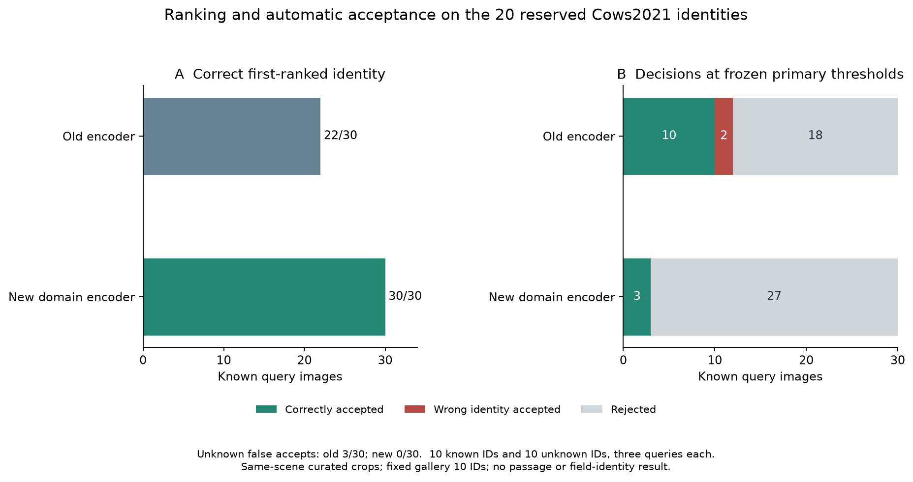

# PYNQ-Z2上的奶牛通道计数与按需视觉身份检索

英文工作题目：On-Device Cattle Passage Counting and On-Demand Visual Identity Retrieval on a PYNQ-Z2: A Public-Replay System Study

版本：2026-10-30，v0.1。本文是基于已完成实验的方法与结果草稿，尚未达到投稿状态。作者、单位、资金与利益声明由实际参与者补充。每项可写主张及其原始记录见[证据对应表](论文主张与证据对应.md)和[结构化来源与SHA](results/claim_ledger_v1.json)。

## 摘要

本文研究在PYNQ-Z2上共同运行奶牛通道检测、计数与按需身份检索的资源取舍。系统复用YOLO26n O8加速引擎，通过跟踪和通行状态机产生事件，并以ARM上的轻量嵌入模型检索身体花纹。公开数据上的保留身份评价中，10个注册身份的30张查询图，域训练编码器的Top-1为30/30，原编码器为22/30；采用预先确定的主阈值后，新编码器正确自动接受3张、未解决27张，30张未注册查询均被拒绝。对同90张输入的板上实现核验，180次正式编码的全部排名及480项固定接受决定与CPU参考一致。固定10张后台照片的四次同板回放处理率为4.974–5.000帧/秒，每轮仍有67–80帧超过200毫秒截止时间，计数均为10，人工确认总量为12。这些结果把候选检索、自动接受和完整系统时序分开评价，为后续实际事件触发与真实输入验证提供依据。

关键词：奶牛重识别；通道计数；PYNQ-Z2；事件触发；开放集拒识。

## 1. 问题定义与研究问题

奶牛经过固定通道时，系统需要回答两个问题：有多少头牛沿哪个方向通过；在耳标关联失败时，能否返回这头牛的身份或明确请求人工确认。YOLO26承担通用视觉检测等任务；具体个体身份需要另设注册信息和识别方法。[YOLO26原始论文](https://arxiv.org/abs/2606.03748)并未给出对本牧场永久牛号的直接映射。

本系统区分检测类别、临时轨迹号和永久身份。检测类别表示“牛”，轨迹号连接当前视频中的位置，永久身份连接注册图库及业务档案。临时号不能直接当作耳标号。RFID关联失败表示在规定时间和空间条件下没有得到可信匹配，原因可能是未佩戴、丢标、漏读或关联冲突；当前公开视频实验采用模拟无RF输入，不判定实际故障原因。

研究围绕三个问题展开：第一，192、256、320检测输入在同一O8引擎上能否满足200毫秒处理预算；第二，体纹编码器在已登记及未登记牛只混合时，候选排名与自动接受风险如何变化；第三，前台检测与后台身份检索共享ARM资源时，吞吐、前台迟到、后台等待和计数是否同时保持。第三个问题的实际计数触发四轮原始记录尚待从SD卡取回，本文结果表只使用已经完整取包并复算的实验。

## 2. 与已有工作的关系

俯视身体花纹与轨迹身份识别已有公开研究。[Cows2021](https://arxiv.org/abs/2105.01938)提供带位置和身份标注的俯视图像及视频；[AutoCattlogger](https://doi.org/10.1016/j.atech.2025.101561)结合体纹表示、图库和跟踪。它们确立了该任务的可行性，也要求本研究说明新机制相对既有方法的增量。

按需识别和RFID—视觉关联也有先例。[ReadMyCow](https://openaccess.thecvf.com/content/WACV2024/html/Smink_Computer_Vision_on_the_Edge_Individual_Cattle_Identification_in_Real-Time_WACV_2024_paper.html)根据质量调用耳标文字识别；[Guzhva等](https://www.frontiersin.org/journals/robotics-and-ai/articles/10.3389/frobt.2018.00107/full)将真实门禁RFID与视觉轨迹关联，其评价使用回溯处理；[Swartz等](https://doi.org/10.3168/jdsc.2024-0659)评价了结合项圈无线RFID与视觉的商业系统可靠性。耳标文字、无线读取、身体检索分别承担不同功能，数值比较须保留各自分母和协议。

[Animal Re-Identification on Microcontrollers](https://arxiv.org/abs/2512.08198v2)展示了微控制器上的轻量嵌入检索。该类工作意味着“小设备运行重识别”本身已有基础。本研究应检验共享计算预算下的事件触发策略及风险—覆盖—时序权衡，而不能以更换检测器或开发板作为充分贡献。五篇最接近工作的读取范围、评估单位与需要匹配的对照见[原始来源对照](文献对照_原始来源.md)。

## 3. 系统方法

### 3.1 前台检测、跟踪和事件

低分辨率通道图像进入复用的YOLO26n O8引擎；检测结果经[ByteTrack](https://arxiv.org/abs/2110.06864)连接成轨迹，再由固定状态机判断完整通行。当前计数协议使用归一化纵向0.4和0.6的两个区域边界，稳定样本数为3，最大间隔为2秒；每条临时轨迹保存通行状态，以完整穿越而非逐帧检测数增加计数。参数及运行代码版本绑定在[实际触发协议](../identity_trigger_pair_20261030/protocol/run_v1.json)中。

O8是此前已存在、在本项目中复用的实现。论文引用其来源并报告本项目实际修改及验证的部分。检测尺寸变化与身份模型输入尺寸分别记录：前者为192/256/320，后者固定为224×224。

### 3.2 关联失败后的因果取图

设计链路是：完整通行事件产生后查询RF关联；关联失败则从该轨迹已有的高分辨率候选中选择照片，进入后台队列。选择器只使用当前或过去一秒内已实际处理的同轨迹信息，最多保留6帧压缩图像，不读取未来帧或身份相似度。

照片质量分数定义为

\[
q = A_{\mathrm{visible}}\,(1-o_{\max})\,
\min\{1,\max(0,m_{\mathrm{edge}})/16\},
\]

其中可见面积、与其他已确认框的最大重叠占比和距ROI边界的最小距离均由框几何计算；同分时取最近的可用帧。该规则是冻结的工程选择，尚未通过对照证明其优于其他取图方法。实际触发阶段的照片、时间因果关系和完整后台结果仍待原始记录核验。

固定10照片负载实验则按冻结时刻发布同10张照片，与本轮检测计数解耦。它用于比较共享负载下的新旧编码器，不能替代上述实际触发评价。

### 3.3 注册图库、候选与拒识

身份编码器基于[MobileNetV3-Small](https://arxiv.org/abs/1905.02244)，输出576维特征，在ARM上以NCNN FP32运行。Cows保留身份评价的图库为10ID、每ID3张图；通道回放使用另一套6个注册ID、共30张图的图库。特征归一化后计算余弦相似度，身份得分取该ID所有图库图像的最高相似度：

\[
s_i(x)=\max_{g\in G_i}\langle f(x),f(g)\rangle,\qquad
\hat i=\arg\max_i s_i(x).
\]

最高身份得分达到冻结阈值时自动接受，否则返回“未解决”并保留候选。新旧编码器分别重算同照片的图库，避免跨编码器直接比较向量。注册库中的ID必须先与可靠的永久牛号建立映射，视觉向量本身不产生法定或业务身份信息。

### 3.4 身份域训练与冻结顺序

新域训练使用16个Cows2021命名空间ID、457张图；对照为原来源20ID、580图的继续训练。六个来源—种子条件使用同一初始编码器，种子26/27/28，每条件300次正式更新，总计1800次。AdamW学习率及weight decay均为0.0001，损失为余弦分类交叉熵与单位特征上的batch-hard欧氏triplet，margin为0.3。固定采用最后300次更新的模型，主种子26在开发评价前确定。[训练协议](../identity_domain_adapt_20261030/protocol/run_v1.json)

来源、图数和ID数同时变化，因此该比较评价整套训练来源取舍，不能将差异全部归因于单一场景因素。最终20ID名单、取图规则和两个模型的阈值均在访问本轮图像前冻结。主工作点使用独立10ID校准，旧阈值0.8348239883357427，新阈值0.8304473380979187；稳定性工作点、历史阈值及此前20ID阈值按原协议一并保留，不在最终20ID上重新选阈值。[最终20ID协议](../identity_final20_20261030/protocol/run_v1.json)

## 4. 数据、输入时钟与评价单位

| 实验 | 样本与独立单位 | 用途 |
|---|---|---|
| 保留20ID的身份评价 | 10注册、10未注册ID；30图库图、30已登记查询、30未登记查询，共90图 | 跨日候选及拒识评价；每ID的多张图共同解释 |
| 同90图ARM核验 | 两模型各90次正式编码，另各2次预热 | 实现一致性及隔离计时，同一批数据的设备复现 |
| 固定后台负载 | 同源通道回放，旧/新/新/旧四轮，每轮392时隙及10照片 | 同设备重复和共享资源控制 |
| 分辨率预算检查 | 192见完整系统回放；256和320各8个受控向量，使用对应训练权重 | 张量就绪至检测raw输出计时与系统负载分别评价 |
| 实际计数触发 | 冻结四轮方案；当前保存部分主机摘要 | 待取回原始数据后验收，未纳入正式结果 |

身份图库和查询按ID及日期规则选择，注册/查询日期至少相隔7天；已知查询与未知查询分母分别为30。该划分是本项目自定义协议，数据提供方路径名中的Test不等于复现其原始测试基准。已有检测训练与身份裁剪父图的潜在重叠、不同年份永久牛号的对应关系在第6节说明。

通道焦点范围由用户确认：源帧8912–10873、指定ROI内完整通行共12头。当前5Hz实验实际释放源帧8915–10870、步长5，共392时隙，名义输入时段为78.4秒；检测前使用固定历史缓存建立跟踪状态。后台图库含晚于该事件日期的注册照片，因此属于回顾检索协议。

固定后台负载阶段使用已准备的192低分辨率回放输入和指定10张高分辨率照片，未模拟逐帧相机取图；时钟不包含曝光和相机传输。实际触发方案另加入逐时隙高分辨率JPEG读取，其低分辨率输入仍为已就绪回放，完整结果待核验。两种负载均不能直接换算成真实相机双流的稳定帧率。

每轮前台处理率定义为

\[
\rho=\frac{N_{\mathrm{processed}}}{392\times0.2\ \mathrm{s}}.
\]

同时报告跳过时隙、从释放至完成计数超过200毫秒的帧数、P95以及后台等待和完整完成时间。平均处理率与逐帧截止时间是两项指标。准备好的张量至网络返回、JPEG解码预处理、事件产生至身份返回也分别计时，不相互替代。

身份评价同时报告Top-1/Top-5与接受决定。对已登记查询，C为正确自动接受，W为错误自动接受，U为拒绝后未解决；此裁剪评价中没有前台漏检，因此M为0。未登记查询另报误接受FA。完整事件评价将满足N=C+W+U+M，M记录未被系统产生有效身份任务的真实事件，额外虚假事件单列。逐事件计数需独立参考和一对一匹配；当前12头人工总量只能用于总量误差。

## 5. 已完成结果

### 5.1 候选排名与自动接受

| 编码器 | 已登记Top-1 /30 | Top-5 /30 | C /30 | W /30 | U /30 | 未登记FA /30 |
|---|---:|---:|---:|---:|---:|---:|
| 原编码器 | 22 | 28 | 10 | 2 | 18 | 3 |
| 新域编码器，种子26 | 30 | 30 | 3 | 0 | 27 | 0 |

表中使用各自独立10ID校准的主阈值。新编码器候选排名全部正确，正确自动接受覆盖为10%，原编码器为33.3%；新编码器的更高排名没有转化为高自动覆盖。30张未登记图的零误收是该样本下的观察，不提供总体零风险保证。已登记的3次新模型接受来自2个ID，统计以ID分组，避免将相邻图片视为独立牛只。[CPU原始评价](../identity_final20_20261030/delivery/results/evaluation/summary.json)

按10个已登记ID配对进行2000次bootstrap，种子26030，Top-1的新减旧差为26.67个百分点，百分位95%区间为13.33–43.33个百分点。这是该小样本划分内的分组重采样范围；同一组的正确自动接受差区间为−50.00–0.00个百分点。[已保存的配对统计](../identity_final20_20261030/delivery/results/evaluation/paired_ID_differences.json)

其余固定工作点、全部输入照片及错误查询已在[保留20ID完整报告](../identity_final20_20261030/保留20身份结果与自动接受限制.md)保留。上述20ID现已用于评分，未来根据这些结果修改方法时需要新的独立证据。

### 5.2 ARM一致性与隔离计时

180次正式ARM编码加4次预热实际完成。90张图的输入hash、180个特征、1200个ID得分和480项固定决定逐项核对，Top-1、Top-5顺序、完整排名及接受决定均无变化，最大归一化特征差为1.833×10⁻⁶。[独立复算记录](../identity_final20_arm_20261030/results/independent_verification.json)

| 编码器 | 正式图数 | 纯网络均值 /ms | 纯网络P95 /ms |
|---|---:|---:|---:|
| 原编码器 | 90 | 149.29 | 152.36 |
| 新域编码器 | 90 | 150.35 | 151.66 |

JPEG读取、解码和预处理独立计时均值47.23毫秒、P95 52.27毫秒。实验先做输入准备再依次运行旧、新编码器，没有并发检测负载；这些计时评价设备上的编码开销，完整事件延迟还包括排队、取图与其他处理。

### 5.3 固定10照片共享负载

| 轮次 | 编码器 | 处理 /392 | 跳过 | 已处理帧迟到 | 处理率 /帧·s⁻¹ | 释放至计数P95 /ms | 通行计数 | 入队至身份结果最大值 /ms |
|---|---|---:|---:|---:|---:|---:|---:|---:|
| r1_old | 原 | 392 | 0 | 80 | 5.000 | 275.27 | 10 | 3780.29 |
| r1_new | 新 | 390 | 2 | 69 | 4.974 | 304.65 | 10 | 1878.58 |
| r2_new | 新 | 390 | 2 | 67 | 4.974 | 302.73 | 10 | 1709.67 |
| r2_old | 原 | 392 | 0 | 76 | 5.000 | 305.45 | 10 | 1789.06 |

四轮各发布10项冻结身份任务。前台和后台共享CPU0/1，后台单线程、nice为10。已处理帧的迟到以释放至计数超过200毫秒判定；后台列从入队计至身份结果返回。新旧模型在两次同源重复中的前台处理率接近，但均存在迟到，后台完成时间也有波动；两次重复不足以把最大时间差归因于模型速度。四轮都输出10，与人工12的绝对总量误差为2，缺少独立逐事件参考时不能进一步拆成漏计和重计。[完整负载与复算](../identity_joint_pair_20261030/results/independent_verification.json)

本负载对照共用原MultiCam阈值0.8445389603236383，附加报告固定阈值0.8707458695890389，均未根据本次接受数调整。这与第5.1节Cows组件的各自10ID校准工作点不同。[同板冻结协议](../identity_joint_pair_20261030/protocol/run_v1.json)

这10张现场风格照片缺少永久身份真值，因此只用于固定负载与候选行为检查。原模型每轮自动接受1张，新模型每轮0张，接受次数不等于身份正确次数。

### 5.4 256与320的预算检查

统一O8实现下，256和320各8个受控向量的张量就绪至raw输出均值分别为235.55和370.93毫秒，全部向量超过200毫秒。当前条件下，192仍是继续做5Hz系统评价的候选；256和320需要降低处理需求或提高实现效率后再评价。不同尺寸使用各自训练权重，以上结果不能作为同权重的纯分辨率消融，也不代表完整视频的实时性能。[三尺寸原始核验](../pynq_o8_sizes_20261030/results/final_review.json)

### 5.5 实际触发实验的待验收项目

实际触发四轮曾启动，主机保存前三轮摘要及第四轮进度；设备连接变化后尚未取得完整raw、照片、特征及第四轮终态。该阶段不进入以上正式结果表。恢复后先读原任务、核对新旧boot，再取回SD卡已保存文件；完整记录决定可评分范围，不通过重跑替代原实验。[当前观察与恢复方案](../identity_trigger_pair_20261030/实际触发对照_部分观察与恢复.md)

## 6. 讨论与适用范围

当前结果支持两个分开的判断：体纹候选可以在该公开划分上改善，且同一编码器可在PYNQ-Z2复现；自动接受覆盖和完整时序仍决定系统是否有用。单看Top-1会漏掉新模型27/30未解决的事实，单看接近5的处理率会漏掉逐帧迟到。后续方法应在冻结风险约束下比较覆盖与等待时间。

实验采用公开回放及模拟RF输入，同一源片的设备重复不提供跨牧场泛化证据。最终身份图像按Cows命名空间隔离，但不同年份数据是否对应同一实体牛尚未核实；部分身份裁剪父图可能已用于检测任务，不能称整个系统从未见过这些像素。作者裁剪身份图像与实际检测裁剪也有输入差异。回顾图库含事件后的照片，不能据此证明首次部署时的因果注册可用。

当前缺少该12事件的独立逐事件参考及永久牛号映射；真实无线异常恢复、真实相机输入、功耗和长期稳定性仍需要相应采集。复用的检测器、O8、ByteTrack和轻量骨干均按来源归属。新贡献应由具体机制及匹配条件下的结果建立。

## 7. 下一阶段实验与论文完成条件

先取回实际触发原始记录，完成实际照片CPU参考、关联重放、因果取图和后台时序复算。若只保存了部分运行，就按完整保存的范围报告，保留中断原因和分母。独立事件JSON到达后，将计数及每个RF异常事件统一匹配，报告方向、C/W/U/M和额外虚假事件。

随后在有可靠注册身份、未登记牛与跨会话图像的数据上比较无视觉回退、始终检索、失败触发和轨迹聚合。保持相同检测输出、输入时钟及图库；分别观察触发次数减少、正确恢复覆盖、错误接受、拒识和完成时间。阈值及策略由开发材料确定，新增最终材料在评价前冻结。单纯提高Top-1不作为自动恢复成功的替代指标。

真实硬件可用后，使用带时间戳的相机/RFID记录验证时钟关联与故障原因，测量从图像接收或曝光到事件/身份输出的完整链路，并补长时负载、内存及外部功率计数据。若最终只使用公开回放，就保留本稿的公开回放研究范围。

论文完成需具备明确贡献、完整对照及上述主张所需的直接证据。当前可推进问题、方法和已完成结果写作；最终结论、刊会选择和投稿应在实验范围稳定后确定。

## 本地复现入口

本稿数字的权威字段与SHA见[claim_ledger_v1.json](results/claim_ledger_v1.json)。组件原始协议、运行记录、失败记录及独立复算入口保存在各阶段目录，整体时间线见[研究阶段总结](../研究阶段总结_20261030.md)。外部文献的完整出处和读取范围见[文献对照](文献对照_原始来源.md)；本稿没有新增训练或模型前向。
