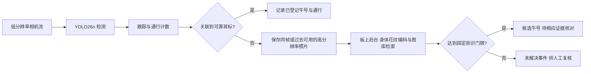

# 奶牛通道计数与耳标异常身份辅助：从想法到实机与论文

更新：2026年10月30日。本文按问题、已有证据、评价和下一步组织；逐次历史实验见[研究进度](<C:/Users/Donson/Documents/ChatGPT/奶牛/研究进度.md>)，原报告及失败记录均保留。

**当前结论：检测、ARM计数和身体身份检索已在同一PYNQ-Z2实际运行。新192模型完整实机原片计数10／人工12、反向3／6；最新有界输入四次也均计10。异步吞吐4.821–4.911FPS，但前台仍迟到、最长身份完成61–79秒，因此保留研究候选，默认未替换。独立事件／永久身份和真实相机／RFID仍待补，现场有效性和论文贡献尚未证明。**

| 目前已验证 | 结果与实际范围 | 仍需解决 |
| --- | --- | --- |
| 192检测与计数 | 同O8完整视频及多次周期回放；新模型10／人工12、旧模型11 | 跨来源质量、入口缺帧、独立事件参考 |
| 两网络同板 | ARM身体网络、真实裁剪／预处理／图库检索已经执行 | 永久身份正确率、未登记牛风险、实际RF关联 |
| 有界高分输入 | 异步4.821／4.911，对照串行4.515／4.439FPS | 170／363迟到，后台最长61.17／79.17秒 |
| 256与320同O8 | 各8向量平均235.55／370.93ms | 尚不能据此承诺含输入／跟踪／后台的5FPS |

本轮[完整四次实机报告与40张照片](<C:/Users/Donson/Documents/ChatGPT/奶牛/async_highres_20261030/有界输入四次实机结果与下一步.md>)已自审：1465实际检测输出、784异步源记录和70次Torch参考均核对。读取与计算实际重叠，前台等待缩短；检测阶段变慢、后台仍饥饿，吞吐改善并未自动变成完整实时或身份收益。低分输入是已就绪回放，计时外完整性检查读过源JPEG；正式周期只用已释放数据，现场双流／曝光编码未证明。

## 1. 两个方向可以这样定义

**方向一：奶牛通道视觉检测、跟踪与双向通行计数。** 系统判断一头牛是否完成A→B或B→A，保持折返、并行、遮挡和跟踪中断的事件记录。耳标提供身份和对照，视觉可以补充头数核对；视觉总数与耳标读取数不一致时，先记录异常，不能直接认定一定掉标。

**方向二：耳标关联异常后的身体花纹辅助检索。** 在规定时间窗内没有可靠RFID关联时，保存当次通行的高分辨率照片，后台与已登记图库比较，输出候选身份或“未解决”。“未佩戴”“掉标”“漏读”“重复读取”“多码冲突”应分别记录；只凭没有读到RFID不能区分这些原因。

方向二是方向一上的附加任务。科学问题可以收紧为：**在资源受限的FPGA SoC上，按需身份检索怎样在控制误接收风险的同时，保持通道检测与计数的吞吐及可接受等待？** 这是待验证的研究问题，不是已经证明的新颖性。

### YOLO26能否认出具体哪一头牛？

通用YOLO26检测权重输出目标框、类别和置信度；其COCO模型含80类。`cow`类别说明“这是牛”，临时track ID说明“当前轨迹”，都不会自动对应牧场的永久牛号。把检测图裁得更高清，也不会自动产生个体身份功能。[Ultralytics官方YOLO26说明](https://docs.ultralytics.com/models/yolo26)

本项目实际采用：YOLO26n定位＋ByteTrack计数；后台用已训练的MobileNetV3-small身体编码器产生576维特征，再对已登记图库检索并拒识。也可以研究每头牛作为封闭类别的分类方案，但新增牛、未登记牛和重新注册需要另行处理。当前实机后台是身体编码器，并未把“高分辨率YOLO26检测”冒充个体识别。

要进一步显示“这头牛的具体信息”，还需要牧场登记表，把永久牛号、耳标号、登记照片与已有生产记录绑定。当前公开图库的身份号不能自动映射成你牧场的真实牛号，也没有你的生产记录；图库登记和信息表是部署的一部分。

图是目标系统设计。当前相机输入来自公开视频回放，RFID异常是模拟；两种网络和照片处理确实在同一块板上运行，现场传感器尚未接入。

### 政策背景需要纠正

论文不应沿用“2026年欧盟所有奶牛全面强制电子耳标”这一未经核对的统一表述。欧盟委员会2023年报告讨论成员国的自愿／国家强制选项，不能由其中的2026年法规评估节点推出全面实施日期。Defra在2026年7月更新的英格兰计划仍表述：预计2027年对新生犊牛引入LF电子身份，旧标签与电子标签会有并存期。研究动机直接写“电子身份系统中的读取和关联异常”更准确，具体辖区与实施要求另外逐项引用。[欧盟委员会报告](https://eur-lex.europa.eu/legal-content/EN/TXT/?uri=celex%3A52023DC0498) · [Defra LITP最新说明](https://www.gov.uk/government/publications/livestock-information-transformation-programme-litp/livestock-information-transformation-programme-litp)

## 2. 论文和现成权重说明了什么

| 证据 | 支持的判断 | 不能直接推出的结论 |
| --- | --- | --- |
| Andrew等的Holstein-Friesian深度度量学习研究 | 背部黑白花纹可用于个体生物特征识别，已有公开数据／代码／权重先例 | 对任意牧场、任意牛种或本项目掉标事件都有效 |
| Cows2021论文 | 发布普通俯视图像的定位／身份标签和视频，适合建立检测及身份基线 | 数据集的图像标签自动成为全部视频的完整通行事件真值 |
| LPYOLO | 低精度检测网络在PYNQ-Z2上部署有研究先例 | 它的人脸检测吞吐等于本项目YOLO26＋身份网络的吞吐 |
| 本项目实际O8与ARM记录 | 特定冻结模型、输入与代码已经同板执行 | 牧场现场精度、功耗、长期稳定性和论文新颖性已证明 |

对应原论文：[花纹个体识别](https://arxiv.org/abs/2006.09205)、[Cows2021](https://arxiv.org/abs/2105.01938)、[LPYOLO](https://arxiv.org/abs/2207.10482)。这是支持可行性的定向来源，不是完整的2026年相关工作系统综述。

官方`yolo26n.pt`可以取得；作者的奶牛检测／身份项目也有已有模型资源。它们适合初始化或比较，**不存在一个通用权重能直接知道你牧场里每头牛的登记牛号**。至少要建立本牧场的带身份图库，并验证拍摄视角、日期变化和未登记牛拒识。本项目已经用公开数据训练并冻结了检测和身体编码器，不需要再把“是否能找到权重”当作实施前提。[本地公开权重核查](<C:/Users/Donson/Documents/ChatGPT/奶牛/cows2021_adaptation_20261027/官方归档与作者权重核查.md>)

## 3. 已经完成哪些实际工作

### 3.1 公开数据训练与低分辨率对照

已检查本地OpenCows2020、Cows2021公开标注和MultiCam视频来源，保留标签范围、日期划分与同次通行泄漏审计。后来按用户的普通俯视和板端约束，完成15个新固定训练条件，并保留3个历史320普通增强控制，覆盖192／256／320、普通／直角增强及seed26／27／28的比较；15个新模型末轮权重共同冻结，再做完整视频评价。

固定通道裁剪后，三个直角增强seed的FP32原片计数分别为：192的10／10／10、256的11／11／12、320的12／12／11。**没有因为某个seed恰好数到12就选择它。** 主候选在读取该组裁剪结果前已固定为192直角seed26。[训练对照](<C:/Users/Donson/Documents/ChatGPT/奶牛/detector_factorial_20261029/低分辨率训练对照与采用决定.md>) · [全部固定裁剪结果](<C:/Users/Donson/Documents/ChatGPT/奶牛/factorial_lane_crop_20261029/固定裁剪结果与部署下一步.md>)

后续新增6次mosaic1.0／0.5配对训练（含3次新重复控制），各10轮。三个新1.0对照各708个参数／缓冲状态张量完全复现旧模型；0.5的开发图未匹配预测减少，但seed28静态匹配少20。原片为10／10／11，反向5Hz为3／3／0，均不足以宣称最终成功。主seed26保持预先选择，随后已完成PTQ及实机，不按seed28的原片11改选。[完整配对结果与候选](<C:/Users/Donson/Documents/ChatGPT/奶牛/mosaic_pair_20261030/配对训练结果与量化候选.md>)

### 3.2 用户指定的O8三尺寸实机

现在三尺寸均已在用户指定的`yolo26_optimization_8`固件上运行奶牛单类权重。下面只比较各自8张训练校准向量的“张量输入→完整raw”，各另有2次预热。

| 输入 | 固定模型 | 实机平均ms | 本阶段范围 |
| --- | --- | --- | --- |
| 192 | S192_rot90_seed26 | 155.46 | 8向量；另外已做完整视频及同板后台 |
| 256 | S256_rot90_seed26 | 235.55 | 8受控向量，不含摄像头／计数／后台 |
| 320 | S320_rot90_seed26 | 370.93 | 8受控向量，不含摄像头／计数／后台 |

各尺寸使用分别训练并冻结的权重，不是同一权重只改尺寸的严格消融。此前320使用O6测得约1056ms的历史结果仍保留，不与本表混用。[同O8实机与数值Review](<C:/Users/Donson/Documents/ChatGPT/奶牛/pynq_o8_sizes_20261030/同O8三尺寸实机与320数值口径.md>)

320初始旧NumPy完整raw参考有1/8未通过。实际探针定位到注意力浮点累加顺序导致一个INT8半整数边界翻转；明确MatMul和Softmax的FP32顺序后，三尺寸24个固定向量与既有原生输出全部逐字节一致，320板端也与该参考一致。权重、校准、原生程序、固件和误差门限没有改变；旧参考失败没有覆盖。

新mosaic0.5主seed26另完成同O8的8训练向量＋2预热，完整raw逐字节一致，平均140.32ms；该次短测不混入旧三尺寸数据。之后完整2654帧的网络均值144.24ms、PNG到计数及raw保存均值179.79ms，两种计时范围也分别报告。

### 3.3 完整192视频：模型可执行与计数质量分开

旧mosaic1.0板端曾完成2654个视频图条件推理、2734个跟踪时刻和6计数路径；下表是该历史模型。新mosaic0.5主seed26也独立完成同样2654帧：FP32／QDQ／实际O8原片都为10，Toros5Hz都为3／0／3、30Hz控制都为4／0／2。新静态FP32／QDQ匹配1838／1839，所有2654帧QDQ raw仍不等于实际O8，8个新原生锚点逐字节相同。[新模型完整实机与视频](<C:/Users/Donson/Documents/ChatGPT/奶牛/pynq_mosaic192_eval_20261030/新候选量化与真实视频结果.md>)

| 数据／评价 | 结果 | 解释 |
| --- | --- | --- |
| 原片8912–10873，人审总数12 | FP32 ONNX计数10；QDQ ONNX计数11；实际O8计数11 | 人审只有总量，不能计算可靠逐事件F1，也不能排除重计与漏计抵消 |
| Toros，发布方轨迹导出6个完整反向事件 | 旧实际O8交接计数TP1／FP0／FN5 | 跨来源召回仍弱；5／30Hz源采样对照都为1／0／5，30Hz不是板端实际FPS |
| 1571张开发验证图，1864个躯干AABB参考 | FP32匹配1819；QDQ匹配1814 | 固定IoU0.5关联，不是COCO mAP，也不是视频身份精度 |

QDQ与实际O8的raw并不相同，不能用导出图替代板端结果。8个视频输入的实际O8输出已与CPU整数参考逐字节核对。[完整实机视频报告](<C:/Users/Donson/Documents/ChatGPT/奶牛/pynq_rot192_eval_20261029/新192量化与PYNQ视频计数结果.md>)

[新mosaic0.5三栏实机视频，仅8912–10873](<C:/Users/Donson/Documents/ChatGPT/奶牛/pynq_mosaic192_eval_20261030/media_delivery/results/media/FP32_QDQ_actual_PYNQ_8912_10873.mp4>) · [旧mosaic1.0三栏视频](<C:/Users/Donson/Documents/ChatGPT/奶牛/pynq_rot192_eval_20261029/media_delivery/results/media/FP32_QDQ_actual_PYNQ_8912_10873.mp4>)

### 3.4 身份网络也已在板上运行

固定身体编码器在Cortex-A9上完成132张图的真实推理；板端照片预处理的132份张量与服务器参考逐字节相同，特征最大差异约4.49×10⁻⁶，144次检索的排名和拒识决定相同。网络张量→特征平均147.16ms；这仅是实现一致性和受控耗时，不能当作真实掉标找回准确率。[ARM身份部署与Review](<C:/Users/Donson/Documents/ChatGPT/奶牛/pynq_identity_ncnn_20261029/身份编码器ARM实机部署与一致性.md>)

当前以Aug19图库检索Aug14原片事件属于回顾实验；图库晚于事件，尚未验证“事件发生前已完成注册”的上线顺序。Aug14同次通行历史图库只作为泄漏控制。正式身份实验还要保证注册图与查询不是同次通行，并分别评价已登记牛和未登记牛。

实际解决并保留了VFPv4不兼容、Pillow9／11缩放补边取整差异，以及转换器生成Python属性名问题。板卡全局Pillow／NumPy未替换，也未在板上安装Torch。

### 3.5 同板周期回放：吞吐、迟到与后台等待

最新一轮专门检验高分辨率读取能否和检测重叠，四次均有实际身份后台，数据如下。表中迟到以已处理时刻为分母，跳过另计；完成时间含当前JPEG等待、选帧及入队。每次仍为392时隙／78.4秒，两个重复不代表独立会话。

| 轮次 | 高分输入 | 处理／392 | 跳过 | >200ms | FPS | 计数／人工12 | 最长身份完成秒 |
| --- | --- | ---: | ---: | ---: | ---: | ---: | ---: |
| 1 | 串行 | 354 | 38 | 353 | 4.515 | 10 | 76.25 |
| 1 | 有界异步 | 378 | 14 | 170 | 4.821 | 10 | 61.17 |
| 2 | 有界异步 | 385 | 7 | 363 | 4.911 | 10 | 79.17 |
| 2 | 串行 | 348 | 44 | 347 | 4.439 | 10 | 79.08 |

两组均逐帧读取并校验JPEG，异步源会读前台跳过的时隙；不是同读取次数消融。1465实际raw、8597观察、8计数路径、784源记录及40身份任务通过复算，580个时刻真实重叠。输入等待缩到1.4–1.6ms，模型阶段却由143–145ms拉长至166–182ms；不能把等待减少全部算作系统收益。异步只保留为研究候选。两次接受均为相同f9790照片，无永久身份真值。[完整范围和原始数据](<C:/Users/Donson/Documents/ChatGPT/奶牛/async_highres_20261030/有界输入四次实机结果与下一步.md>)

下表保留此前高分照片按需读取的同模型阶段，输入成本和工作负载与本轮不同。

此前，新mosaic0.5权重已完成两轮顺序反转的6次同板实测，所有已处理时刻均运行实际O8，后台合计40次真实身份前向。输入、图库、照片和拒识口径保持；公开回放与RFID全未读模拟不等于现场传感器。

| 轮次 | 策略 | 处理／392 | 跳帧 | 释放→计数>200ms | FPS | 计数／人工12 |
| --- | --- | ---: | ---: | ---: | ---: | ---: |
| 1 | 独占 | 391 | 1 | 21 | 4.987 | 10 |
| 1 | 直接后台 | 388 | 4 | 66 | 4.949 | 10 |
| 1 | 空闲后台 | 388 | 4 | 37 | 4.949 | 10 |
| 2 | 空闲后台 | 391 | 1 | 20 | 4.987 | 10 |
| 2 | 直接后台 | 392 | 0 | 55 | 5.000 | 10 |
| 2 | 独占 | 392 | 0 | 22 | 5.000 | 10 |

每次计数与任务数同时报告，两次重复不能支持统计显著性或跨牧场泛化。当前及全部实际照片、后台排队与终态见[新候选两轮复测](<C:/Users/Donson/Documents/ChatGPT/奶牛/pynq_mosaic192_joint_20261030/新候选同板周期与两轮复测.md>)。新旧模型的计数、实际触发负载不同，不能把旧单次与新两次直接解释为纯调度改善。

这两次设备重复中，直接后台最大排队0.60–0.67秒，空闲后台4.24–4.63秒。40个身份任务中共有4次接受，都是源帧9790的重复回放；没有永久身份真值，不能写成找回4头不同奶牛。

下表保留旧mosaic1.0的历史单次控制，范围与新权重分开。

前台实际O8＋跟踪计数；当次计数触发高分辨率通道图读取、实时框裁剪、照片保存、预处理、实际NCNN网络和图库检索。耳标输入固定为“全部未读”的模拟压力条件。每条件78.4秒、392个5Hz释放时隙。

| 单次运行条件 | 处理帧／392 | 跳帧 | 200ms迟到 | 最大后台排队 |
| --- | --- | --- | --- | --- |
| 原PNG6，直接后台 | 389 | 3 | 128 | 1.29秒 |
| 原PNG6，空闲后台 | 392 | 0 | 28 | 27.60秒 |
| 无损PNG0，直接后台 | 392 | 0 | 67 | 0.65秒 |
| 无损PNG0，空闲后台 | 388 | 4 | 25 | 5.02秒 |

每个后台条件均完成11次真实身份作业，各计数仍为11。PNG0与PNG6在11张保存微基准中像素完全相同，平均保存由732ms降为100ms，但文件总量约3倍。实际流水线中17个新旧同帧／同框作业的照片、张量和网络特征也逐字节一致；其余因采样或轨迹变化不强行配对。

空闲策略让真实网络在前台完成后的间隙推进，暂停区间与CPU用时已核查；代价是后台等待增加。各条件只有单次运行，独占控制本身也有波动，暂不作统计显著性推断。**约5FPS平均吞吐可以达到；零跳帧、零迟到、长期稳定和真实相机全链路延迟不是同一个结论。**

[直接并发结果](<C:/Users/Donson/Documents/ChatGPT/奶牛/pynq_periodic_joint_20261030/同板前后台周期实测与下一步.md>) · [空闲策略与等待代价](<C:/Users/Donson/Documents/ChatGPT/奶牛/pynq_idle_control_20261030/空闲后台调度结果与等待代价.md>) · [PNG无损编码及三组完整对照](<C:/Users/Donson/Documents/ChatGPT/奶牛/pynq_capture_encoding_20261030/抓拍无损编码与完整同板结果.md>)

[全部11张实际触发照片](<C:/Users/Donson/Documents/ChatGPT/奶牛/pynq_periodic_joint_20261030/media_delivery/results/media/all11_actual_photos.png>)。固定阈值每组接受1个预测、拒绝10个；照片没有可靠永久身份真值，不能写成1/11准确率，更不能自动说接受的牛号正确。

## 4. 数据还需要怎样补

不一定要重新寻找另一个名字的数据集，但需要**独立于当前开发过程的新会话、事件参考和身份关系**。

| 任务 | 可继续用的现有材料 | 论文仍缺的关键证据 |
| --- | --- | --- |
| 普通俯视检测训练 | Cows2021定位标注、经审计的真实OpenCows图 | 低对比／遮挡难例的独立标注与跨场景表现；统一躯干与整牛框的评价口径 |
| 通行计数 | 原片12人审总量、Toros6发布方派生事件、其他普通俯视视频草案 | 独立逐事件帧、完整覆盖与争议仲裁；真实同一通道双向会话 |
| 已登记身份与拒识 | 带身份公开图、不同日期图库和既定编码器 | 按牛／会话／日期隔离的未见查询，未登记牛及真实永久身份标签 |
| 同板性能 | 现有实际O8与ARM回放、三种调度／保存对照及两轮顺序反转复测 | 更多重复／长时负载、真实输入、功耗、内存和队列上界 |
| 耳标异常辅助 | 已实现可复算的RF输入扰动与全部未读压力条件 | 真实读取、时钟同步和漏读／掉标／冲突分型；不能把模拟写成现场试验 |

当前原片已经多次用于开发，不再是最终独立测试集。60张带标签身份查询也已多次用于开发比较。未使用的留出数据应继续保持隔离，方法和评价协议冻结后再作最终测试；不能为了补一张好看的结果提前反复查看。

独立逐事件JSON此前已请人复核，目前未收到可接受文件。人工确认12头这一事实已保留；接收新JSON时仍会检查源SHA、8912–10873覆盖、事件帧、复核者声明和仲裁，不由模型预测代替人工参考。

## 5. 当前最需要改的是哪里

固定192三实现的只读诊断指向旧640开发参照94：它在入口阶段几乎没有高分对应检测，实际O8仅2/15参照时刻匹配；入口连续有效观察0。即使只修复ID，也补不回不存在的入口观察。

对旧mosaic1.0候选检查全部300候选发现，入口有几何接近却分类分数很低的框。小幅降低阈值不足以恢复既定三次稳定要求，且可能引入额外框。这个定位基于开发模型参照，仍不能当作独立漏检真值，也不能自动定位新模型漏掉的是同一头牛。[剩余案例与原生像素Review](<C:/Users/Donson/Documents/ChatGPT/奶牛/rot192_event_diagnosis_20261030/固定192剩余未计案例与训练方向.md>)

已完成的gamma0.7和CLAHE输入对照未改善完整计数。CLAHE在该局部参照的IoU0.3对应增多，但入口最长只有两次，仍不足三次稳定要求；不能只展示局部框增多。全部36计数路径、12675个源输入hash和34图像面板已核查。Toros在这里是侧视反向压力对照，本轮配对训练已按用户要求使用普通俯视材料。[输入对照自审](<C:/Users/Donson/Documents/ChatGPT/奶牛/photometric_input_20261030/Review与当前状态.md>)

训练覆盖审计现已完成：8888个原生躯干区域中，低亮度代理5899、低背景对比3707，不支持“训练缺少暗色牛”的简单归因。实际加载器6809幅增强图有20292个AABB、5466个短边<24px；原生旋转矩形与增强AABB口径不同，不能直接同比。一对高度相似框已回查原始XML，仅登记疑点，未自动删除。mosaic0.5配对提供局部反向改善，但原片仍未恢复12，量化与真实O8验证现已确认这种质量取舍，下一步转向完整通行差异和普通俯视新会话，不继续按单片搜索区域或seed。[覆盖审计及边界](<C:/Users/Donson/Documents/ChatGPT/奶牛/training_coverage_20261030/训练覆盖审计与下一组对照.md>)

新旧实际O8差异已进一步定位：开发参照103的实际原始框有3次连续入口观察，确认及合法交接只留下2次。9550分数0.28858足够进入高分集合，但融合代价即使IoU=1也至少0.7114，超过未确认阶段0.7门限；实测融合0.7722、纯IoU0.2105。只在9550干预就能恢复对应通行，但全局改纯IoU有回归，故不采用。94的入口检测缺口与103的确认损失分别保留；640模型参照仍不是人工真值。[确认瓶颈与单因素回归](<C:/Users/Donson/Documents/ChatGPT/奶牛/unconfirmed_iou_20261030/未确认关联控制与不采用决定.md>)

后台照片的因果选择现已实际比较：原完整轨迹10事件中7次改选更早照片，边界代理改善，但清晰度有3升4降；实机两组各7次改选仍未新增接受候选。每帧JPEG读取平均46–48ms，远大于约0.23ms几何选择，因果组253／281迟到及75–81秒身份等待不支持采用。全部59面板与未配对记录保留，不能凭几何分数证明身份更正确。[抓拍选择与完整时序代价](<C:/Users/Donson/Documents/ChatGPT/奶牛/causal_photo_20261030/因果抓拍实机结果与不采用决定.md>)

输入取得成本已进一步拆开：16均匀来源、两次反转重复的256读取条件中，冷文件42–45ms、热文件2–4ms；128实际O8前向及8准入／2预热全部raw对应旧实机。页驻留和设备计数支持存储等待解释，readinto后额外不可变复制约3.82ms，不能用较快read调用代替完整队列语义。该诊断阶段没有新的周期／身份并发，原5FPS门禁仍红；后续有界生产者的四次实机现已完成：能真实重叠并缩短等待，但资源竞争及后台等待仍需解决。[输入成本与作用范围](<C:/Users/Donson/Documents/ChatGPT/奶牛/input_cost_20261030/高分输入取得成本与下一步.md>)

此前一轮还观察到9次计数：二轮当帧丢失入口段使临时轨迹5只有1次A观察；二轮独占漏9515使21最长只有2次。旧轨迹只删9515的计数探针也从10变9，只删10440仍10；这是事后只读诊断，不是跟踪完整重跑或部署特判。平均接近5FPS仍可能丢掉决定计数的入口证据。

## 6. 怎样继续科研并形成论文

### 先把可检验主张写清

建议工作题目：**资源受限FPGA SoC上的奶牛通道视觉计数与耳标异常按需身份辅助检索**。该题目不预设全面取代耳标，也不依赖未经证实的法规日期。

能否形成论文，要看下面几条主张能否被独立证据支持：

1. 在规定的普通俯视通道条件下，计数方法相对明确基线减少逐事件漏计／重计，结果在新会话和真实双向数据中保持。
2. 在固定已知／未知比例与拒识门限下，缺失RF关联的完整通行事件获得更好的正确恢复与错误风险权衡。
3. 在相同模型与负载下，按需调度和照片流水线相对直接后台，在前台吞吐／迟到、后台等待及资源成本之间提供可复现改善。

“用了YOLO26”“能跑FPGA”“加了耳标”“平均约5FPS”各自都不足以自动构成论文贡献。O8引擎是复用的既有实现，不能把它的全部硬件设计认领为本轮新贡献。当前最有实证基础的是系统取舍与复现链路，算法泛化和身份正确率仍需补强。

### 评价按完整事件与实际设备计算

计数：进入／离开分开报告MAE及逐事件Precision、Recall、F1，记录折返、遮挡、并行和错误轨迹；有轨迹GT再报IDF1／HOTA。事件先按时间和空间一对一对应，再判断方向，不因方向相同才允许匹配。

身份：已登记Top-1／检索指标与未登记误接收分开。完整RF异常通行分为正确找回C、错误身份W、未解决U、完全漏掉M，保持`N=C+W+U+M`；额外虚假事件另记。报告错误接收风险与覆盖率，不能只报告“接受样本中的准确率”，也不能只展示成功照片。

硬件：明确输入从曝光、接收、已就绪图像或张量哪一段开始计时；报告吞吐、P95／P99、超过200ms的数量、跳帧、后台排队／完成时延、内存、文件体积和实测功耗／每事件能量。当前没有功率计数据，不能估填板卡瓦数。

划分与统计：训练、验证、最终测试按牛／日期／会话等分组；候选参数在验证阶段冻结。重采样或置信区间使用会话／牛等有效单位，不能把相邻帧当作独立重复。系统条件使用相同回放和明确顺序，增加多次运行以量化波动。

### 下一步按这个顺序执行

1. 接收独立事件JSON，补齐事件分母；保持未审核草案与正式参考分开。
2. 新旧实际通行差异及确认阶段单因素控制已完成，局部恢复1次但全局有回归，继续保留原规则。94的连续入口检测与103的确认损失分别验证，结合普通俯视新会话及独立参考，不通过换seed、帧号特判或向训练加入原片来追12。
3. 有界输入与计算已经实际重叠，吞吐改善但后台仍饥饿。下一步固定同一生产者、模型与选择规则，比较现有空闲门控、低优先级后台或明确服务预算，统计前台截止时间、后台完成与实际队列；再用固定同事件照片和带永久ID新会话验证身份收益。
4. 两阶段周期重复已暴露前台9／10波动及后台饥饿。继续掉帧与确认／稳定入口的独立分解、输入代价受控的相同负载和长时实验，明确允许迟到与等待上限，不以少触发任务或事后挑一轮作为优胜。
5. 有合适相机／耳标硬件后检验真实双流、时间同步与读取异常；若论文只做公开回放，题目和结论就明确限定为公开回放原型。
6. 可以先完成问题定义、相关工作、方法与实验协议稿；最终结果与结论要等独立评分和实际设备证据齐全。稿件形成后再按真实贡献选择期刊／会议，不承诺某分区录用。

## 7. 本轮状态与自审

同板部署可行性已有真实记录。最新四次有界输入的父任务、四身份子任务、生产线程和采集进程均终态，原O8、锁、SSH与Jupyter已核查；参考作业130643完成0:0。1465实际raw、8597观察、40照片／输入／检索、784源记录和70Torch参考／80检索决定均核对。CRLF首次提交拒绝只作LF修复，未改输入或门限；其余历史失败均留档。默认策略未替换，当前四次10、此前9／10以及旧模型11等结果分别保留。

总体研究目标继续：尚缺独立逐事件／永久身份参考、同通道真实双向评价、跨来源稳定计数，以及对应论文主张的现场或明确限定的回放证据。

本机原标注页文件仍在[这里](<C:/Users/Donson/Documents/ChatGPT/奶牛/phase3_diagnosis_20261026/annotation_workbench/index.html>)。此前恢复8779本地服务的命令被自动审批策略拦截（未给出更具体原因），没有改动标注文件；该问题不影响上述模型、板端与报告结果。
