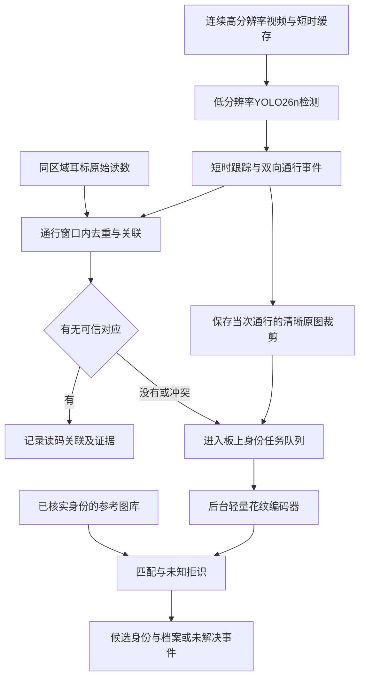

# 奶牛通道双向计数与异常身份找回研究路线

2026年10月26日。本文按本轮确认的两个条件制定：先使用公开数据；实时检测和后台身份识别最终均在PYNQ-Z2上完成。服务器用于训练、数据准备和离线对照，部署运行时不承担身份推理。

## 1 判断与推荐定位

两个方向可以作为同一系统的两个阶段。第一阶段建立可靠的通行事件，回答“何时、朝哪个方向、经过几头”；第二阶段为耳标关联异常的事件补充花纹身份候选，回答“可能是哪一头”。先把事件数统计正确，后续身份识别才能有完整的对象和分母。

建议总题目为：**面向PYNQ-Z2的奶牛通道双向计数与电子耳标异常身份辅助识别**。应用可行性有文献基础，原版YOLO26n与身份网络能否共同满足板卡的资源和时效预算，需要先做板上试验。

| 层次 | 建议名称 | 对用户提供的结果 | 目前可验证的范围 |
| --- | --- | --- | --- |
| 方向1 | 奶牛通道双向视觉计数与耳标记录核对 | 进入/离开次数、通行时间、图像证据、读码关联异常 | 公开连续视频中的视觉计数；受控生成的读码事件核对 |
| 方向2 | 面向耳标读取异常的奶牛花纹身份辅助找回 | 已登记牛的身份候选、匹配证据、对应档案或未解决状态 | 公开数据中的登记图库匹配、未知拒识及合成耳标缺失条件 |

方向2共享方向1的检测、跟踪和通行记录，但新增了图库登记、身份编码、未知拒识与后台调度。它是功能扩展，不是单纯提高检测分辨率。

## 2 先修正问题背景

不使用“2026年欧盟强制普及奶牛电子耳标”作为论文前提。欧委会当前牛识别说明以常规耳标为基础，电子替代使用依主管部门批准和国家安排；原课程针对英格兰，Defra的现行公开计划是预计在2027年向英格兰新生犊牛引入低频电子标识，并逐步过渡。[欧委会牛识别说明](https://food.ec.europa.eu/animals/identification/bovine-animals_en)、[Defra计划](https://www.gov.uk/government/publications/livestock-information-transformation-programme-litp/livestock-information-transformation-programme-litp)

研究动机可以直接写为：电子耳标记录受丢失、损坏、漏读和错误关联影响，需要独立通行证据与身份辅助核对。视觉统计的可信度同样需要试验，不能预设它永远比RFID正确。

“未获得可信耳标读数”是系统可观察状态，“未佩戴或掉标”是可能原因，二者分开。视觉识别提供管理身份候选，独立核验和官方身份处理保留原有流程。

## 3 完整流程应该怎样工作

实际系统应在奶牛通过时就拍摄或缓存，然后等待读码关联窗口结束，决定是否运行后台身份识别。若等“漏读确定”后才拍照，奶牛可能已离开最佳视野。不存在读码信号时，也必须能由视觉或通行传感器建立事件。

原图裁剪来自真实高分辨率采集，低分辨率检测结果用于定位。把低分辨率图放大不会恢复花纹细节。建议保留一个短片段或少量候选帧，按清晰度、遮挡和视角选择；尺寸与帧数通过实验确定。

公开视频回放阶段可把视频文件视作输入源。其解码、缓冲、检测、身份匹配和事件写盘均应纳入板上系统测试；它验证回放系统，不等同于真实摄像机或牧场部署验收。

## 4 方向1的最小可用实现

### 4.1 明确统计对象

初版限定一个固定摄像机、一个观察通道、Holstein-Friesian奶牛；允许分时双向通行，先记录相向同时通行、严重遮挡等困难条件，再逐步验证。这个观察通道可以模拟牧场出入口，但公开牛舍视频的虚拟通道结果不能直接推广为真实边界监测。

分别保存进入数和离开数。同一头牛出去再回来是两次方向不同的通行。获得存栏估计还需要初始数量、全部通道覆盖和其他数量变化记录；双向流量本身不提供这些条件。

### 4.2 检测与跟踪

先以官方YOLO26n做检测基线，必要时用公开奶牛检测标注微调；以ByteTrack作为一个短时跟踪基线。官方检测模型提供框与类别，跟踪器维护视频中的临时ID。[YOLO检测说明](https://docs.ultralytics.com/tasks/detect/)、[跟踪文档](https://docs.ultralytics.com/modes/track/)

临时track ID服务于这一次视频关联，不能当成跨天的牛档案编号。每头牛作为YOLO类别训练可留作闭集对照，主方案仍采用检测与个体再识别分工。

### 4.3 用区域状态形成通行事件

在通道两侧定义A、B区域，中间留过渡带，以轨迹中心或合适的身体参考点进行判断：

| 观察到的稳定区域序列 | 输出 |
| --- | --- |
| A经过过渡带到B | 一次进入事件 |
| B经过过渡带到A | 一次离开事件 |
| A进入过渡带又回到A | 不计作完成通行 |
| A到B后又完整回到A | 分别记一次进入和一次离开 |
| 只有中间片段或身份关联中断 | 保留边界不确定或待核查状态 |

加入区域滞回与稳定性判断，防止计数线附近抖动反复触发。轨迹丢失后重新分配ID可能造成重复计数，需要视频证据与轨迹拼接/事件去重评估；不能只靠一个冷却秒数宣称解决所有重复问题。

### 4.4 再与耳标记录核对

原始读数包含码值、来源、捕获/接收时间及有效状态。同码重复读数不代表多头牛；不同读码数量相等也不保证身份正确。

关联前提是RF读区与视觉区域有经过验证的对应关系，时钟和传输延迟有已知误差。对同窗口多牛多码，采用一对一分配并允许不分配；没有足够依据时保持不确定。

第一阶段完成后，可以知道哪些通行缺少可信身份，但还不能仅凭计数推断那一头牛的编号。

## 5 方向2怎样找回具体身份

### 5.1 提前建立参考图库

正式牧场应用应在身份和图像对应关系已独立核实时登记多张参考图，绑定内部牛ID与档案。成功读到一个RF码并不自动证明它来自当前画面的牛，登记时也要确认对应关系。

公开数据阶段使用作者的匿名身份标签构建实验图库，不把这些标签称为已经验证的官方耳标号或真实生产档案。图库外新牛输出未知，证据不足的老牛输出未解决。

### 5.2 后台使用身份编码与匹配

对清晰裁剪图提取花纹特征向量，与图库比较，输出最相近候选、相似度及与第二候选的间隔；经过验证集校准后决定接收、继续取帧或拒识。基于背部黑白花纹的度量学习已有直接科研依据。[相关论文](https://arxiv.org/abs/2006.09205)

高分辨率抓拍提供更清晰的身份材料，后台模型本身可以是轻量卷积编码器。是否采用YOLO26分类模型作闭集对照、采用何种特征网络，需要比较身份效果和板上成本；不能把更大YOLO模型天然视作身份找回模块。

### 5.3 保留状态与证据

每次通行保存事件ID、方向与时间、临时轨迹、图像引用、原始RF观察、关联状态、身份候选、最终处理状态及模型版本。原始RF记录、视觉候选与人工更正分别留存。

不让不确定预测自动更新参考图库，防止一次错误导致后续连锁误识别。档案查询发生在获得可接受身份候选之后，图像模型不直接生成产奶、健康或治疗记录。

## 6 从公开数据开始的具体路线

| 数据资源 | 适合先做什么 | 使用前必须检查什么 |
| --- | --- | --- |
| [OpenCows2020](https://data.bris.ac.uk/data/dataset/10m32xl88x2b61zlkkgz3fml17) | 奶牛检测微调与身份识别基线；平台区分检测定位和身份部分 | 标签坐标、原有划分、完整帧与裁剪图的区别 |
| [Cows2021](https://data.bris.ac.uk/data/dataset/4vnrca7qw1642qlwxjadp87h7) | 跟踪、短时序与花纹识别；论文提供视频数据依据 | 原视频是否足够连续、是否有人为截断、是否覆盖所需方向 |
| [MultiCamCows2024](https://data.bris.ac.uk/data/dataset/2inu67jru7a6821kkgehxg3cv2) | 跨日期/相机身份评估，筛选可作计数实验的监控视频 | 原始视频与标注对应、有效视野及是否具备双向通行 |

本轮实际打开了MultiCamCows2024的[原始README](https://data.bris.ac.uk/datasets/2inu67jru7a6821kkgehxg3cv2/readme.txt)，其中明确列出137段监控视频。它提供检查原始视频的理由，但本轮尚未下载并观看这些视频，不能直接宣布其中已包含合格的双向通道计数测试集。

建议先取得少量代表性原始视频，检查分辨率、帧率、时间连续性、方向、重叠与身份可见性，再决定下载范围。若公开片段只有单牛单向经过，就只能验证对应条件；倒放或拼接可用于软件边界测试，真实双向计数结论仍需要真实双向素材。

### 6.1 补充通行真值

对选中的连续片段人工标注真实通行时间、方向、可追踪个体、遮挡和疑难情况，再抽查一致性。不要用待评价的跟踪结果充当计数真值。

先按视频/会话/日期划分训练、验证和冻结测试集，再抽帧与增强。同一原图、连续tracklet或重叠相机的同次通行不跨集合；不同数据集是否共享牛群和素材也需核查。

### 6.2 构造身份实验

区分模型训练身份、阈值验证身份、测试已登记身份、测试图库外身份。gallery参考图与query查询图来自独立通行或日期。主实验报告登记身份的匹配结果与未知牛误接收；量化校准和阈值选择不使用最终测试查询。

### 6.3 公开数据阶段怎样处理耳标

当前没有现场同步RF记录。因此先独立验证视觉计数和身份匹配，再基于已标注通行构造正常、缺失、重复、延迟、多码和冲突输入，测试关联规则与后台流程。

这叫受控耳标事件实验。随机删除一条RF记录不能模拟所有真实漏读机制；真实拥挤、读区串扰、时钟漂移与视觉遮挡可能相关。此阶段可报告合成异常条件下的身份恢复效果，真实RF协同效果留待现场数据验证。

## 7 两个阶段都在PYNQ Z2上完成的条件

### 7.1 先验证部署路径

PYNQ-Z2厂商规格为512MB DDR3、220 DSP和630KB BRAM，带双核Cortex-A9。两网络、视频缓冲、运行时和图库共享这些资源。[厂商规格](https://www.tul.com.tw/images/PYNQ-Z2_PA_v2_pp_20201209_STD.pdf)

低比特检测器已有PYNQ-Z2实物先例，但采用经过重设计的网络，不能直接作为原版YOLO26n的部署结果。[LPYOLO](https://arxiv.org/abs/2207.10482)

保留YOLO26n为目标检测基线，尽早审计算子、峰值激活、参数、PS/PL分区与传输。官方部署表给出约2.4M参数，其INT8纯权重即约2.4MB，超过全部片内BRAM；这限制全片内常驻方案，但不排除采用DDR和复用计算引擎。[模型说明](https://docs.ultralytics.com/models/yolo26/)

FINN当前官方文档已将Pynq-Z1/Z2列为退役支持板卡，需锁定并实际验证工具链。[官方支持状态](https://finn.readthedocs.io/en/latest/getting_started.html#supported-fpga-hardware)

因此第一个板级里程碑是“小网络正确上板＋目标图映射与预算”，随后才承诺完整系统。若原版目标不能满足预算，将结果和原因列出，再明确比较结构改造；不能把另一网络的成功记成原版YOLO26n成功。

### 7.2 高分辨率数据与轻量身份计算分开预算

抓拍保持足够花纹细节，身份编码器输入尺寸用实验确定；不必把整张高分辨率图全部送进一个大型检测器。保留原图证据，控制候选帧数、裁剪尺寸和缓存上限，联合评价身份精度与计算成本。

“都在板上”允许PS与PL分工。可先评估PL承担检测、PS低优先级执行轻量身份网络的方案，但ARM运行时兼容性和延迟待测；也可以研究单一常驻计算引擎复用或同一bitstream内的分区。两个完整网络同时空间展开可能超限，需要真实资源报告判断。

不把反复切换完整overlay作为默认后台策略，因为重配置可能中断实时检测与视频路径。任何共享计算策略都应说明安全切换边界、最长不可抢占时间和输入缓存。

### 7.3 空闲处理需要可完成的工作量

前台捕获、检测和计数保持服务；后台任务在预算允许时执行。记录每个任务的入队时间、推理次数、完成时间和证据状态，观察最长等待、队列长度及内存/存储使用。

对同一瓶颈资源的简化平均预算，设异常到达率为`λ`次/秒，识别耗时为`t`秒/次，可供后台使用的时间比例为`r`，则稳定排队至少要求：

`λ × t < r`

这是平均条件，突发牛流仍需独立测试；`r`应从前台运行时的真实剩余服务能力测得。若两个任务使用不同执行资源，分别测量各自瓶颈，不能套用一个抽象“空闲率”。

队列上限、最长等待和拥塞策略要预先定义。后台阻塞时保留事件和图像，标记待处理或超时，不能静默丢掉异常，也不能让后台任务拖垮计数。持续拥塞表明该配置未满足目标，需调整模型、候选帧预算或调度并重新评价。

## 8 具体按什么顺序推进

| 步骤 | 要做的工作 | 应得到的产物 | 下一步门槛 |
| --- | --- | --- | --- |
| 1 固定范围 | 固定俯视通道视角、计数事件、异常定义与全板本地推理要求 | 简短范围说明与数据字段 | 区分现场目标与公开视频验证范围 |
| 2 数据审计 | 少量获取原始视频和标注，逐段查看并选择开发/验证/测试会话 | 文件清单、许可、视频检查记录、split | 有足够真实通行素材；双向是否存在有证据 |
| 3 计数基线 | YOLO26n检测、ByteTrack短时跟踪、区域计数状态机 | 带轨迹视频、方向事件表、误计漏计案例 | 在冻结片段上可复现；不能只看总数一致 |
| 4 身份基线 | 登记图库、独立query、轻量编码器、拒识 | 候选列表、Rank-1、误接收与覆盖率曲线 | 已知与未知分开；无近邻帧泄漏 |
| 5 异常融合 | 使用受控RF事件验证读码关联、触发、后台任务和档案查询 | 正常/缺失/冲突回放与事件轨迹 | 不填错身份；恢复与未解决都有记录 |
| 6 板级验证 | 小网络上板、目标模型量化/映射、单网络和共同运行测量 | 软件/板上数值对照、资源时序、分段延迟 | 两种推理实际发生在Z2，输出正确 |
| 7 长会话测试 | 原始视频完整回放，加入前台峰值与后台积压 | 计数质量、身份风险、等待分布、能量和队列曲线 | 无持续失控积压；拥塞有明确处理 |
| 8 形成论文 | 固定一个主要贡献，做对照、消融、跨日期/相机和复现包 | 结果表、统计、失败案例、论文初稿 | 每个论文主张都有对应实验 |

板级步骤的“小网络与工具链验证”应与步骤2–4并行开展，避免算法全部完成后才发现硬件不可映射。其余阶段保留依赖顺序。

最初两周建议：前两天完成范围与视频小样本审计；第3–5天建立计数基线和通行真值；第6–8天建立图库匹配及未知拒识；第9–10天结合板级小网络、目标图预算与受控RF回放，形成下一阶段决定。这是工作安排，实际下载、标注和综合耗时可能改变进度。

## 9 评价与论文贡献怎样安排

| 评价层 | 必须回答的问题 | 指标 |
| --- | --- | --- |
| 双向计数 | 每次真实通行是否正确记录方向，是否漏计或重计 | 事件Precision/Recall/F1、分方向计数MAE、重复/漏事件数 |
| 身份找回 | 在没有可信RF关联时，是否给出正确牛ID | 已登记Rank-1、正确恢复率、错误身份率、未知误接收、未解决比例 |
| 联合运行 | 后台是否损害前台，异常是否能够及时处理 | 前台延迟P95/P99与计数质量、后台等待P95、最长等待、队列长度、丢帧 |
| 硬件与能耗 | 性能是否来自实际Z2，成本是否合理 | 实现后LUT/FF/BRAM/DSP、时序、峰值内存、输入端功率、整段会话J/通行 |

同时比较持续全量身份推理、固定每事件K帧识别、空闲优先/限额调度三种策略。在匹配的身份错误风险或覆盖率下比较成本，不只挑一个有利阈值。选帧与多次尝试的阈值应按完整事件在验证集校准。

检测框mAP与跟踪IDF1可作为诊断指标，不能替代最终通行和身份评价。条件身份准确率也不能隐藏没有被检测出来的通行，完整系统需要保留实际事件总数。

单纯拼接YOLO、跟踪、计数线与图库匹配首先形成工程基线。更有研究价值的问题是：在全部本地、资源有限的条件下，如何使异常身份识别共享计算而不破坏前台计数，并得到可解释的精度、等待与能耗取舍。量化、身份信息保留与任务调度可选择其中一项作为主要机制，再用系统实验验证。

当前公开数据路线可以形成公开基准和板级系统研究；真实牧场双向监测、RF失效率和人工工作量收益需要后续现场证据。来源与更具体的实验验收见[配套证据表](<C:/Users/Donson/Documents/ChatGPT/奶牛/科研路线_计数与身份找回_20261026/02_证据与实验验收.md>)。

## 10 服务器与当前执行状态

本轮完成方案与数据入口核查，没有下载完整训练集、训练模型、提交Slurm作业或连接板卡。当前工作目录实查保留课程`current-source`，本报告独立保存本轮路线，不将先前对话里的文件当作本轮仍存在的工程实现。

进入训练时按use-renly-slurm执行：登录后先核对账户、主机、HOME、实时分区和当前队列；在登录节点准备代码、依赖、权重和数据，在Slurm计算任务内训练/评估，记录任务ID、日志和结果，并核实终态及产物。实际分区/GPU以当次查询为准。服务器测出的延迟不能填进PYNQ-Z2结果表。

下一轮最直接的实施任务是**公开原始视频小样本审计与计数基线**，同时核查PYNQ镜像、Vivado/HLS版本、可用视频输入和板卡连接。当前没有这些环境实测信息，因此尚不固定硬件构建脚本或承诺帧率。
